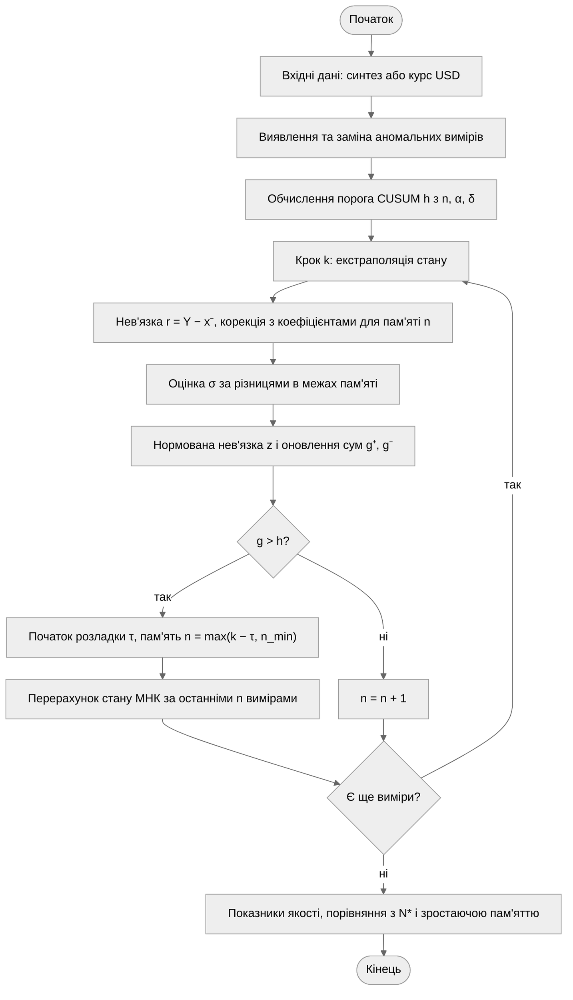
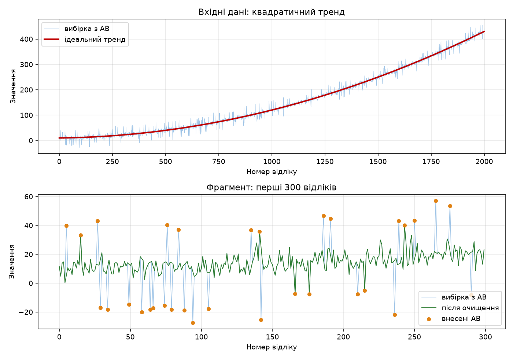
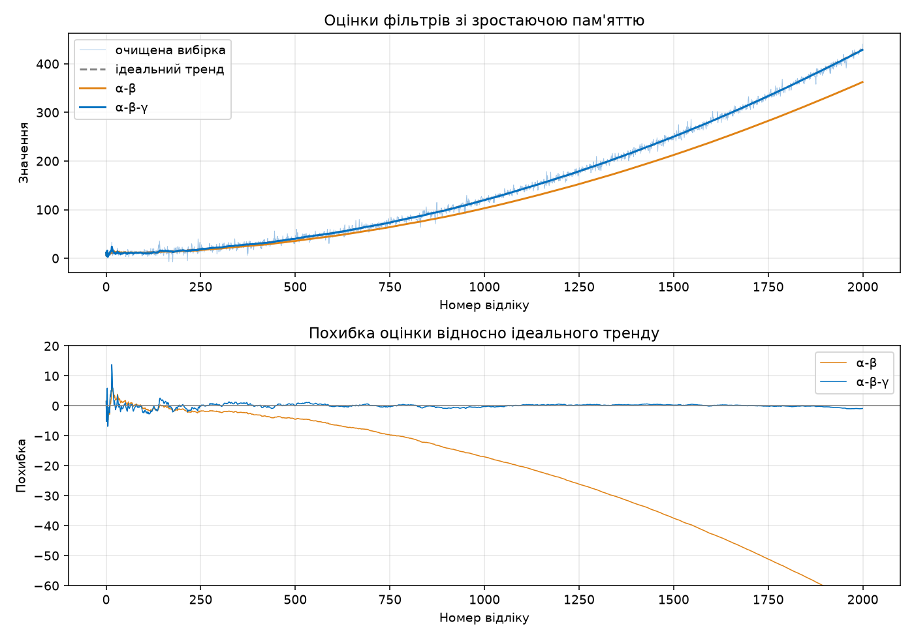
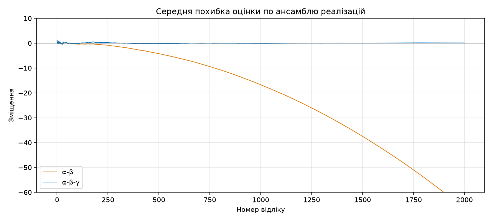
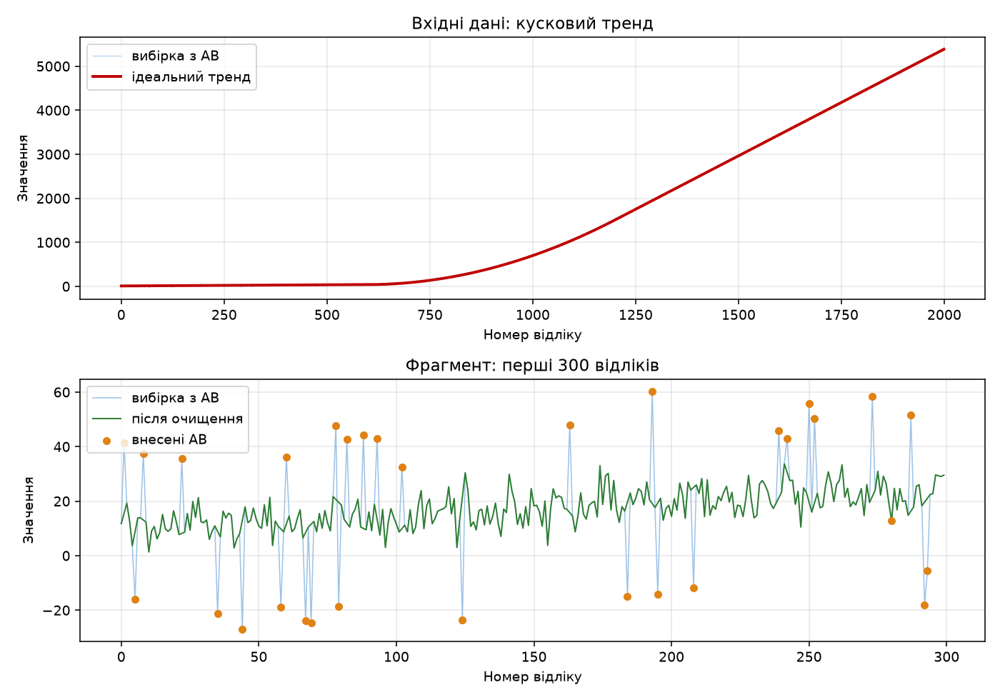
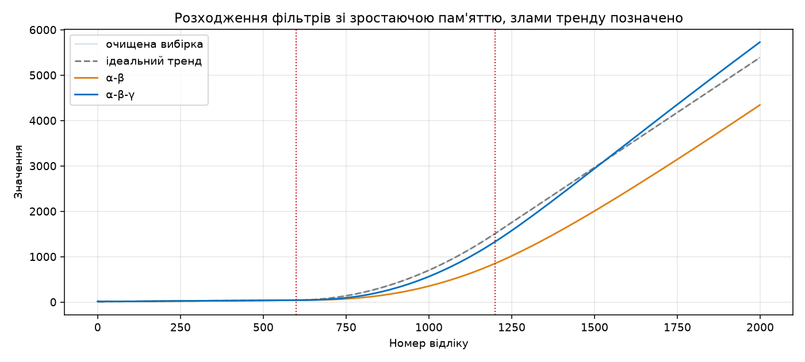
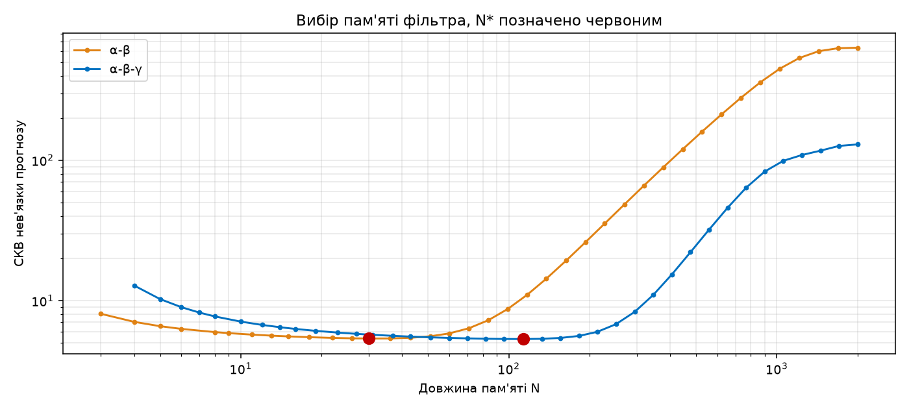
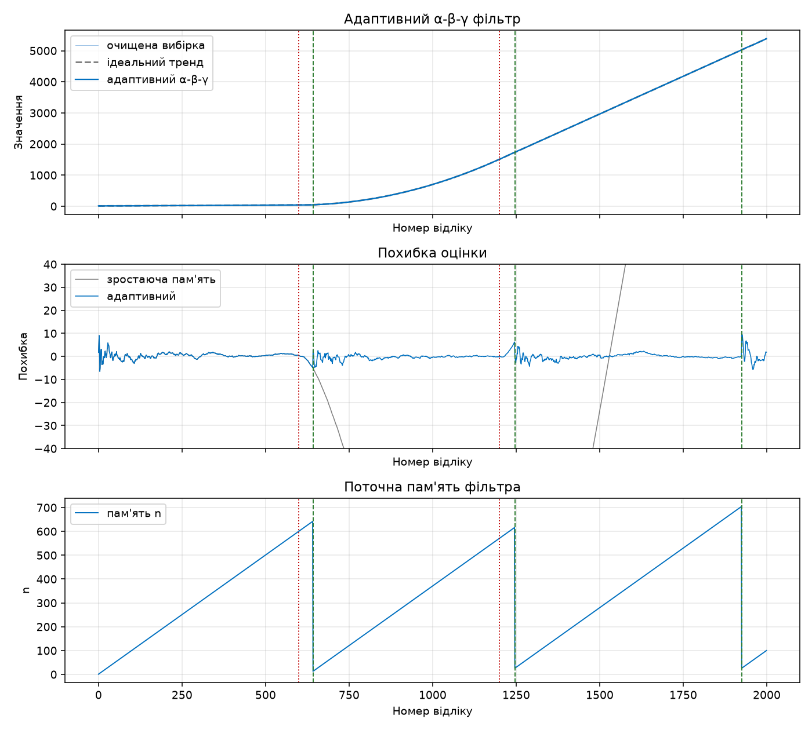
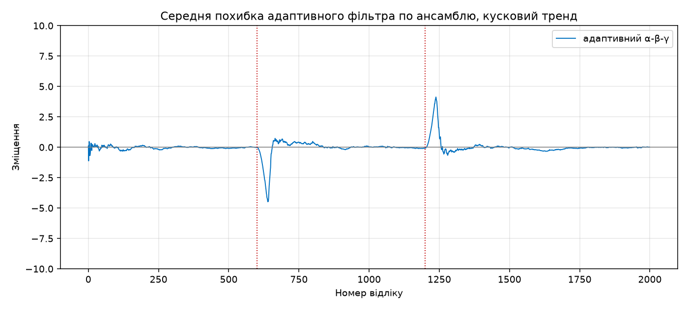
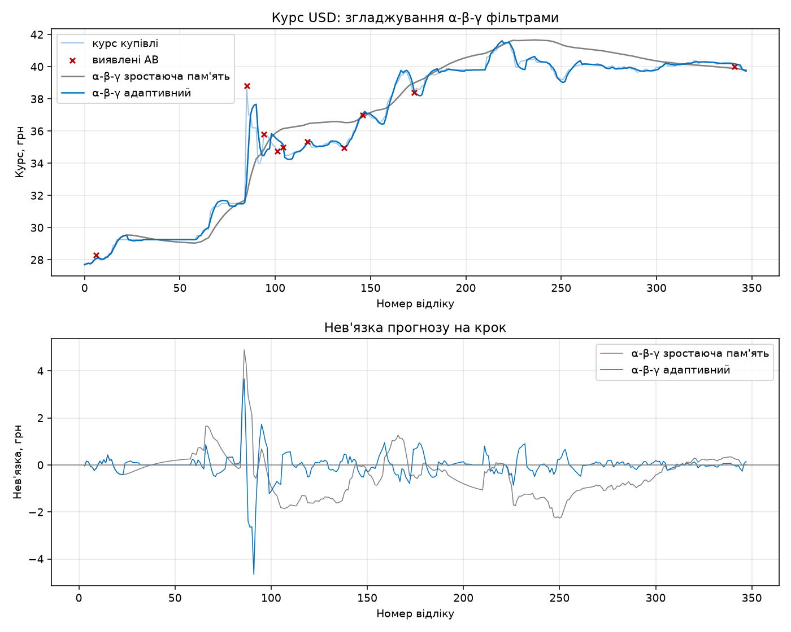

# І. Мета

Виявити, дослідити та узагальнити особливості реалізації процесів статистичного навчання
на вибірці Time Series, об'єм якої зростає, з використанням можливостей мови
програмування Python.

# ІІ. Завдання

Розробити програмний скрипт мовою Python, що реалізує рекурентне згладжування динамічного
процесу для універсальної платформи обробки статистичних даних.

Група вимог 1:

1. Отримання вхідних даних із властивостями, заданими в ЛР 1: реальних та синтетичних.
2. Дослідження вхідних даних і компенсація аномальних вимірів.
3. Рекурентне згладжування з використанням алгоритмів фільтрації Калмана: α-β та
   α-β-γ фільтрів.
4. Фільтр має давати незміщену оцінку.
5. Обґрунтування вибору фільтра.

Група вимог 2:

1. Модифікація скалярного фільтра для усунення ефекту розходження в одному з напрямів:
   адаптація параметрів (пам'яті) фільтра; підвищення ступеня фільтра; розробка алгоритму
   адаптивної модифікації рекурентного фільтра. Рішення, засноване на емпірично підібраних
   константах для конкретних вхідних даних, ефективним не вважається.

Обраний рівень складності – ІІ: реалізовано обидві групи вимог, у групі 2 опрацьовано
всі три напрями.

Умови варіанта 8 успадковані з ЛР 1: похибка за нормальним законом, тренд квадратичний
і лінійний, реальні дані – курс USD за даними Ощадбанку.

# ІІІ. Результати виконання лабораторної роботи

## 3.1. Синтезована математична модель

### 3.1.1. Модель вхідних даних

Вхідні дані – адитивна суміш тренду та похибки вимірювання:

$$Y(t) = S(t) + \varepsilon(t), \quad \varepsilon(t) \sim N(0, \sigma^2), \quad \sigma = 5, \quad t = 0, 1, \ldots, n-1$$

Перша модель тренду – квадратична, як у ЛР 2:

$$S_1(t) = a t^2 + b t + c, \quad a = 10^{-4},\ b = 10^{-2},\ c = 10$$

Друга модель поєднує обидва тренди варіанта: лінійна ділянка переходить у квадратичний
розгін, а після нього знову в лінійну, з неперервною похідною в точках зламу
$t_1 = 0{,}3n$ і $t_2 = 0{,}6n$:

$$S_2(t) = \begin{cases} c + k t, & t < t_1 \\ c + k t + a_2 (t - t_1)^2, & t_1 \le t < t_2 \\ c + k t + a_2 (t_2 - t_1)^2 + 2 a_2 (t_2 - t_1)(t - t_2), & t \ge t_2 \end{cases}$$

де $k = 0{,}05$, $a_2 = 4 \cdot 10^{-3}$. Ця модель імітує зміну режиму процесу і потрібна
для дослідження розходження: на одному поліномі фільтр належного порядку не розходиться.

Обсяг кожної вибірки $n = 2000$. Аномальні виміри вносяться так само, як у ЛР 2:

$$Y_{AV}(t_j) = Y(t_j) + s_j (q + |\xi_j|) \sigma, \quad s_j \in \{-1, +1\},\ \xi_j \sim N(0, 1),\ q = 5$$

у 10 % відліків з рівномірно розподіленими номерами.

Реальні дані – курс купівлі USD за даними Ощадбанку, 348 відліків з лютого 2022 до
лютого 2023 року.

### 3.1.2. Компенсація аномальних вимірів

Використано адаптивний детектор із ЛР 2: залишок після ковзної медіани ширини $w$,
підібраної за мінімумом автокореляції залишку, порівнюється з порогом
$k(n) = \Phi^{-1}(1 - \alpha / 2n)$ у одиницях $\hat\sigma_{MAD}$. Виявлені відліки
замінюються лінійною інтерполяцією сусідів.

До детектора внесено дві зміни. Перша – виправлення ітеративного уточнення: у ЛР 2
залишок на кожній ітерації рахувався для вже очищених даних, тому знайдений на попередній
ітерації викид, замінений інтерполяцією, виглядав нормальним і знімався з маски. Тепер
медіана береться з очищених даних, а залишок – з вихідних:

$$r(t) = Y(t) - \operatorname{med}_w \tilde Y(t)$$

де $\tilde Y$ – дані з інтерпольованими виявленими відліками.

Друга зміна стосується квантованих рядів. Курс валют змінюється кроками по 0,05 грн
і тижнями стоїть на місці, тому понад половина залишків дорівнює нулю, і $MAD = 0$.
У цьому випадку розсіювання оцінюється через середнє абсолютне відхилення:

$$\hat\sigma = \sqrt{\pi / 2} \cdot \overline{|r - \operatorname{med} r|}$$

### 3.1.3. α-β та α-β-γ фільтри

Стан процесу описується рівнем $x$, швидкістю $v$ і прискоренням $a$ (для α-β фільтра
$a \equiv 0$). Крок дискретизації $T = 1$. На кожному кроці стан екстраполюється:

$$x_k^- = x_{k-1} + v_{k-1} + \frac{a_{k-1}}{2}, \qquad v_k^- = v_{k-1} + a_{k-1}$$

і коригується за нев'язкою $r_k = Y_k - x_k^-$:

$$x_k = x_k^- + \alpha_n r_k, \qquad v_k = v_k^- + \beta_n r_k, \qquad a_k = a_{k-1} + \gamma_n r_k$$

Коефіцієнти залежать від пам'яті фільтра $n$ – кількості вимірів, за якими побудовано
оцінку. Для α-β фільтра:

$$\alpha_n = \frac{2(2n - 1)}{n(n + 1)}, \qquad \beta_n = \frac{6}{n(n + 1)}$$

для α-β-γ фільтра:

$$\alpha_n = \frac{3(3n^2 - 3n + 2)}{n(n + 1)(n + 2)}, \qquad \beta_n = \frac{18(2n - 1)}{n(n + 1)(n + 2)}, \qquad \gamma_n = \frac{60}{n(n + 1)(n + 2)}$$

За зростаючої пам'яті $n = k$ такий фільтр є рекурентною формою методу найменших квадратів:
оцінка $x_k$ точно дорівнює значенню в точці $k$ полінома степеня 1 (α-β) або 2 (α-β-γ),
навченого за МНК на всіх вимірах $Y_1, \ldots, Y_k$. Це перевіряється чисельно в п. 3.6.

### 3.1.4. Незміщеність оцінки та вибір фільтра

МНК-оцінка незміщена, якщо модель фільтра містить справжній тренд. Нехай
$E[Y] = F c$, де $F$ – матриця плану полінома степеня $m$. Тоді

$$E[\hat c] = (F^T F)^{-1} F^T E[Y] = (F^T F)^{-1} F^T F c = c$$

Для квадратичного тренду ця умова виконується лише для α-β-γ фільтра ($m = 2$).
α-β фільтр наближає параболу прямою, і його зміщення зростає з пам'яттю. Пряма МНК
для $a t^2$ на відрізку $[0, n]$ відхиляється від параболи в кінцевій точці на
$a n^2 / 6$, тому

$$\Delta_{\alpha\beta}(n) \approx -\frac{a n^2}{6}$$

При $a = 10^{-4}$ і $n = 2000$ це $-66{,}7$, тобто понад $13\sigma$.

Отже, для даних варіанта 8 обрано α-β-γ фільтр: квадратичний тренд вимагає моделі
другого порядку. α-β фільтр незміщений лише на лінійних ділянках.

### 3.1.5. Ефект розходження

Коефіцієнти $\alpha_n, \beta_n, \gamma_n$ спадають як $1/n$, $1/n^2$, $1/n^3$. Зі
зростанням пам'яті фільтр дедалі менше реагує на нові виміри. Поки модель процесу
незмінна, це корисно: дисперсія оцінки спадає. Коли процес змінює режим, фільтр
продовжує вважати правильними оцінки, усереднені по старих даних, і похибка необмежено
зростає. Це і є розходження фільтра.

Індикатором розходження є нев'язка прогнозу $r_k$: у справному фільтрі вона має нульове
середнє, а дисперсія дорівнює

$$D[r_k] = \sigma^2 (1 + \rho(n)), \qquad \rho(n) = h^T (F^T F)^{-1} h$$

де $\rho(n)$ – дисперсія прогнозу МНК на крок уперед у частках $\sigma^2$, $h$ – вектор
полінома в точці прогнозу.

### 3.1.6. Модифікація 1: навчена обмежена пам'ять

Пам'ять фільтра обмежується числом $N$: $n = \min(k, N)$. Після $k = N$ коефіцієнти
перестають спадати, і фільтр зберігає здатність відстежувати зміни.

Щоб $N$ не був підібраною вручну константою, його навчено за даними. Критерій –
СКВ нев'язки прогнозу на крок:

$$N^* = \arg\min_N \sqrt{\frac{1}{n} \sum_k r_k^2(N)}$$

Нев'язка $r_k$ обчислюється до того, як фільтр отримав $Y_k$, тому це позавибіркова оцінка
якості прогнозу, яка не заохочує підгонку під шум. Кандидати – 40 значень на
геометричній сітці від $m + 2$ до $n$.

### 3.1.7. Модифікація 2: підвищення ступеня фільтра

Перехід від α-β до α-β-γ фільтра додає до стану прискорення. Це усуває розходження,
спричинене тим, що порядок моделі нижчий за порядок тренду (п. 3.1.4), але не усуває
розходження від зміни режиму процесу. Тому в роботі ця модифікація поєднується з двома
іншими, а не застосовується окремо.

### 3.1.8. Модифікація 3: власний адаптивний алгоритм

Обмежена пам'ять $N^*$ має два недоліки. Вона вибирається за всією вибіркою, тобто
непридатна для роботи в реальному часі. Крім того, вона однакова для всього ряду: на
довгій стабільній ділянці фільтр марно відкидає корисні старі виміри, а одразу після
зміни режиму $N^*$ може бути завеликою.

Запропонований алгоритм тримає зростаючу пам'ять, доки нев'язки узгоджуються з моделлю,
і скорочує її, щойно статистичний тест фіксує розладку. Усі параметри виводяться
з теорії або з властивостей даних.

1. Нормована нев'язка. За формулою п. 3.1.5:

$$t_k = \frac{r_k}{\hat\sigma \sqrt{1 + \rho(n - 1)}}$$

2. Оцінка шуму. Різниці порядку $m + 1$ знищують поліном степеня $m$, тому
$\Delta^{m+1} Y = \Delta^{m+1} \varepsilon$ і $D[\Delta^{p} \varepsilon] = C_{2p}^{p} \sigma^2$:

$$\hat\sigma = \frac{\hat\sigma_{MAD}(\Delta^{p} Y)}{\sqrt{C_{2p}^{p}}}, \quad p = m + 1$$

Оцінка будується лише з уже отриманих вимірів у межах поточної пам'яті, тож після
перезапуску вона перенавчається на новому режимі. Знизу $\hat\sigma$ обмежена шумом
квантування $q / \sqrt{12}$, де $q$ – найменший ненульовий крок ряду.

3. Поправка на оцінену дисперсію. Оскільки $\sigma$ невідома, $t_k$ має розподіл
Стьюдента, а не нормальний. Особливо це важливо на початку ряду, де $\hat\sigma$ побудовано
за кількома відліками. Статистика переводиться в стандартну нормальну за рівністю
ймовірностей:

$$z_k = \operatorname{sign}(t_k) \cdot \Phi^{-1}\!\left(1 - S_t(|t_k|;\ \nu)\right)$$

Кількість ступенів свободи $\nu$ враховує, що сусідні різниці корельовані
($\rho_j = (-1)^j C_{2p}^{p-j} / C_{2p}^{p}$) і що MAD має асимптотичну ефективність
0,3675:

$$\nu = L \cdot \frac{0{,}3675}{1 + 2 \sum_{j=1}^{p} \rho_j^2}$$

де $L$ – кількість використаних різниць. Для α-β-γ фільтра $\nu \approx 0{,}16 L$.

4. Двобічний CUSUM-тест Пейджа:

$$g_k^+ = \max(0,\ g_{k-1}^+ + z_k - \delta), \qquad g_k^- = \max(0,\ g_{k-1}^- - z_k - \delta)$$

Дрейф $\delta = 0{,}5$ – стандартне налаштування на зсув середнього на $1\sigma$. Поріг
$h$ виводиться з вимоги до хибних тривог: на вибірці обсягу $n$ очікується не більше
$\alpha = 0{,}05$ хибних тривог. Для середньої довжини серії без тривоги використано
наближення Зігмунда:

$$ARL_0(h) = \frac{e^{2\delta b} - 2\delta b - 1}{2\delta^2}, \quad b = h + 1{,}166, \qquad ARL_0(h) = \frac{2n}{\alpha}$$

Для $n = 2000$ це дає $h = 9{,}43$, для $n = 348$ – $h = 7{,}68$.

5. Перезапуск пам'яті. Коли $g_k > h$, момент початку розладки оцінюється як останній
крок $\tau$, на якому відповідна сума $g$ дорівнювала нулю. Пам'ять скорочується до
$n = k - \tau$, а стан $(x, v, a)$ перераховується МНК саме за цими вимірами. Далі
пам'ять знову зростає.

6. Мінімальна пам'ять. Перерахунок стану за двома-трьома точками дав би прогноз,
шумніший за сам вимір. Тому $n$ не опускається нижче $n_{min}$, найменшої пам'яті, за якої
дисперсія прогнозу не перевищує дисперсію виміру:

$$n_{min} = \min \{ n : \rho(n) \le 1 \}$$

Для α-β фільтра $n_{min} = 6$, для α-β-γ – $n_{min} = 13$.

## 3.2. Блок-схема алгоритму та її опис



Рисунок 1 – Блок-схема адаптивного алгоритму фільтрації

Алгоритм складається з підготовчої частини і рекурентного циклу. У підготовчій частині
дані очищуються від аномальних вимірів, а з обсягу вибірки, допустимої частки хибних
тривог і дрейфу обчислюється поріг CUSUM-тесту.

Рекурентний цикл обробляє виміри по одному. Кожен крок починається як у звичайному
α-β-γ фільтрі: екстраполяція стану, нев'язка, корекція. Далі нев'язка нормується на
очікуване для поточної пам'яті розсіювання і подається у дві кумулятивні суми, що
накопичують систематичне відхилення вгору та вниз. Поки суми нижче порога, пам'ять
зростає, і фільтр поводиться як рекурентний МНК. Перевищення порога означає зміну
режиму процесу: пам'ять скорочується до вимірів після оціненого моменту розладки, стан
перераховується за ними, і цикл продовжується.

Фільтри з обмеженою пам'яттю $N^*$ і зростаючою пам'яттю реалізовані тим самим циклом
без тесту й без перезапусків. Вони використовуються для порівняння.

## 3.3. Опис структури проекту програми

```
project/
├── justfile            рецепти запуску та збірки звіту
├── pyproject.toml      залежності лабораторної роботи
├── out/                графіки, які генерує програма
└── src/
    ├── main.py         точка входу: етапи роботи, Монте-Карло, графіки
    ├── series.py       вхідні дані: тренди, похибка, аномальні виміри, реальні дані
    ├── detect.py       виявлення та компенсація аномальних вимірів
    ├── filters.py      α-β та α-β-γ фільтри, дисперсія прогнозу, МНК-стан
    └── adaptive.py     навчання пам'яті N* і власний адаптивний алгоритм
```

Рисунок 2 – Структура проекту

Використані бібліотеки: `numpy` – обчислення фільтрів і МНК, обробка ансамблю реалізацій
одним масивом; `scipy` – квантилі нормального розподілу й розподілу Стьюдента,
розв'язання рівняння для порога CUSUM; `pandas` разом з `xlrd` – читання реальних даних;
`matplotlib` – візуалізація.

## 3.4. Результати роботи програми

Усі результати отримано за `seed = 42` і відтворюються при повторному запуску.

### Етап 1. Квадратичний тренд: вхідні дані

Таблиця 1 – Параметри синтезованих вибірок

| Параметр | Квадратичний тренд | Кусковий тренд |
| --- | --- | --- |
| Обсяг вибірки $n$ | 2000 | 2000 |
| Тренд | $10^{-4} t^2 + 10^{-2} t + 10$ | $S_2(t)$, злами в 600 і 1200 |
| Похибка | $N(0;\ 5^2)$ | $N(0;\ 5^2)$ |
| Внесено аномальних вимірів | 200 | 200 |
| Виявлено | 168 | 183 |
| Хибних спрацювань | 0 | 5 |
| Пропущено | 32 | 17 |



Рисунок 3 – Синтезована вибірка з квадратичним трендом і фрагмент після очищення

Детектор підібрав вікно $w = 41$ і поріг $4{,}21\sigma$. Пропущені аномалії – це викиди,
зсув яких частково компенсований власною похибкою відліку протилежного знаку.

### Етап 2. Фільтри зі зростаючою пам'яттю

Таблиця 2 – Похибка оцінки відносно ідеального тренду, квадратичний тренд

| Фільтр | Зміщення | СКВ | max $\lvert e \rvert$ |
| --- | --- | --- | --- |
| α-β | –22,386 | 29,921 | 67,090 |
| α-β-γ | 0,025 | 0,805 | 13,799 |



Рисунок 4 – Оцінки α-β і α-β-γ фільтрів та їхні похибки на квадратичному тренді

Похибка α-β фільтра наприкінці вибірки становить –67,09, що збігається з теоретичною
оцінкою $-a n^2 / 6 = -66{,}7$ з п. 3.1.4. Похибка α-β-γ фільтра після короткого розгону
лишається біля нуля, а її СКВ 0,805 у 6 разів менше за СКВ шуму. Максимум 13,8 припадає
на перші відліки, коли пам'ять ще мала.

### Етап 3. Перевірка незміщеності

Одна реалізація не доводить незміщеності: середнє похибки по часу змішує зміщення і шум.
Тому фільтри прогнано на 100 незалежних реалізаціях шуму з тим самим трендом, і для
кожного моменту часу усереднено похибку по ансамблю. Для незміщеного фільтра це середнє
має бути близьким до нуля в кожній точці.

Таблиця 3 – Середня по ансамблю похибка на другій половині вибірки, 100 реалізацій

| Фільтр | Середня похибка |
| --- | --- |
| α-β | –38,868 |
| α-β-γ | 0,033 |



Рисунок 5 – Середня по ансамблю похибка оцінки

Крива α-β-γ фільтра лежить на нулі по всій довжині вибірки, крива α-β фільтра –
парабола $-a k^2 / 6$. Вимога незміщеності виконується для α-β-γ фільтра, що
й обґрунтовує його вибір для даних варіанта.

### Етап 4. Кусковий тренд: розходження



Рисунок 6 – Синтезована вибірка з кусковим трендом

Таблиця 4 – Похибка фільтрів зі зростаючою пам'яттю, кусковий тренд

| Фільтр | Зміщення | СКВ | max $\lvert e \rvert$ |
| --- | --- | --- | --- |
| α-β | –458,193 | 632,637 | 1045,019 |
| α-β-γ | –5,590 | 129,012 | 340,231 |



Рисунок 7 – Розходження фільтрів зі зростаючою пам'яттю після зміни режиму

Обидва фільтри розходяться. До першого зламу тренд лінійний і оцінки правильні; після
нього фільтри тримаються за параметри, усереднені по сотнях відліків старого режиму.
α-β-γ фільтр після другого зламу проскакує справжній тренд і наприкінці вибірки
помиляється на 340 одиниць, тобто на $68\sigma$. Підвищення ступеня фільтра тут не
допомагає: кусковий тренд не описується жодним поліномом.

### Етап 5. Модифікація 1: навчена пам'ять



Рисунок 8 – СКВ нев'язки прогнозу залежно від довжини пам'яті

Навчені значення: $N^* = 30$ для α-β фільтра і $N^* = 113$ для α-β-γ. Крива має чіткий
мінімум. Ліворуч від нього оцінка зашумлена через малу кількість вимірів, праворуч
фільтр не встигає за змінами тренду. Мінімум α-β-γ фільтра лежить правіше: модель другого
порядку правильно описує ділянку розгону і може довше накопичувати виміри.

### Етап 6. Модифікація 3: адаптивний алгоритм

Таблиця 5 – Тривоги адаптивного алгоритму, справжні злами в точках 600 і 1200

| Фільтр | Тривог | Перші тривоги (момент / оцінений початок) |
| --- | --- | --- |
| α-β | 15 | 313 / 295, 641 / 607, 683 / 652, 737 / 730, … |
| α-β-γ | 3 | 642 / 629, 1246 / 1220, 1925 / 1899 |



Рисунок 9 – Адаптивний α-β-γ фільтр: оцінка, похибка і поточна пам'ять

На рисунку 9 червоні пунктирні лінії позначають справжні злами, зелені – тривоги.
α-β-γ фільтр виявив обидва злами з затримкою 42 і 46 відліків. Остання тривога в точці
1925 хибна: її спричинила аномалія у відліку 1924 зі зсувом $4{,}3\sigma$, яку детектор
пропустив, у поєднанні з випадковим відхиленням сусідніх відліків. Пам'ять на нижньому
графіку зростає лінійно, падає при кожній тривозі й знову зростає.

α-β фільтр подає 15 тривог: на всій квадратичній ділянці його модель неадекватна, і
алгоритм раз у раз скорочує пам'ять, щоб утримати похибку. Перша тривога в точці 313
хибна: вона виникла на лінійній ділянці, де модель α-β фільтра адекватна. Різниця між 15 і 3 тривогами показує ефект модифікації 2:
підвищення ступеня прибирає перезапуски, зумовлені невідповідністю моделі.

### Етап 7. Порівняння модифікацій

Таблиця 6 – Похибка оцінки на кусковому тренді

| Фільтр | Пам'ять | Зміщення | СКВ | max $\lvert e \rvert$ |
| --- | --- | --- | --- | --- |
| α-β | зростаюча | –458,193 | 632,637 | 1045,019 |
| α-β | $N^* = 30$ | –0,452 | 1,818 | 9,112 |
| α-β | адаптивна | –1,068 | 2,140 | 9,112 |
| α-β-γ | зростаюча | –5,590 | 129,012 | 340,231 |
| α-β-γ | $N^* = 113$ | –0,090 | 1,488 | 6,525 |
| α-β-γ | адаптивна | 0,029 | 1,335 | 9,610 |

Обидві модифікації пам'яті зменшують СКВ на два порядки. Найменші СКВ і зміщення дає
адаптивний α-β-γ фільтр, причому без перегляду всієї вибірки наперед. Найбільша похибка
у нього вища, ніж у фільтра з $N^*$: вона припадає на інтервал між зламом і тривогою, коли
фільтр ще працює з довгою пам'яттю старого режиму.

### Етап 8. Монте-Карло для адаптивного алгоритму

Адаптивний α-β-γ фільтр прогнано на 100 реалізаціях кожного тренду без аномальних вимірів.

Таблиця 7 – Статистичні характеристики адаптивного алгоритму, 100 реалізацій

| Показник | Значення |
| --- | --- |
| Реалізацій з хибною тривогою, квадратичний тренд | 2 зі 100 |
| Розрахункова частка хибних тривог $\alpha$ | 5 % |
| Виявлено злам у точці 600 | 100 зі 100 |
| Виявлено злам у точці 1200 | 100 зі 100 |
| Медіана затримки виявлення | 46 відліків |
| Середня по ансамблю похибка, кусковий тренд | –0,018 |



Рисунок 10 – Середня по ансамблю похибка адаптивного α-β-γ фільтра на кусковому тренді

Поза короткими інтервалами після зламів зміщення адаптивного фільтра дорівнює нулю.
Після кожного зламу виникає імпульс зміщення амплітудою близько $\sigma$ – це плата
за затримку виявлення. Після перезапуску він згасає за кілька десятків відліків.

### Етап 9. Реальні дані

Детектор вивів вікно $w = 3$ і поріг $3{,}80\sigma$ і виявив 10 аномальних вимірів.
Найбільший із них – стрибок до 38,80 грн у відліку 85, після якого курс встановився
біля 36,5 грн.

Таблиця 8 – Нев'язка прогнозу на крок, курс USD

| Фільтр | Пам'ять | Середнє, грн | СКВ, грн |
| --- | --- | --- | --- |
| α-β | зростаюча | –0,950 | 1,873 |
| α-β | $N^* = 3$ | 0,000 | 0,324 |
| α-β | адаптивна, 30 тривог | –0,005 | 0,479 |
| α-β-γ | зростаюча | –0,378 | 0,986 |
| α-β-γ | $N^* = 5$ | 0,001 | 0,388 |
| α-β-γ | адаптивна, 35 тривог | –0,012 | 0,556 |



Рисунок 11 – Курс USD: оцінки α-β-γ фільтрів і нев'язки прогнозу

Фільтри зі зростаючою пам'яттю на реальних даних розходяться: середня нев'язка –0,95 і
–0,38 грн означає систематичне запізнення, на рисунку 11 воно видно як тривалий від'ємний
зсув нев'язки після девальвації. Обидві модифікації прибирають зміщення: середня нев'язка
падає до тисячних гривні. Середня пам'ять адаптивного α-β-γ фільтра склала 20 відліків.

## 3.5. Програмний код

Нижче наведено фрагменти, що безпосередньо реалізують моделі розділу 3.1. Повний код
проекту додається до звіту окремим архівом.

Коефіцієнти, екстраполяція і корекція α-β та α-β-γ фільтрів:

```python
def gains(n, order):
    if order == 2:
        d = n * (n + 1)
        return 2 * (2 * n - 1) / d, 6 / d, 0.0
    d = n * (n + 1) * (n + 2)
    return 3 * (3 * n * n - 3 * n + 2) / d, 18 * (2 * n - 1) / d, 60 / d


def predict(x, v, a):
    return x + v + a / 2, v + a


def correct(x_pred, v_pred, a, residual, g):
    alpha, beta, gamma = g
    return x_pred + alpha * residual, v_pred + beta * residual, a + gamma * residual
```

Фільтр із зростаючою або обмеженою пам'яттю, що обробляє одразу ансамбль реалізацій:

```python
def run(data, order, memory=None):
    x = np.zeros(data.shape[1:])
    v = np.zeros_like(x)
    a = np.zeros_like(x)
    estimate = np.empty_like(data, dtype=float)
    innovation = np.empty_like(estimate)
    for k in range(len(data)):
        n = k + 1 if memory is None else min(k + 1, memory)
        x_pred, v_pred = predict(x, v, a)
        innovation[k] = data[k] - x_pred
        x, v, a = correct(x_pred, v_pred, a, innovation[k], gains(n, order))
        estimate[k] = x
    innovation[:order] = np.nan
    return estimate, innovation
```

Дисперсія прогнозу на крок і навчання пам'яті $N^*$:

```python
@cache
def prediction_factor(n, order):
    if n < order:
        return np.inf
    tau = (np.arange(n, dtype=float) - n) / n
    f = np.vander(tau, order, increasing=True)
    return float(np.linalg.inv(f.T @ f)[0, 0])


def learn_memory(data, order, grid=None):
    grid = memory_grid(len(data), order) if grid is None else grid
    rmse = np.array([np.sqrt(np.nanmean(filters.run(data, order, m)[1] ** 2)) for m in grid])
    return int(grid[np.argmin(rmse)]), grid, rmse
```

Поріг CUSUM за наближенням Зігмунда і перехід від статистики Стьюдента до нормальної:

```python
def siegmund_arl(h, drift=DRIFT):
    b = h + 1.166
    return (np.exp(2 * drift * b) - 2 * drift * b - 1) / (2 * drift**2)


def cusum_threshold(n, alpha=ALPHA, drift=DRIFT):
    target = 2 * n / alpha
    return float(optimize.brentq(lambda h: siegmund_arl(h, drift) - target, 0.0, 100.0))


def to_normal(t, df):
    return float(np.sign(t) * stats.norm.isf(stats.t.sf(abs(t), df)))
```

Основний цикл адаптивного алгоритму:

```python
for k in range(n_total):
    n += 1
    x_pred, v_pred = filters.predict(x, v, a)
    r = data[k] - x_pred
    x, v, a = filters.correct(x_pred, v_pred, a, r, filters.gains(n, order))

    seen = k + 1 - order
    if k >= order:
        innovation[k] = r
    if n > order and seen > 2 * order:
        window = diffs[max(0, k - n - order) : seen]
        t = r / (
            noise_sigma(window, order, step)
            * np.sqrt(1 + filters.prediction_factor(n - 1, order))
        )
        z = to_normal(t, max(len(window) * dof, 1.0))
        up, down = max(0.0, up + z - drift), max(0.0, down - z - drift)
        up_start = k if up == 0.0 else up_start
        down_start = k if down == 0.0 else down_start
        if max(up, down) > h:
            start = up_start if up > h else down_start
            n = min(max(k - start, floor), k + 1)
            x, v, a = filters.fit_state(data[k - n + 1 : k + 1], order)
            alarms.append((k, start))
            up = down = 0.0
            up_start = down_start = k
    estimate[k] = x
    memory[k] = n
```

## 3.6. Аналіз результатів та верифікація

Верифікація рекурентного фільтра проти пакетного МНК. На перших 200 відліках оцінку
фільтра зі зростаючою пам'яттю в кожній точці $k$ порівняно зі значенням полінома,
навченого `numpy.polyfit` на вимірах $Y_1, \ldots, Y_k$. Найбільша розбіжність
$2{,}0 \cdot 10^{-14}$ для α-β і $2{,}8 \cdot 10^{-14}$ для α-β-γ фільтра – це рівень
похибки округлення подвійної точності. Отже, формули коефіцієнтів і початкові умови
реалізовано правильно, і властивості МНК (зокрема незміщеність) переносяться на фільтр.

Верифікація за теоретичним зміщенням. Похибка α-β фільтра на квадратичному тренді
наприкінці вибірки –67,09 проти розрахункових –66,7 (п. 3.1.4). Залишкова різниця
пояснюється шумом і невиявленими аномаліями.

Верифікація незміщеності. Середня по 100 реалізаціях похибка α-β-γ фільтра на другій
половині вибірки становить 0,033 при СКВ шуму 5. Для α-β фільтра в тих самих умовах
вона дорівнює –38,9.

Верифікація порога CUSUM. Поріг розраховано на частку хибних тривог 5 % на вибірку.
Фактично на 100 реалізаціях квадратичного тренду, де зламу немає, тривога спрацювала
у двох. Під час налагодження без поправки на розподіл Стьюдента хибних тривог було
13,5 % (на 200 реалізаціях), і майже всі вони припадали на перші 40 відліків, де
$\hat\sigma$ побудовано за кількома різницями. Поправка з ефективною кількістю ступенів
свободи прибрала цей надлишок, не змінюючи $h$.

Верифікація оцінки моменту розладки. Оцінений початок розладки 629 і 1220 при справжніх
600 і 1200. CUSUM фіксує момент, коли зсув нев'язок став помітним, а не момент зміни
тренду. Після зламу в точці 600 прискорення з'являється плавно, і зміщення
$a_2 (t - t_1)^2$ набирає величину порядку $\sigma$ лише через $\sqrt{\sigma / a_2} \approx 35$
відліків, що узгоджується з оціненим початком і з медіанною затримкою 46.

Розходження на реальних даних. Курс валюти не є поліномом з білим шумом: це процес зі
стрибками і тривалими плато. Тому оптимальна пам'ять тут дуже коротка ($N^* = 3$ і 5),
а адаптивний алгоритм подає 30–35 тривог на 348 відліків. За СКВ нев'язки фільтр із
$N^*$ кращий за адаптивний (0,388 проти 0,556 грн для α-β-γ). Проте $N^*$ обрано за всім
рядом заднім числом, тобто в реальному часі таке значення недоступне. Адаптивний фільтр
отримує ту саму якість зміщення (–0,012 грн проти –0,378 у фільтра зі зростаючою
пам'яттю), обробляючи ряд в одному проході.

Обмеження. Адаптивний алгоритм реагує на будь-яку систематичну зміну нев'язок, зокрема
на кілька пропущених детектором аномалій поспіль. Хибна тривога в точці 1925 на
кусковому тренді – саме такий випадок. Наслідок обмежений: пам'ять скорочується до
$n \ge n_{min}$, і похибка після перезапуску не перевищує декількох $\sigma$.

# IV. Висновки

У роботі реалізовано рекурентне згладжування Time Series α-β та α-β-γ фільтрами
й досліджено ефект розходження на синтезованих даних з квадратичним і кусковим трендом
та на курсі USD. Виконано обидві групи вимог, у групі 2 – всі три напрями модифікації.

α-β і α-β-γ фільтри зі зростаючою пам'яттю є рекурентною формою МНК: їхні оцінки
збігаються з пакетним МНК з точністю до $10^{-14}$. З цього випливає умова незміщеності:
модель фільтра має містити справжній тренд. Для квадратичного тренду варіанта 8 обрано
α-β-γ фільтр, середня по ансамблю похибка якого становить 0,033 проти –38,9 у α-β
фільтра. Зміщення α-β фільтра відповідає теоретичному значенню $-a n^2 / 6$.

Розходження виникає, коли процес змінює режим, а коефіцієнти фільтра вже спали майже
до нуля. Підвищення ступеня фільтра усуває лише розходження від заниженого порядку
моделі. На кусковому тренді α-β-γ фільтр зі зростаючою пам'яттю помиляється на 340
одиниць ($68\sigma$).

Обмеження пам'яті числом $N^*$, навченим за СКВ нев'язки прогнозу, зменшує СКВ похибки
з 129 до 1,49. Цей спосіб не потребує ручного підбору констант, але вимагає всієї
вибірки наперед і дає одну пам'ять на весь ряд.

Розроблений адаптивний алгоритм поєднує зростаючу пам'ять з CUSUM-тестом нормованих
нев'язок і перезапуском пам'яті з оціненого моменту розладки. Усі його параметри
виведено з теорії: поріг – з допустимої частки хибних тривог за наближенням Зігмунда,
нормування – з дисперсії прогнозу МНК, мінімальна пам'ять – з умови $\rho(n) \le 1$,
поправка на оцінену $\sigma$ – з розподілу Стьюдента з ефективною кількістю ступенів
свободи. На кусковому тренді алгоритм дав найменшу СКВ похибки, 1,335, і виявив обидва
злами в усіх 100 реалізаціях з медіанною затримкою 46 відліків. Частка хибних тривог
склала 2 % при розрахункових 5 %.

На реальних даних обидві модифікації прибрали систематичне запізнення фільтра. Напрям
подальшої роботи – стійкіша до одиночних викидів статистика тесту, щоб пропущені
детектором аномалії не спричиняли перезапусків.
