# І. Мета

Виявити, дослідити та узагальнити особливості реалізації процесів пошуку закономірностей
в структурах Time Series з використанням можливостей мови програмування Python.

# ІІ. Завдання

Розробити програмний скрипт мовою Python, що розширює універсальну платформу обробки
Time Series функціоналом поглибленого аналізу властивостей.

Група вимог 1:

1. Для реальних даних, що оброблялись у ЛР 1–3, реалізувати поглиблений аналіз:
   декомпозицію, виявлення властивостей через обрані показники, візуалізацію,
   кластеризацію і кореляційний аналіз.
2. Виявлені закономірності і властивості описати та пояснити.
3. Реалізувати генерування синтетичних Time Series з виявленими закономірностями
   і довести адекватність моделей порівнянням їхніх показників з реальними даними.
4. Оформити блоки аналізу реальних даних та генерації і аналізу модельних окремими
   модулями.

Група вимог 2: реалізувати функціонал групи 1 на наданому або самостійно обраному
багатовимірному наборі даних.

Обраний рівень складності – ІІІ: група 1 виконана на курсі USD Ощадбанку, а її
ефективність підтверджена виконанням групи 2 на багатовимірних даних.

Набір даних варіанта 8 (`Data_Set_8.xlsx`) містить 15 замовлень інтернет-магазину за
один місяць і часового ряду не утворює: на ньому неможливі ні декомпозиція, ні
кластеризація, ні оцінка автокореляції. Тому для групи 2 використано дозволений
завданням варіант самостійно обраних багатовимірних даних – архів погодних
спостережень Open-Meteo [1] для 12 міст України.

Таблиця 1 – Вхідні дані

| Параметр | Група 1 | Група 2 |
| --- | --- | --- |
| Джерело | архів курсів Ощадбанку | архівний API Open-Meteo |
| Період | 08.02.2022 – 06.02.2023 | 01.01.2015 – 31.12.2024 |
| Обсяг | 348 записів | 12 міст × 3653 доби, 87 672 години |
| Показники | купівля, продаж, курс НБУ | температура, вологість, тиск, вітер, опади, сонячна радіація |
| Крок | нерегулярний (ряд подій) | доба; година для температури Києва |

Міста групи 2 обрано з різних кліматичних зон: Ужгород, Львів, Івано-Франківськ, Луцьк,
Вінниця, Київ, Чернігів, Полтава, Харків, Дніпро, Запоріжжя, Одеса.

# ІІІ. Результати виконання лабораторної роботи

## 3.1. Синтезована математична модель

### 3.1.1. Модель вхідних даних

Курс валют у файлі Ощадбанку – ряд подій: кожен запис фіксує зміну курсу, за один день
їх буває до шести. Тому аналіз ведеться за номером запису $t$, а не за календарним
часом. Пропуски (нулі у файлі) заповнюються лінійною інтерполяцією.

Добові погодні показники описуються адитивною моделлю з лінійним трендом, річною
сезонністю у вигляді $k$ гармонік і аномалією зі змінною за сезоном дисперсією:

$$Y(t) = a + b t + \sum_{j=1}^{k} \left( c_j \cos \frac{2\pi j t}{P} + d_j \sin \frac{2\pi j t}{P} \right) + \sigma(t)\, z(t), \quad P = 365{,}25$$

Коефіцієнти оцінюються МНК, $k = 3$. Амплітуда річного циклу $A = \sqrt{c_1^2 + d_1^2}$,
тренд за десятиліття – $3652{,}5\, b$. Різниця $r(t) = Y(t) - \hat Y(t)$ – аномалія,
з якою працюють кореляційний аналіз і модель синтезу.

### 3.1.2. Декомпозиція

STL-декомпозиція розкладає ряд на тренд, сезонну компоненту і залишок
$Y(t) = T(t) + S(t) + R(t)$, згладжуючи компоненти LOESS у двох вкладених циклах [2].
MSTL узагальнює її на кілька сезонностей: $Y(t) = T(t) + \sum_i S_i(t) + R(t)$. Для
погодинної температури задано добовий і річний періоди.

Внесок компонент оцінюється силою тренду і сезонності:

$$F_T = \max \left( 0,\ 1 - \frac{\operatorname{Var} R}{\operatorname{Var}(T + R)} \right), \quad F_S = \max \left( 0,\ 1 - \frac{\operatorname{Var} R}{\operatorname{Var}(S + R)} \right)$$

Значення, близьке до 1, означає, що компонента домінує над залишком. Для зведеної
таблиці за містами $S$ береться як сума гармонік з п. 3.1.1: на добових даних STL
вбирає в сезонну компоненту частину шуму, бо кожен день року за 10 років має лише
10 значень, і для шумних показників на кшталт опадів $F_S$ виходить завищеним.

### 3.1.3. Показники властивостей

Для кожного ряду обчислюються вибіркові середнє, медіана, СКВ, коефіцієнт варіації,
асиметрія та ексцес.

Стаціонарність перевіряється двома тестами з протилежними нульовими гіпотезами: ADF
(H0 – одиничний корінь) і KPSS (H0 – стаціонарність). Ряд вважається стаціонарним, якщо
ADF відкидає H0, а KPSS – ні, на рівні $\alpha = 0{,}05$.

Пам'ять процесу оцінюється показником Херста за R/S-аналізом. Ряд ділиться на
неперекривні вікна довжини $n$, у кожному обчислюється відношення розмаху кумулятивних
відхилень до СКВ, і $E[R/S](n) = c\, n^H$. $H \approx 0{,}5$ відповідає незалежним
приростам, $H > 0{,}5$ – персистентності.

На коротких вікнах класична оцінка завищена. Для незалежних нормальних відліків
очікуване R/S відоме (формула Аніса–Ллойда з поправкою Пітерса [3]):

$$E[R/S]_0(n) = \frac{n - \frac12}{n} \cdot \frac{\Gamma\left(\frac{n-1}{2}\right)}{\sqrt{\pi}\, \Gamma\left(\frac{n}{2}\right)} \sum_{i=1}^{n-1} \sqrt{\frac{n-i}{i}}$$

Тому в роботі використано скориговану оцінку – нахил відхилення від цього рівня:

$$H = 0{,}5 + \frac{d \ln \left( R/S(n) \,/\, E[R/S]_0(n) \right)}{d \ln n}$$

### 3.1.4. Кореляційний аналіз

Кореляція Пірсона обчислюється окремо для рівнів і для приростів (група 1) або аномалій
(група 2). Спільний тренд чи сезонність дають високу кореляцію рівнів навіть між
незалежними процесами, тому висновки робляться за приростами й аномаліями.

Крос-кореляція з лагом $\tau$:

$$r_{xy}(\tau) = \operatorname{corr}\left( x(t),\ y(t + \tau) \right)$$

Максимум при $\tau > 0$ означає, що $x$ випереджає $y$. Для пар міст перенесення
погоди оцінюється асиметрією $r(+1) - r(-1)$, де $x$ – західніше місто.

Спадання кореляції аномалій з відстанню $d$ між містами (по великому колу, формула
гаверсинусів) апроксимується експонентою $r(d) = e^{-d/L}$, де $L$ – радіус кореляції.

### 3.1.5. Кластеризація

Режими курсу валют виділяються K-means на стандартизованих ознаках кожного запису:
рівень курсу НБУ, премія ринку $p = buy - nbu$, спред $s = sell - buy$ і ковзна
середня $\lvert \Delta buy \rvert$ за 10 записів. Кількість кластерів $k \in [2, 6]$
обирається за максимумом коефіцієнта силуету.

Міста кластеризуються двома незалежними способами:

1. Метод Уорда за кліматичними ознаками: середня температура, річна амплітуда,
   вологість, річна сума опадів, вітер, радіація.
2. Метод середнього зв'язку за кореляційною відстанню між рядами аномалій температури
   $d_{ij} = \sqrt{2 (1 - r_{ij})}$.

Узгодженість розбиттів вимірюється скоригованим індексом Ренда (ARI): 1 – розбиття
збігаються, близько 0 – збіг випадковий.

### 3.1.6. Модель синтезу курсу валют

Курс моделюється кусково-стаціонарним процесом на режимах, знайдених кластеризацією.
На кожній ділянці премія і спред – процеси AR(1), що повертаються до свого середнього:

$$p(t) - \mu_p = \varphi_p \left( p(t-1) - \mu_p \right) + e_p(t), \qquad s(t) - \mu_s = \varphi_s \left( s(t-1) - \mu_s \right) + e_s(t)$$

$$buy(t) = nbu(t) + p(t), \qquad sell(t) = buy(t) + s(t)$$

Курс НБУ – зовнішній вхід: сталий у періоди фіксації або випадкове блукання там, де
він змінювався. Інновації $(e_p, e_s, \Delta nbu)$ не вважаються нормальними: їх беруть
бутстрепом із залишків тієї самої ділянки, причому всі три з одного запису. Так
зберігаються важкі хвости приростів і зв'язок між рядами. На межі режимів премія
стрибає до нового середнього $\mu_p$: зміна режиму і є стрибком ринку.

### 3.1.7. Модель синтезу погоди

Для кожного міста детермінована частина моделі п. 3.1.1 переноситься в синтез без
змін. Сезонна дисперсія оцінюється регресією квадратів аномалій на дві гармоніки,
що не залежить від форми розподілу:

$$\sigma^2(t) = g_0 + \sum_{j=1}^{2} \left( g_j \cos \frac{2\pi j t}{P} + h_j \sin \frac{2\pi j t}{P} \right), \qquad z(t) = \frac{r(t)}{\sigma(t)}$$

Стандартизовані аномалії всіх 12 міст описуються однією векторною авторегресією:

$$\mathbf{z}(t) = \sum_{i=1}^{p} \mathbf{A}_i\, \mathbf{z}(t-i) + \mathbf{u}(t)$$

Порядок $p$ обирається за BIC з $p \le 5$. Матриці $\mathbf{A}_i$ передають і пам'ять
кожного міста, і запізнену залежність між містами, тобто перенесення погоди.

Досліджено три способи генерування інновацій $\mathbf{u}(t)$:

1. Нормальні з коваріацією залишків $\mathbf{u} \sim N(0, \Sigma_u)$.
2. Сезонний бутстреп: вектор залишків береться цілком з того самого вікна
   $\pm 15$ діб навколо дня року. Зберігається просторова кореляція і різна взимку
   та влітку форма розподілу.
3. Копула: VAR будується на нормальних рангах аномалій, а згенеровані ранги
   переводяться назад у аномалії через емпіричний розподіл того самого сезону:

$$s(t) = \Phi^{-1}\left( \hat F_d(z(t)) \right), \qquad z^*(t) = \hat F_d^{-1}\left( \Phi(s^*(t)) \right)$$

де $\hat F_d$ – емпірична функція розподілу аномалій у вікні навколо дня року $d$.
Перетворення точно відтворює сезонний розподіл аномалій, зокрема асиметрію.

### 3.1.8. Перевірка адекватності

Модель генерує $N$ незалежних реалізацій того самого обсягу, що й реальні дані
($N = 200$ для курсу, $N = 100$ для погоди). На кожній обчислюється той самий набір
показників, що й на реальному ряді. Модель вважається адекватною за показником, якщо
реальне значення лежить у центральному 90 % інтервалі $[P_5, P_{95}]$ модельних значень.

## 3.2. Блок-схема алгоритму та її опис

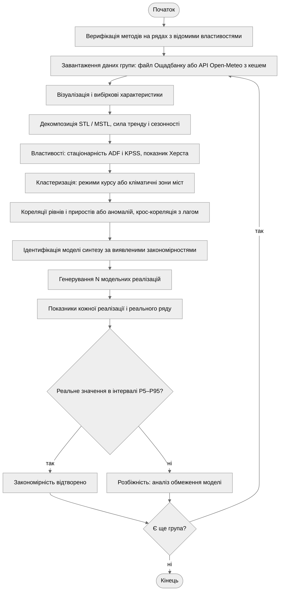

Рисунок 1 – Блок-схема алгоритму програми

Програма спершу перевіряє методи на рядах, властивості яких відомі заздалегідь. Далі
для кожної групи вимог виконується однаковий конвеєр. Аналітична частина (візуалізація,
декомпозиція, властивості, кластеризація, кореляції) виявляє закономірності, і на їх
основі ідентифікується модель синтезу. Генераційна частина отримує ансамбль модельних
реалізацій і порівнює кожен показник із реальним значенням. Показники, які модель не
відтворює, аналізуються окремо як обмеження моделі.

## 3.3. Опис структури проекту програми

```
project/
├── justfile           рецепти запуску та збірки звіту
├── pyproject.toml     залежності лабораторної роботи
├── data/              кеш погодних даних (CSV)
├── out/               графіки, які генерує програма
└── src/
    ├── main.py          точка входу
    ├── loaders.py       завантаження даних
    ├── analysis.py      властивості, декомпозиція
    ├── patterns.py      кореляції, кластеризація
    ├── synthesis.py     синтез, адекватність
    ├── plots.py         оформлення графіків
    ├── study_rates.py   етапи групи 1
    ├── study_weather.py етапи групи 2
    └── verify.py        верифікація методів
```

Рисунок 2 – Структура проекту

Аналіз реальних даних (`analysis.py`, `patterns.py`) і генерація та аналіз модельних
(`synthesis.py`) винесені в окремі модулі, що не залежать від конкретного набору даних.
Модулі `study_rates.py` і `study_weather.py` лише поєднують їх для своєї групи вимог.

Використані бібліотеки: `numpy` – обчислення; `pandas` – табличні дані й часові
індекси; `statsmodels` – STL, MSTL, тести ADF і KPSS, автокореляція, VAR; `scipy` –
статистики розподілів, ієрархічна кластеризація; `scikit-learn` – K-means, силует,
ARI; `requests` – запити до API; `matplotlib` – візуалізація.

## 3.4. Результати роботи програми

Усі результати отримано за `seed = 42` і відтворюються при повторному запуску.

### Етап 1. Група 1: вхідні дані

Таблиця 2 – Вибіркові характеристики курсу USD, грн

| Ряд | $m$ | Медіана | $\sigma$ | min | max | Асиметрія | Ексцес |
| ------------ | -------- | --------- | -------- | -------- | -------- | ------------ | ---------- |
| Купівля | 36,481 | 39,200 | 4,374 | 27,700 | 41,500 | –0,761 | –0,972 |
| Продаж | 37,385 | 39,900 | 4,030 | 28,100 | 41,990 | –0,758 | –0,845 |
| НБУ | 33,223 | 36,569 | 3,702 | 27,876 | 36,569 | –0,207 | –1,940 |
| Δ купівлі | 0,035 | 0,000 | 0,452 | –2,200 | 7,200 | 11,109 | 183,476 |
| Δ продажу | 0,036 | 0,000 | 0,472 | –2,500 | 7,820 | 12,666 | 214,731 |
| Δ НБУ | 0,025 | 0,000 | 0,395 | –0,293 | 7,314 | 18,161 | 332,249 |

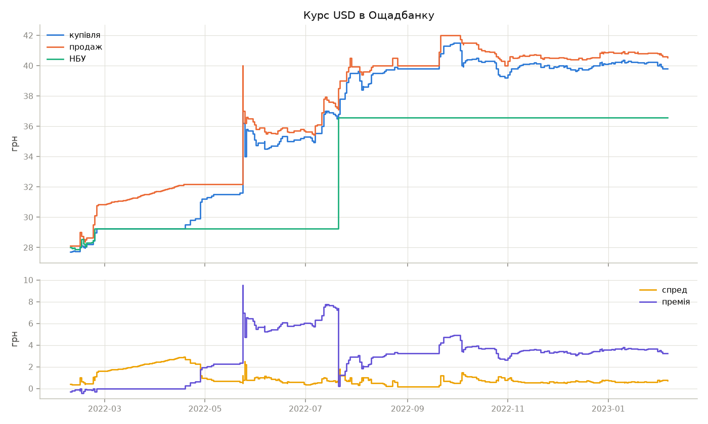

Рисунок 3 – Курси купівлі, продажу і НБУ, спред і премія ринку

348 записів припадають на 256 днів, у файлі заповнено 80 пропусків. Медіана приростів
усіх трьох рядів дорівнює нулю: курс більшість часу стоїть на місці й зрідка стрибає.
Звідси ексцес приростів 183–332, тобто розподіл, далекий від нормального.

### Етап 2. Група 1: декомпозиція

Таблиця 3 – Сила компонент STL-декомпозиції, період 5 записів

| Ряд | $F_T$ | $F_S$ | СКВ залишку, грн |
| --- | --- | --- | --- |
| Купівля | 0,981 | 0,000 | 0,604 |
| Продаж | 0,991 | 0,013 | 0,378 |
| НБУ | – | – | 0,000 |

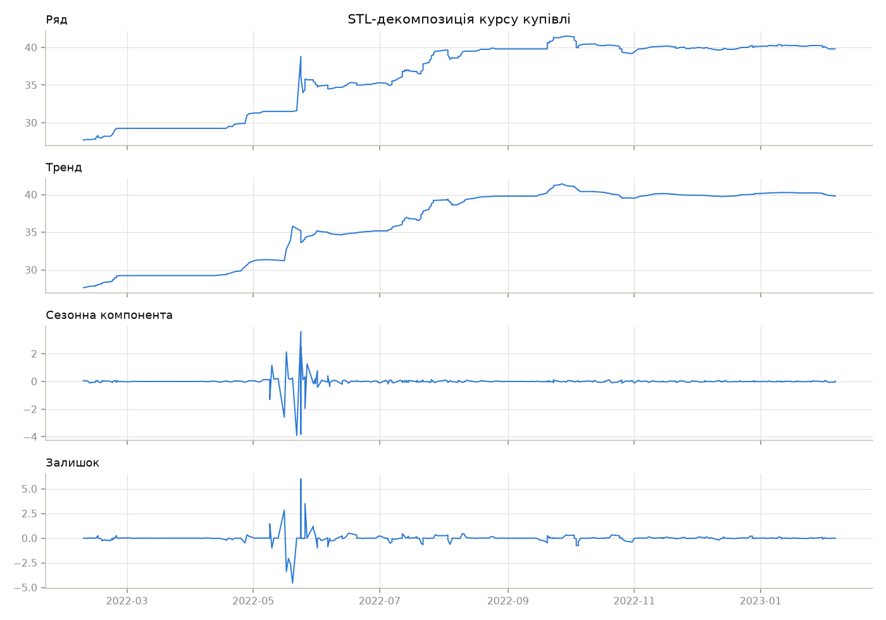

Рисунок 4 – STL-декомпозиція курсу купівлі

Тижневої сезонності в курсі немає ($F_S \le 0{,}013$), динаміку визначає тренд.
Сезонна компонента на рисунку 4 відмінна від нуля лише навколо шоку кінця травня – це
відгук LOESS на стрибки, а не повторюваний цикл. Курс НБУ кусково-сталий: STL розкладає його без залишку, тож частки компонент
для нього не визначені.

### Етап 3. Група 1: властивості

Таблиця 4 – Стаціонарність рівнів і приростів

| Ряд | ADF | $p_{ADF}$ | KPSS | $p_{KPSS}$ | Стаціонарний |
| ---------- | ---------- | ---------- | ---------- | ---------- | -------------- |
| Купівля | –2,080 | 0,253 | 2,617 | 0,010 | ні |
| Δ купівлі | –9,494 | < 0,001 | 0,293 | 0,100 | так |
| Продаж | –2,251 | 0,188 | 2,635 | 0,010 | ні |
| Δ продажу | –23,374 | < 0,001 | 0,285 | 0,100 | так |
| НБУ | –1,290 | 0,634 | 2,510 | 0,010 | ні |
| Δ НБУ | –18,548 | < 0,001 | 0,088 | 0,100 | так |

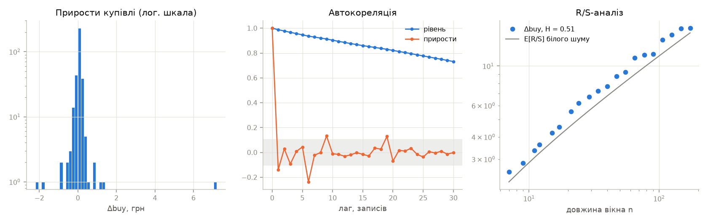

Рисунок 5 – Розподіл приростів, автокореляція і R/S-аналіз курсу купівлі

Рівні всіх трьох рядів нестаціонарні, прирости стаціонарні: курс є інтегрованим
процесом першого порядку. Автокореляція рівня спадає повільно, автокореляція приростів
вже на першому лагу близька до меж значущості. Скоригований показник Херста приростів
купівлі, продажу і курсу НБУ – 0,508, 0,502 і 0,474, тобто пам'яті в приростах немає.
Класичні оцінки тих самих рядів – 0,602, 0,595 і 0,568 – створили б хибне враження
персистентності.

### Етап 4. Група 1: кластеризація режимів

Силует K-means за $k = 2, \ldots, 6$: 0,490; 0,583; 0,602; 0,652; 0,552. Обрано
$k = 5$.

Таблиця 5 – Режими курсу і їхні ділянки в часі

| Ділянка | Записів | Режим | НБУ, грн | Премія, грн | Спред, грн |
| --- | --- | --- | --- | --- | --- |
| 08.02 – 24.02.2022 | 20 | низька премія | 28,84 | 0,99 | 0,74 |
| 24.02 – 27.04.2022 | 46 | курс = НБУ | 29,56 | 0,08 | 2,24 |
| 28.04 – 22.05.2022 | 19 | низька премія | 28,84 | 0,99 | 0,74 |
| 24.05 – 27.05.2022 | 11 | шок | 29,26 | 6,68 | 1,16 |
| 30.05 – 21.07.2022 | 61 | висока премія | 29,26 | 6,22 | 0,73 |
| 21.07 – 22.07.2022 | 2 | курс = НБУ | 29,56 | 0,08 | 2,24 |
| 22.07.2022 – 06.02.2023 | 189 | після девальвації | 36,57 | 3,38 | 0,64 |

Значення ознак у таблиці 5 – середні по всьому кластеру, тому для повторюваних режимів
вони однакові.

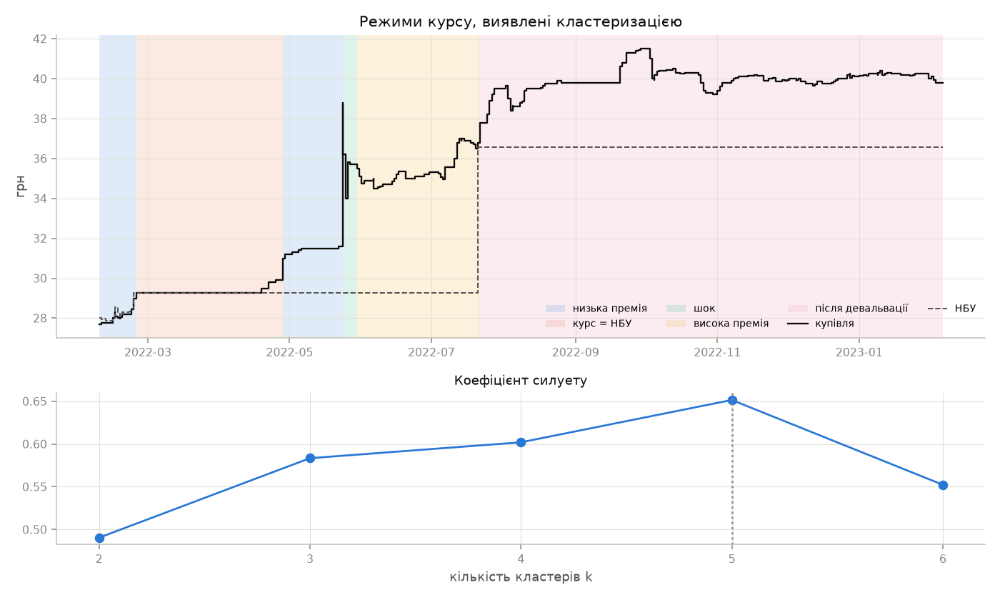

Рисунок 6 – Режими курсу, виявлені кластеризацією, і коефіцієнт силуету

Кластеризація без жодних дат на вході відновила хронологію подій. Після 24.02.2022
курс НБУ зафіксовано, купівля в банку дорівнює офіційному курсу, а продаж поступово
зростає – звідси найширший спред 2,24 грн. З кінця квітня ринок відривається від
офіційного курсу. 24.05 купівля стрибає на 7,2 грн за один запис, після чого
стабілізується з премією близько 6 грн. Девальвація 21.07.2022 скоротила премію
до 3,4 грн, і цей режим тривав до кінця періоду.

### Етап 5. Група 1: кореляційний аналіз

Таблиця 6 – Кореляція рівнів і приростів

| Пара | Рівні | Прирости |
| --- | --- | --- |
| купівля – продаж | 0,992 | 0,912 |
| купівля – НБУ | 0,878 | 0,021 |
| продаж – НБУ | 0,887 | 0,126 |

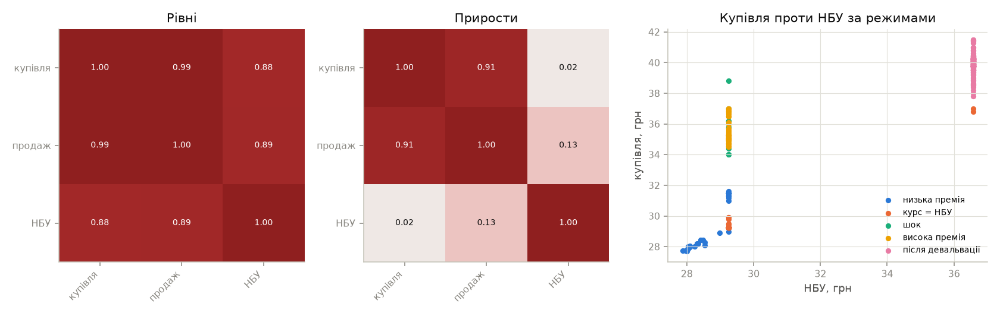

Рисунок 7 – Кореляційні матриці рівнів і приростів, купівля проти курсу НБУ за режимами

Висока кореляція рівнів з курсом НБУ (0,88) – наслідок спільного тренду. Прирости
купівлі з курсом НБУ майже не корелюють (0,021), а крос-кореляція має максимум 0,093
на лагу 2, що нижче межі значущості $1{,}96 / \sqrt{347} = 0{,}105$. Отже, поки курс
НБУ зафіксований, ринковий курс змінюється незалежно від нього. На діаграмі розсіювання
кожен режим – вертикальна смуга над одним значенням курсу НБУ. Купівля і продаж
змінюються синхронно (0,912), тобто банк зсуває обидва курси разом.

### Етап 6. Група 1: синтез і адекватність моделі

Таблиця 7 – Параметри моделі на ділянках режимів

| Режим | Записів | НБУ | $\mu_p$ | $\varphi_p$ | $\mu_s$ | $\varphi_s$ |
| --- | --- | --- | --- | --- | --- | --- |
| низька премія | 20 | блукання | –0,14 | 0,37 | 0,72 | 0,88 |
| курс = НБУ | 46 | фіксований | 0,07 | 0,99 | 2,26 | 0,95 |
| низька премія | 19 | фіксований | 2,17 | 0,67 | 0,75 | 0,67 |
| шок | 11 | фіксований | 6,68 | 0,54 | 1,15 | 0,51 |
| висока премія | 61 | фіксований | 6,22 | 0,99 | 0,73 | 0,91 |
| курс = НБУ | 2 | фіксований | 0,33 | 0,00 | 1,75 | 0,00 |
| після девальвації | 189 | фіксований | 3,38 | 0,93 | 0,64 | 0,84 |

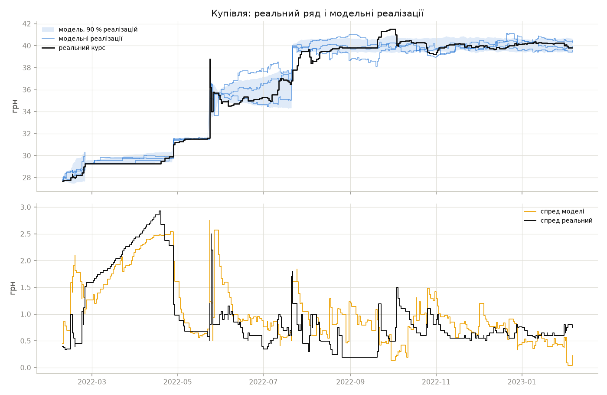

Рисунок 8 – Реальний курс купівлі, модельні реалізації та спред

Таблиця 8 – Адекватність моделі курсу, 200 реалізацій

| Показник | Реальний | Модель, $m$ | $P_5$ | $P_{95}$ | У межах |
| --- | --- | --- | --- | --- | --- |
| $m$ купівлі | 36,481 | 36,665 | 36,479 | 36,878 | так |
| $\sigma$ купівлі | 4,374 | 4,328 | 4,188 | 4,479 | так |
| $\sigma$ Δ купівлі | 0,452 | 0,361 | 0,307 | 0,419 | ні |
| $\sigma$ Δ НБУ | 0,395 | 0,397 | 0,394 | 0,404 | так |
| $m$ спреду | 0,904 | 0,916 | 0,821 | 1,008 | так |
| max спреду | 2,925 | 2,701 | 2,367 | 3,405 | так |
| $r$ Δ купівлі, Δ продажу | 0,912 | 0,860 | 0,786 | 0,911 | ні |
| $r$ Δ купівлі, Δ НБУ | 0,021 | 0,123 | –0,109 | 0,353 | так |
| $r$ купівлі й НБУ | 0,878 | 0,877 | 0,838 | 0,913 | так |
| $H$ Δ купівлі | 0,508 | 0,427 | 0,367 | 0,483 | ні |
| ACF(1) Δ купівлі | –0,139 | –0,064 | –0,225 | 0,055 | так |
| Ексцес Δ купівлі | 183,476 | 67,723 | 40,454 | 95,657 | ні |
| $p_{ADF}$ купівлі | 0,253 | 0,293 | 0,126 | 0,432 | так |

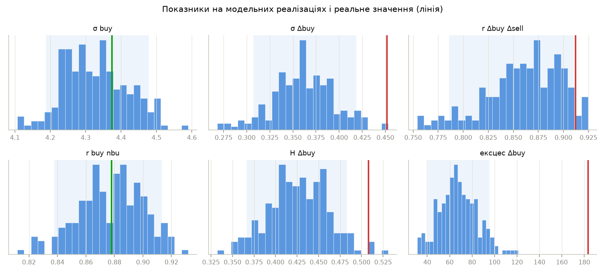

Рисунок 9 – Розподіл показників на модельних реалізаціях і реальне значення

Модель відтворює 9 показників з 13: рівень і розкид курсу, його нестаціонарність,
спред, кореляційну структуру рівнів і незалежність ринкового курсу від курсу НБУ.
Кореляція приростів купівлі й продажу лише на 0,001 виходить за межу інтервалу.
Розбіжності за $\sigma$ приростів і ексцесом спричиняє одна подія – стрибок 24.05
на 7,2 грн із подальшим відкатом. У моделі цей стрибок завжди менший: премія переходить
до середнього рівня режиму $\mu_p = 6{,}68$, а реальний ринок спершу перескочив його.

### Етап 7. Група 2: вхідні дані

Таблиця 9 – Вибіркові характеристики добових показників, Київ

| Показник | $m$ | Медіана | $\sigma$ | min | max | Асиметрія | Ексцес |
| ---------------- | --------- | ----------- | -------- | -------- | --------- | ------------ | ---------- |
| Температура, °C | 9,84 | 9,40 | 9,55 | –17,50 | 29,60 | –0,10 | –0,96 |
| Вологість, % | 73,47 | 74,00 | 13,71 | 35,00 | 99,00 | –0,25 | –0,81 |
| Тиск, гПа | 1016,44 | 1015,90 | 8,33 | 985,60 | 1045,90 | 0,20 | 0,36 |
| Вітер, км/год | 12,70 | 12,10 | 4,66 | 3,40 | 32,10 | 0,68 | 0,22 |
| Опади, мм | 1,68 | 0,10 | 3,60 | 0,00 | 51,50 | 4,16 | 26,85 |
| Радіація, МДж/м² | 12,06 | 11,18 | 8,31 | 0,34 | 29,58 | 0,25 | –1,32 |

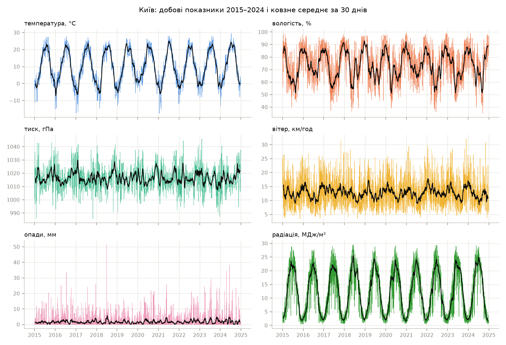

Рисунок 10 – Добові показники Києва за 2015–2024 роки і ковзне середнє за 30 днів

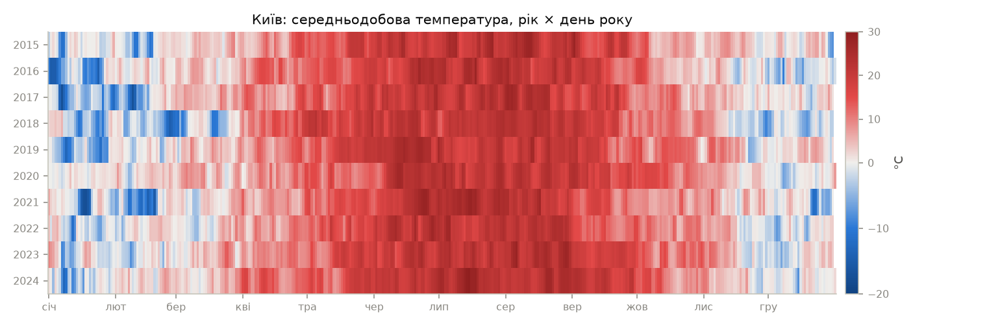

Рисунок 11 – Середньодобова температура Києва: рік × день року

Температура і радіація мають виразний річний цикл. Опади – єдиний показник з різко
несиметричним розподілом: медіана 0,1 мм, у більшості днів опадів немає. На тепловій
карті видно і стабільний річний цикл, і відмінності між роками: холодні січні 2016
і 2017 років, лютий 2021 року і м'яка зима 2019–2020 років.

### Етап 8. Група 2: декомпозиція

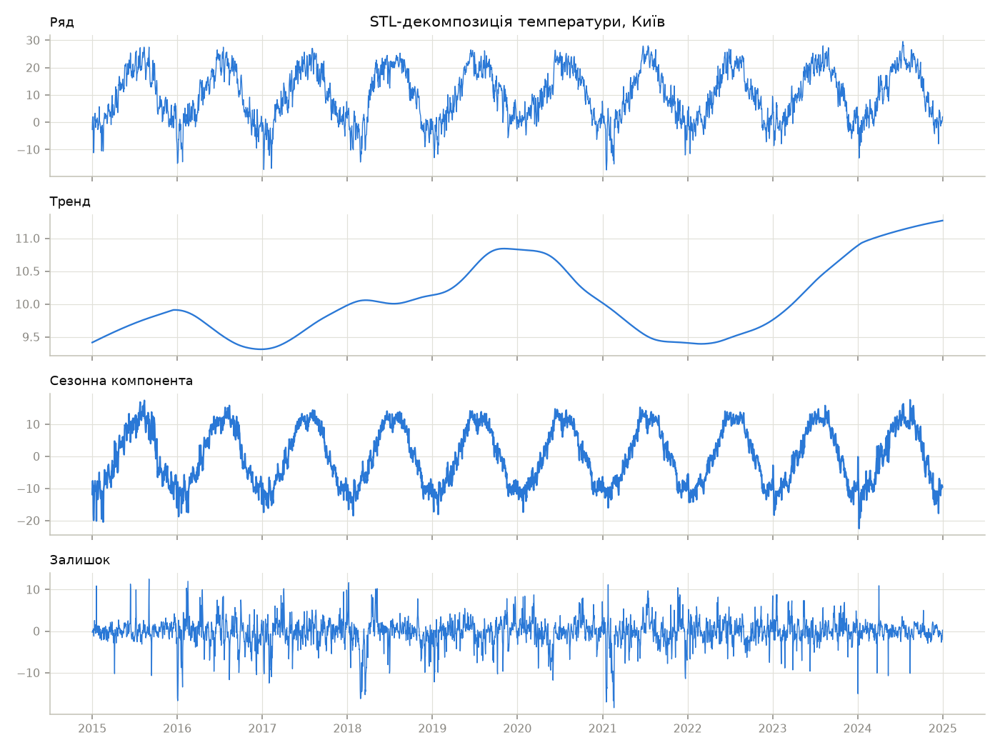

Рисунок 12 – STL-декомпозиція середньодобової температури, Київ

Для температури Києва $F_S = 0{,}888$, $F_T = 0{,}037$, СКВ залишку 3,18 °C. Сила
тренду мала, бо річний цикл з розмахом понад 20 °C на порядок більший за потепління.
Сам тренд при цьому зростає з 9,69 °C у 2015 році до 11,11 °C у 2024 році.

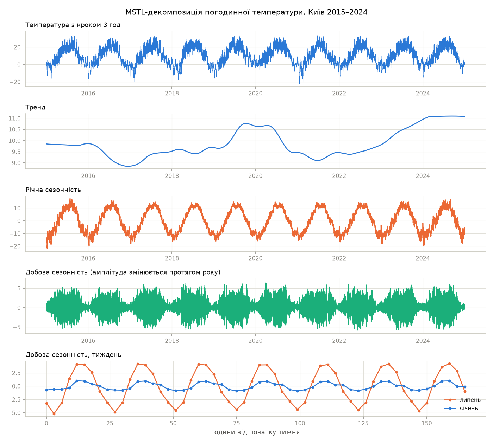

Рисунок 13 – MSTL-декомпозиція погодинної температури з добовим і річним періодами

Для MSTL погодинні дані усереднено до 3 годин, періоди – 8 і 2922 відліки. СКВ добової
сезонності 2,38 °C, річної – 9,01 °C, залишку – 3,29 °C. Добова компонента модульована
річним циклом: її розмах змінюється від 4,4 °C у грудні до 13,0 °C у травні, коли
ночі ще холодні, а сонце вже високо. Тренд MSTL показує і міжрічні коливання, і загальне
потепління за десятиліття.

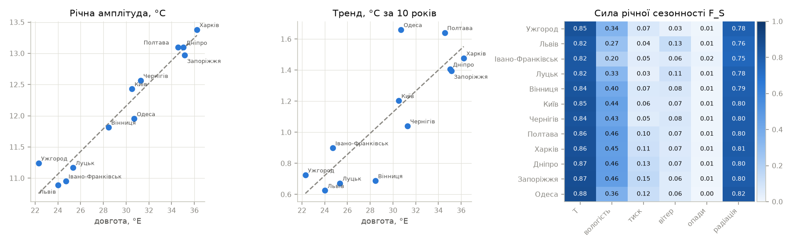

Рисунок 14 – Річна амплітуда і тренд температури проти довготи, сила річної сезонності

Сила річної сезонності за гармонічною моделлю (рисунок 14, праворуч) розділяє показники
на дві групи. Температура (0,82–0,88) і радіація (0,75–0,82) визначаються сезоном.
Вологість (0,20–0,46) – частково. Тиск, вітер і опади ($\le 0{,}15$) майже не мають
річного циклу, їх визначає синоптична мінливість.

### Етап 9. Група 2: властивості

Таблиця 10 – Тренд і річна амплітуда температури

| Місто | Довгота, °E | Тренд, °C / 10 років | Амплітуда, °C |
| --- | --- | --- | --- |
| Ужгород | 22,30 | +0,73 | 11,24 |
| Львів | 24,03 | +0,63 | 10,89 |
| Івано-Франківськ | 24,71 | +0,90 | 10,95 |
| Луцьк | 25,34 | +0,67 | 11,17 |
| Вінниця | 28,47 | +0,69 | 11,82 |
| Київ | 30,52 | +1,20 | 12,43 |
| Одеса | 30,72 | +1,66 | 11,95 |
| Чернігів | 31,29 | +1,04 | 12,57 |
| Полтава | 34,55 | +1,64 | 13,10 |
| Дніпро | 35,05 | +1,41 | 13,10 |
| Запоріжжя | 35,14 | +1,39 | 12,97 |
| Харків | 36,23 | +1,48 | 13,38 |

Річна амплітуда зростає із заходу на схід: кореляція з довготою $r = 0{,}97$
($p < 0{,}001$). Це континентальність клімату – вплив Атлантики слабшає зі сходом.
Одеса нижче лінії тренду: море згладжує річний цикл. Тренд теж зростає зі сходом
($r = 0{,}84$, $p = 0{,}001$): на заході 0,6–0,9 °C за 10 років, на сході й півдні
1,4–1,7 °C. Потепління додатне в усіх містах, але оцінка тренду окремого міста за
10 років має велику невизначеність (п. 3.6).

Таблиця 11 – Властивості температурних аномалій

| Місто | $\sigma$, °C | Асиметрія | Асиметрія взимку | Ексцес | ACF(1) | $H$ |
| --- | --- | --- | --- | --- | --- | --- |
| Ужгород | 3,355 | –0,179 | –0,444 | 0,216 | 0,827 | 0,685 |
| Львів | 3,643 | –0,346 | –0,666 | 0,838 | 0,809 | 0,680 |
| Івано-Франківськ | 3,582 | –0,365 | –0,534 | 0,921 | 0,807 | 0,669 |
| Луцьк | 3,661 | –0,413 | –0,838 | 0,961 | 0,808 | 0,680 |
| Вінниця | 3,618 | –0,333 | –0,699 | 0,550 | 0,807 | 0,684 |
| Київ | 3,671 | –0,426 | –0,834 | 0,599 | 0,813 | 0,667 |
| Чернігів | 3,823 | –0,533 | –1,001 | 0,928 | 0,816 | 0,683 |
| Полтава | 3,791 | –0,483 | –0,927 | 0,871 | 0,806 | 0,653 |
| Харків | 3,882 | –0,457 | –0,861 | 0,630 | 0,801 | 0,649 |
| Дніпро | 3,621 | –0,411 | –0,800 | 0,826 | 0,803 | 0,667 |
| Запоріжжя | 3,518 | –0,333 | –0,729 | 0,648 | 0,808 | 0,665 |
| Одеса | 3,089 | –0,260 | –0,537 | 0,799 | 0,797 | 0,689 |

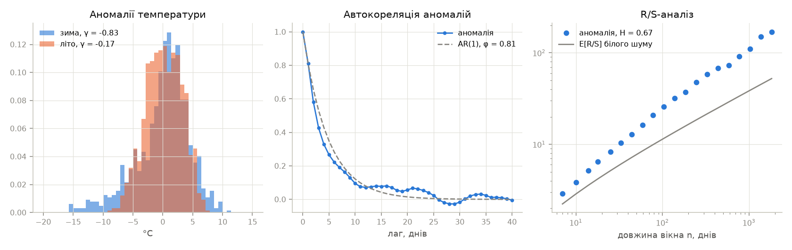

Рисунок 15 – Розподіл аномалій взимку і влітку, автокореляція, R/S-аналіз, Київ

Температура Києва стаціонарна за обома тестами вже без вилучення сезонності
($p_{ADF} = 0{,}004$, $p_{KPSS} = 0{,}1$): сезонний цикл періодичний і не накопичується.
Аномалії стаціонарні в усіх містах. Їхні властивості однакові по всій мережі
і пояснюються фізикою атмосфери:

- аномалії мають від'ємну асиметрію, що взимку зростає до –0,45…–1,0: сильні морози
  від вторгнень арктичного повітря глибші, ніж теплі відхилення;
- ACF(1) ≈ 0,81, автокореляція спадає майже як в AR(1) і за 10 діб падає до 0,1 –
  це тривалість синоптичного процесу;
- $H = 0{,}65$–$0{,}69$: окрім короткої пам'яті, аномалії мають і повільнішу
  мінливість – теплі й холодні місяці.

Найменша $\sigma$ аномалій в Одесі (3,09 °C) – море стримує коливання.

### Етап 10. Група 2: кореляційний аналіз

Таблиця 12 – Кореляція показників Києва: сирі ряди та аномалії

| Пара | Сирі ряди | Аномалії |
| --- | --- | --- |
| температура – вологість | –0,55 | –0,01 |
| температура – радіація | +0,78 | +0,17 |
| вологість – опади | +0,33 | +0,45 |
| вологість – радіація | –0,76 | –0,56 |
| тиск – вітер | –0,27 | –0,33 |
| тиск – опади | –0,34 | –0,34 |
| опади – радіація | –0,20 | –0,50 |

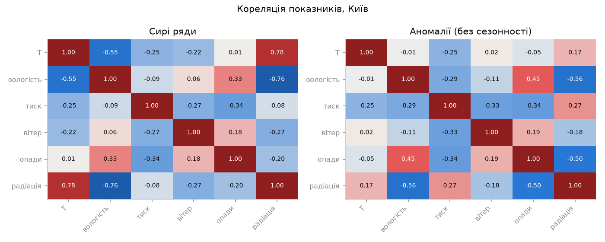

Рисунок 16 – Кореляційні матриці показників Києва до і після вилучення сезонності

Частина сильних зв'язків у сирих рядах створена сезонністю. Кореляція температури
з вологістю –0,55 зникає в аномаліях (–0,01): обидва показники просто мають протилежні
річні цикли. Справжні зв'язки після вилучення сезонності посилюються: опади
з радіацією (–0,50, хмарність), вологість з опадами (+0,45). Тиск зі зміною сезону
не пов'язаний, і його кореляції з вітром і опадами однакові в обох випадках:
циклони приносять і вітер, і опади.

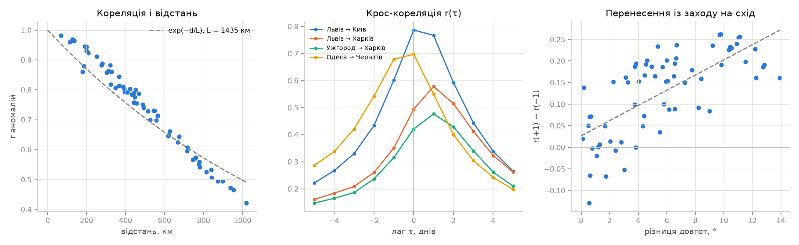

Рисунок 17 – Кореляція аномалій і відстань, крос-кореляція пар міст, асиметрія за різницею довгот

Кореляція аномалій температури між містами – від 0,42 до 0,98 – спадає з відстанню,
радіус кореляції $L = 1435$ км. Для далеких пар максимум крос-кореляції зсунутий:
Львів випереджає Харків на 1 добу ($r = 0{,}579$ проти 0,495 на нульовому лагу),
Ужгород – Харків теж на 1 добу. Для близьких пар і пари південь – північ
(Одеса – Чернігів) максимум на нульовому лагу. По всіх 66 парах асиметрія
$r(+1) - r(-1)$ зростає з різницею довгот: нахил 0,0176 на градус, $r = 0{,}70$,
$p = 5{,}3 \cdot 10^{-11}$. Це західне перенесення: атмосферні фронти проходять
територію України із заходу на схід приблизно за добу.

### Етап 11. Група 2: кластеризація міст

Таблиця 13 – Кліматичні ознаки і кластери міст

| Місто | T, °C | Амплітуда, °C | Вологість, % | Опади, мм/рік | Вітер, км/год | Кластер |
| ---------------- | ------ | ------------ | ------------ | ---------- | ---------- | -------------- |
| Ужгород | 11,02 | 11,24 | 74,74 | 857 | 9,29 | захід |
| Львів | 9,68 | 10,89 | 76,29 | 787 | 13,04 | захід |
| Івано-Франківськ | 9,86 | 10,96 | 75,40 | 715 | 10,85 | захід |
| Луцьк | 9,76 | 11,17 | 75,74 | 696 | 12,83 | захід |
| Вінниця | 9,75 | 11,82 | 73,39 | 580 | 11,37 | центр і північ |
| Київ | 9,84 | 12,43 | 73,47 | 615 | 12,70 | центр і північ |
| Чернігів | 9,24 | 12,57 | 73,97 | 645 | 13,81 | центр і північ |
| Полтава | 9,91 | 13,10 | 71,32 | 598 | 13,48 | схід |
| Харків | 9,69 | 13,38 | 70,96 | 583 | 12,96 | схід |
| Дніпро | 10,99 | 13,10 | 72,54 | 559 | 13,19 | схід |
| Запоріжжя | 11,54 | 12,97 | 70,35 | 551 | 13,38 | схід |
| Одеса | 12,62 | 11,95 | 71,92 | 468 | 14,87 | південь |

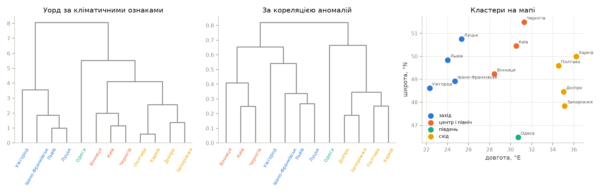

Рисунок 18 – Дендрограми за кліматичними ознаками і за кореляцією аномалій, кластери на мапі

K-means за силуетом обирає $k = 2$ (0,371), але на 12 об'єктах силует малоінформативний:
розбиття на дві групи лише відокремлює схід від решти. Дендрограма Уорда має природний
розріз на чотири кластери. Розбиття на чотири кластери за кліматом і за кореляцією
аномалій повністю збіглися (ARI = 1,000). Перше спирається на середні значення,
друге – лише на синхронність добових коливань, і обидва дають ті самі кліматичні зони:
вологий захід з найбільшою кількістю опадів, центр і північ, континентальний схід
з найбільшою амплітудою, приморська Одеса.

### Етап 12. Група 2: синтез моделі

BIC обрав порядок VAR $p = 2$ і для аномалій, і для їхніх нормальних рангів.

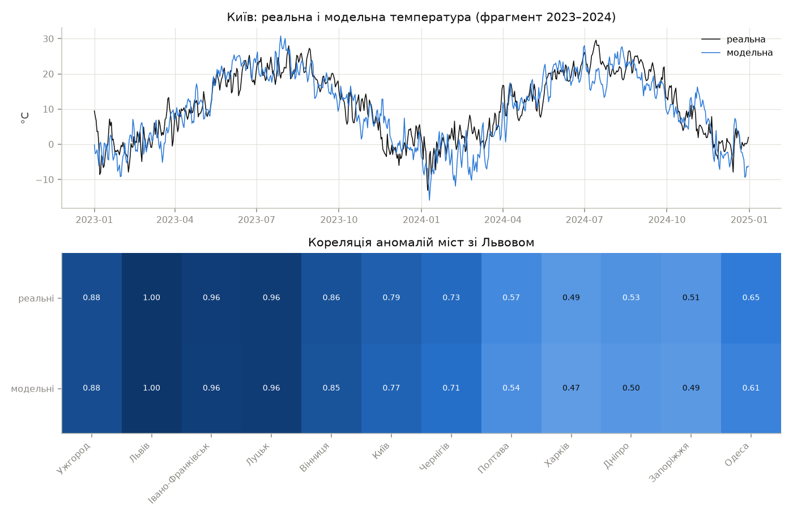

Рисунок 19 – Реальна і модельна температура Києва, кореляція аномалій міст зі Львовом

Модельний ряд має той самий річний цикл, розкид і характер синоптичних коливань.
Кореляція аномалій міст зі Львовом у моделі повторює реальну з відхиленням до 0,04.

### Етап 13. Група 2: адекватність і порівняння генераторів

Таблиця 14 – Частка міст, де показник лежить в інтервалі $[P_5, P_{95}]$ моделі

| Показник | Нормальні інновації | Сезонний бутстреп | Копула |
| --- | --- | --- | --- |
| $m$ | 1,00 | 1,00 | 1,00 |
| $\sigma$ | 1,00 | 1,00 | 1,00 |
| Тренд $b$ | 1,00 | 1,00 | 1,00 |
| Амплітуда $A$ | 1,00 | 1,00 | 1,00 |
| $\sigma$ взимку / влітку | 1,00 | 0,75 | 0,67 |
| ACF(1) | 1,00 | 1,00 | 0,42 |
| ACF(7) | 0,00 | 0,00 | 0,00 |
| $H$ | 0,17 | 0,17 | 0,00 |
| Асиметрія | 0,00 | 0,08 | 1,00 |
| Асиметрія взимку | 0,00 | 0,00 | 1,00 |
| Ексцес | 0,08 | 1,00 | 1,00 |
| Середня $r$ між містами | так | так | ні |
| $r$ Львів → Харків, лаг 1 | так | так | ні |
| ARI кластерів | так | так | так |
| Усього показників у межах | 78 з 135 | 87 з 135 | 98 з 135 |

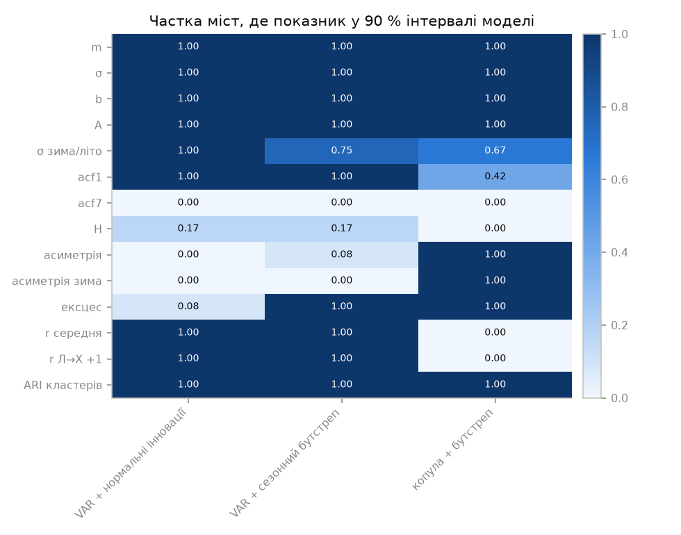

Рисунок 20 – Частка міст, де показник відтворено, за генераторами

Таблиця 15 – Адекватність моделі для Києва, сезонний бутстреп, 100 реалізацій

| Показник | Реальний | Модель, $m$ | $P_5$ | $P_{95}$ | У межах |
| --- | --- | --- | --- | --- | --- |
| $m$, °C | 9,839 | 9,831 | 9,591 | 10,065 | так |
| $\sigma$, °C | 9,547 | 9,562 | 9,298 | 9,848 | так |
| Тренд, °C / 10 років | 1,204 | 1,037 | –0,004 | 1,842 | так |
| Амплітуда, °C | 12,433 | 12,449 | 12,089 | 12,818 | так |
| $\sigma$ взимку / влітку | 1,476 | 1,468 | 1,315 | 1,649 | так |
| ACF(1) | 0,813 | 0,810 | 0,794 | 0,825 | так |
| ACF(7) | 0,191 | 0,124 | 0,080 | 0,186 | ні |
| $H$ | 0,667 | 0,619 | 0,573 | 0,659 | ні |
| Асиметрія | –0,426 | –0,158 | –0,294 | –0,001 | ні |
| Асиметрія взимку | –0,834 | –0,189 | –0,507 | 0,071 | ні |
| Ексцес | 0,599 | 0,607 | 0,231 | 1,135 | так |
| Середня $r$ між містами | 0,745 | 0,736 | 0,714 | 0,756 | так |
| $r$ Львів → Харків, лаг 1 | 0,579 | 0,561 | 0,518 | 0,602 | так |
| ARI кластерів | 1,000 | 1,000 | 1,000 | 1,000 | так |

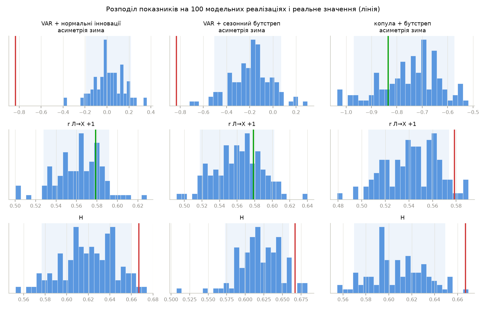

Рисунок 21 – Розподіл показників на модельних реалізаціях для трьох генераторів

Усі три генератори відтворюють детерміновану частину: середнє, розкид, тренд,
амплітуду. У кожній модельній реалізації кластери міст за кореляцією аномалій
збігаються з реальними (ARI = 1). Решта показників розходиться між генераторами.

VAR із нормальними інноваціями відтворює кореляційну структуру – короткочасну пам'ять,
кореляцію між містами і перенесення із заходу на схід, – але дає симетричні аномалії.
Сезонний бутстреп додає ексцес (12 міст з 12) і зберігає всю кореляційну структуру.
Асиметрію він відтворює лише частково (–0,16 проти –0,43 для Києва): сума
асиметричних інновацій у VAR наближається до нормального розподілу.

Копула відтворює асиметрію й ексцес у всіх 12 містах, бо розподіл аномалій задається
емпірично. Ціна – занижені кореляції: між містами і на першому лагу. Причина у формі
залежності: пірсонівська кореляція реальних аномалій вища, ніж кореляція їхніх
нормальних рангів, тобто сильні холодні аномалії в різних містах збігаються частіше,
ніж допускає гаусова копула. Отже, для задач, де важлива просторова і часова
залежність (прогноз, перенесення), доцільний сезонний бутстреп. Для оцінки
екстремумів температури доцільна копула.

Жоден генератор не відтворює ACF(7) і показник Херста: реальні аномалії мають довшу
пам'ять, ніж дає VAR(2).

## 3.5. Програмний код

Нижче наведено фрагменти, що безпосередньо реалізують моделі розділу 3.1. Повний код
проекту додається до звіту окремим архівом.

Скоригований показник Херста:

```python
def expected_rs(n):
    i = np.arange(1, n)
    tail = np.sqrt((n - i) / i).sum()
    if n <= 340:
        ratio = np.exp(gammaln((n - 1) / 2) - gammaln(n / 2)) / np.sqrt(
            np.pi
        )
    else:
        ratio = 1 / np.sqrt(n * np.pi / 2)
    return (n - 0.5) / n * ratio * tail


def hurst(x, corrected=True, min_window=HURST_MIN_WINDOW):
    sizes, rs = rs_curve(x, min_window)
    if corrected:
        excess = np.log(rs) - np.log([expected_rs(n) for n in sizes])
        h = 0.5 + np.polyfit(np.log(sizes), excess, 1)[0]
        return h, sizes, rs
    h = np.polyfit(np.log(sizes), np.log(rs), 1)[0]
    return h, sizes, rs
```

Гармонічна регресія і сила сезонності:

```python
def seasonal_fit(frame, k=3):
    x = harmonic_design(np.arange(len(frame)), k)
    beta, *_ = np.linalg.lstsq(x, frame.values, rcond=None)
    resid = pd.DataFrame(
        frame.values - x @ beta, index=frame.index, columns=frame.columns
    )
    return beta, resid


def harmonic_strength(frame, k=3):
    beta, resid = seasonal_fit(frame, k)
    x = harmonic_design(np.arange(len(frame)), k)
    seasonal = x[:, 2:] @ beta[2:]
    total = np.var(seasonal + resid.values, axis=0)
    return pd.Series(
        1 - np.var(resid.values, axis=0) / total, index=frame.columns
    )
```

Крос-кореляція з лагом і кореляційна відстань для кластеризації:

```python
def cross_correlation(x, y, max_lag):
    x, y = np.asarray(x, dtype=float), np.asarray(y, dtype=float)
    n = len(x)
    lags = np.arange(-max_lag, max_lag + 1)
    r = []
    for lag in lags:
        ahead, behind = max(0, lag), max(0, -lag)
        r.append(
            np.corrcoef(x[behind : n - ahead], y[ahead : n - behind])[0, 1]
        )
    return lags, np.array(r)


def correlation_linkage(frame):
    r = frame.corr().values
    d = np.sqrt(np.clip(2 * (1 - r), 0, None))
    np.fill_diagonal(d, 0.0)
    return linkage(squareform(d, checks=False), method="average")
```

Генерування курсу за режимами:

```python
def synth_rates(model, rng):
    rows = []
    s_prev = None
    for seg in model:
        n = seg["length"]
        (mu_p, phi_p), (mu_s, phi_s) = seg["premium"], seg["spread"]
        draws = seg["innovations"][
            rng.integers(0, len(seg["innovations"]), n)
        ]
        if seg["floating"]:
            nbu = seg["nbu"][0] + np.r_[0.0, np.cumsum(draws[1:, 2])]
        else:
            nbu = np.full(n, seg["nbu"].mean())
        p_prev = mu_p
        s_prev = mu_s if s_prev is None else s_prev
        out = np.empty((n, 3))
        for i in range(n):
            p_prev = mu_p + phi_p * (p_prev - mu_p) + draws[i, 0]
            s_prev = max(mu_s + phi_s * (s_prev - mu_s) + draws[i, 1], 0.0)
            out[i] = nbu[i] + p_prev, nbu[i] + p_prev + s_prev, nbu[i]
        rows.append(out)
    return pd.DataFrame(np.vstack(rows), columns=["buy", "sell", "nbu"])
```

Ідентифікація моделі погоди:

```python
def fit_climate(frame, k=HARMONICS, k_sigma=SIGMA_HARMONICS):
    t = np.arange(len(frame))
    x_mean = harmonic_design(t, k)
    x_sigma = harmonic_design(t, k_sigma, trend=False)
    beta, *_ = np.linalg.lstsq(x_mean, frame.values, rcond=None)
    resid = frame.values - x_mean @ beta
    gamma, *_ = np.linalg.lstsq(x_sigma, resid**2, rcond=None)
    z = resid / np.sqrt(x_sigma @ gamma)
    pools = seasonal_pools(len(z))
    scores = normal_scores(z, pools)
    return {
        "columns": list(frame.columns),
        "index": frame.index,
        "beta": beta,
        "gamma": gamma,
        "k": k,
        "k_sigma": k_sigma,
        "z": z,
        "scores": scores,
        "sorted_pools": [np.sort(z[pool], axis=0) for pool in pools],
        "var_z": fit_var(z),
        "var_scores": fit_var(scores),
    }
```

Генерування VAR із трьома типами інновацій і копульне перетворення:

```python
def simulate_var(var, n, rng, innovations="gauss"):
    coefs, residuals = var["coefs"], var["residuals"]
    p, m, _ = coefs.shape
    total = n + BURN
    if innovations == "gauss":
        u = rng.multivariate_normal(np.zeros(m), var["sigma_u"], total)
    else:
        pools = seasonal_pools(len(residuals), p)
        days = day_of_year(total, -BURN)
        u = residuals[[rng.choice(pools[d]) for d in days]]
    z = np.zeros((total, m))
    for t in range(p, total):
        z[t] = u[t] + sum(coefs[i] @ z[t - 1 - i] for i in range(p))
    return z[BURN:]


def seasonal_quantiles(scores, sorted_pools):
    z = np.empty_like(scores)
    doy = day_of_year(len(scores))
    columns = np.arange(scores.shape[1])
    for day, ref in enumerate(sorted_pools):
        rows = np.flatnonzero(doy == day)
        position = np.clip(
            stats.norm.cdf(scores[rows]) * len(ref) - 0.5, 0, len(ref) - 1
        )
        low = np.floor(position).astype(int)
        high = np.minimum(low + 1, len(ref) - 1)
        frac = position - low
        z[rows] = ref[low, columns] * (1 - frac) + ref[high, columns] * frac
    return z


def synth_climate(model, rng, method="bootstrap"):
    n = len(model["index"])
    if method == "copula":
        scores = simulate_var(model["var_scores"], n, rng, "bootstrap")
        z = seasonal_quantiles(scores, model["sorted_pools"])
    else:
        z = simulate_var(model["var_z"], n, rng, method)
    values = mean_curve(model, n) + sigma_curve(model, n) * z
    return pd.DataFrame(
        values, index=model["index"], columns=model["columns"]
    )
```

Перевірка адекватності методом Монте-Карло:

```python
def monte_carlo(metrics, real, generate, runs, rng):
    reference = metrics(real)
    samples = pd.DataFrame([metrics(generate(rng)) for _ in range(runs)])
    low, high = np.percentile(samples.values, BAND, axis=0)
    report = pd.DataFrame(
        {
            "реальний": pd.Series(reference),
            "модель m": samples.mean(),
            "P5": low,
            "P95": high,
        }
    )
    real = report["реальний"]
    report["в межах"] = (real >= report["P5"]) & (real <= report["P95"])
    return report, samples
```

## 3.6. Аналіз результатів та верифікація

Методи перевірено на рядах, властивості яких відомі заздалегідь.

Таблиця 16 – Верифікація методів

| Перевірка | Задано | Отримано |
| --- | --- | --- |
| $H$ білого шуму, $n = 347$, 100 реалізацій | 0,5 | класичний 0,566 ± 0,049; скоригований 0,472 ± 0,051 |
| $H$ білого шуму, $n = 3653$, 100 реалізацій | 0,5 | класичний 0,544 ± 0,026; скоригований 0,486 ± 0,022 |
| $H$ процесу AR(1), $\varphi = 0{,}8$, $n = 3653$ | коротка пам'ять | 0,651 |
| Лаг $y(t) = x(t-2) + 0{,}5\varepsilon(t)$ | +2; $r = 0{,}894$ | +2; $r = 0{,}900$ |
| Тренд гармонічної регресії, за 10 років | 1,096 | 1,309 (СКВ оцінки 0,172) |
| Амплітуда гармонічної регресії, °C | 12,0 | 11,884 |
| СКВ залишку, °C | 3,0 | 2,982 |
| Похибка $\hat F^{-1}(\Phi(s)) - z$ копули | 0 | $1{,}8 \cdot 10^{-14}$ |

Верифікація показника Херста. Класична R/S-оцінка на білому шумі зміщена вгору на
0,04–0,07, і зміщення більше на коротких рядах. Скоригована оцінка відрізняється від 0,5
менше, ніж на одне СКВ. Для групи 1 це принципово: класична оцінка 0,60 для приростів
курсу хибно вказувала б на персистентність, скоригована 0,51 її не підтверджує.
Процес AR(1) без довгої пам'яті дає $H = 0{,}651$, бо на скінченних вікнах коротка
пам'ять теж підвищує R/S. Тому значення $H = 0{,}67$ для аномалій погоди
інтерпретується порівнянням з моделлю VAR(2) з тією самою ACF(1), яка дає 0,62.
Різниця і є ознакою довшої пам'яті.

Верифікація крос-кореляції. Зсув на два відліки відновлено точно, а значення $r$
збігається з теоретичним $1 / \sqrt{1 + 0{,}5^2} = 0{,}894$ з точністю до вибіркової
похибки. Знак лагу відповідає означенню п. 3.1.4, тому висновок про випередження
Харкова Львовом має правильний напрям.

Верифікація гармонічної регресії. Амплітуда і СКВ залишку відновлені з похибкою
до 1 %, оцінка тренду відхиляється від заданої на 1,2 СКВ. Це звичайна вибіркова
похибка тренду за 10 років при незалежному шумі 3 °C. Реальні аномалії автокорельовані,
тому похибка тренду на них у кілька разів більша: у модельних реалізаціях 90 % інтервал
тренду Києва – від 0,0 до 1,84 °C за 10 років. Тренд окремого міста є наближеною
оцінкою. Надійніші висновки – додатний тренд у всіх 12 містах і його систематичне
зростання з довготою.

Верифікація копули. Пряме і зворотне перетворення разом відтворюють вихідні значення
з машинною точністю, а нормальні ранги мають $m = 0$ і $\sigma = 0{,}997$. Ця перевірка
виявила помилку в першій версії зворотного перетворення: ранг $r$ відповідав
$u = (r + \frac12)/L$, а позиція у вибірці обчислювалась як $u(L - 1)$. Через це крайні
значення зсувались до центру на пів рангу. Після виправлення позиція береться як
$uL - \frac12$.

Внутрішня перевірка моделей. Оцінювання моделі і генерування узгоджені між собою:
середнє, СКВ, тренд і амплітуду модель погоди відтворює в 12 містах з 12 при всіх
трьох генераторах. Модель курсу відтворює рівень, розкид і p-значення ADF. Тобто
детермінована частина і нестаціонарність перенесені в синтез правильно, а розбіжності
стосуються лише стохастичної частини.

Обмеження моделей.

- Модель курсу не відтворює одиничні події, яких у даних немає повторень. Стрибок
  24.05 визначає ексцес приростів (183 проти 68 у моделі) і більшу частину їхньої
  дисперсії. Для таких подій потрібна окрема компонента стрибків, але оцінити її
  параметри за одним випадком неможливо.
- Модель погоди має коротку пам'ять: ACF(7) і $H$ занижені в усіх містах. Повільна
  складова аномалій (теплі й холодні місяці) спільна для всіх міст. Її можна описати
  другим, місячним рівнем моделі, але в експерименті з ним погіршилось відтворення
  просторових кореляцій, тому в остаточну модель його не включено.
- Сезонний бутстреп і копула відтворюють різні аспекти: кореляційну структуру
  і форму розподілу відповідно. Поєднати їх може копула з хвостовою залежністю,
  наприклад t-копула.

# IV. Висновки

У роботі реалізовано поглиблений аналіз Time Series: декомпозицію, оцінку властивостей,
візуалізацію, кластеризацію і кореляційний аналіз. Також реалізовано синтез модельних
рядів з виявленими закономірностями і перевірку їх адекватності. Аналіз і синтез
оформлено окремими модулями, незалежними від набору даних. Виконано обидві групи вимог:
групу 1 – на курсі USD Ощадбанку, групу 2 – на погодному архіві 12 міст України
за 10 років.

Для курсу валют виявлено, що ряд нестаціонарний, а його прирости стаціонарні, без пам'яті
($H = 0{,}51$ після поправки на зміщення) і з дуже важкими хвостами (ексцес 183).
Тижневої сезонності немає ($F_S = 0$). Кластеризація ознак курсу відновила п'ять
режимів, що відповідають подіям 2022 року: фіксацію курсу НБУ, появу і зростання
ринкової премії, шок кінця травня і девальвацію. Прирости ринкового курсу з курсом НБУ
не корелюють (0,021), хоча рівні корелюють на 0,88 через спільний тренд. Режимна модель
з AR(1) і бутстрепом інновацій відтворює 9 показників з 13.

Для погоди виявлено просторові закономірності: річна амплітуда температури зростає
із заходу на схід (кореляція з довготою 0,97). Потепління додатне в усіх містах
і більше на сході й півдні (1,4–1,7 °C за 10 років), ніж на заході (0,6–0,9 °C). Аномалії температури мають
від'ємну асиметрію, що посилюється взимку, коротку пам'ять синоптичного масштабу
і радіус кореляції 1435 км. Крос-кореляція показала західне перенесення: погода
у Львові випереджає Харків на добу. Частина сильних кореляцій між показниками
виявилась наслідком сезонності, що підтверджує потребу аналізувати аномалії, а не
сирі ряди. Кластеризація за кліматом і за синхронністю коливань дала однакові чотири
кліматичні зони (ARI = 1).

Модель погоди з гармонічною сезонністю, сезонною дисперсією і VAR(2) відтворює річний
цикл, тренд, кореляцію між містами, перенесення і кліматичні зони. Порівняння трьох
генераторів інновацій показало компроміс. Сезонний бутстреп зберігає кореляційну
структуру (87 показників з 135), копула – форму розподілу (98 з 135) ціною занижених
кореляцій. Причина – хвостова залежність: сильні морози в різних містах збігаються
частіше, ніж у гаусовій моделі.

Поправка Аніса–Ллойда до показника Херста зменшує зміщення на білому шумі з 0,04–0,07
до рівня, меншого за СКВ оцінки. Без неї висновок про пам'ять приростів курсу був би
хибним. Напрям подальшої роботи – копула з хвостовою залежністю та дворівнева модель
з повільною місячною складовою.

# Перелік джерел

1. Open-Meteo. Historical Weather API. URL: https://open-meteo.com/en/docs/historical-weather-api
2. Cleveland R. B., Cleveland W. S., McRae J. E., Terpenning I. STL: A Seasonal-Trend
   Decomposition Procedure Based on Loess. Journal of Official Statistics. 1990. Vol. 6,
   No. 1. P. 3–73.
3. Peters E. E. Fractal Market Analysis: Applying Chaos Theory to Investment and
   Economics. New York: Wiley, 1994. 315 p.
