# І. Мета

Виявити, дослідити та узагальнити особливості реалізації процесів обробки Time Series
алгоритмами ковзного вікна з використанням можливостей мови програмування Python.

# ІІ. Завдання

Розробити програмний скрипт мовою Python, що розширює універсальну платформу обробки
Time Series алгоритмами ковзного вікна та апроксимації.

Група вимог 1. Для даних, що оброблялись у ЛР 1–4, реалізувати обробку алгоритмами
ковзного вікна: Moving Average, автокореляційними моделями ARMA, ARIMA та іншими:

1. Дослідити властивості даних.
2. Вибрати та реалізувати алгоритм обробки даних.
3. Реалізувати екстраполяцію на 0,5; 1,0; 1,5; 2 інтервали спостереження.
4. Оцінити показники якості моделі та результатів прогнозування.
5. Обґрунтувати вибір та ефективність етапів обробки.
6. Провести аналіз результатів, довести їх придатність для використання.

Група вимог 2. Провести R&D дослідження:

1. Доповнити групу 1 оптимізацією параметрів алгоритмів ковзного вікна та апроксимації
   і довести дієвість обраних рішень.
2. Порівняти обробку методами ковзного вікна і методами статистичного навчання
   за типовими показниками ефективності.
3. Сформувати рекомендації щодо використання методів залежно від властивостей ряду.

Обраний рівень складності – ІІ: реалізовано обидві групи вимог.

Обробляються два ряди з попередніх робіт з протилежними властивостями. Від властивостей
ряду залежить вибір методу, тож рекомендації групи 2 мають спиратися на обидва типи.

Таблиця 1 – Вхідні дані

| Параметр | Ряд 1 | Ряд 2 |
| --- | --- | --- |
| Показник | курс купівлі USD в Ощадбанку | середньодобова температура, Київ |
| Джерело | архів курсів Ощадбанку (ЛР 1–3) | архівний API Open-Meteo [1] (ЛР 4) |
| Обсяг | 348 записів (02.2022 – 02.2023) | 3653 доби (2015–2024) |
| Крок | запис, нерегулярний у часі | доба |
| Вікно спостереження $W$ | 100 записів | 730 діб |

# ІІІ. Результати виконання лабораторної роботи

## 3.1. Синтезована математична модель

### 3.1.1. Алгоритми ковзного вікна

Згладжування каузальне: оцінка в момент $t$ обчислюється лише за вікном
$y(t-w+1), \ldots, y(t)$, тож ним можна користуватись у реальному часі.

Просте (SMA) і зважене (WMA) ковзні середні:

$$s(t) = \sum_{i=0}^{w-1} c_i\, y(t - i), \qquad c_i^{SMA} = \frac{1}{w}, \qquad c_i^{WMA} = \frac{2 (w - i)}{w (w + 1)}$$

Ковзна медіана – медіана тих самих $w$ значень, стійка до стрибків і викидів.
Експоненційне згладжування (EMA) – ковзне середнє з нескінченним вікном і ваговими
коефіцієнтами, що спадають геометрично:

$$s(t) = \alpha\, y(t) + (1 - \alpha)\, s(t-1), \qquad 0 < \alpha \le 1$$

На лінійному тренді $y(t) = b t$ ковзні середні запізнюються на сталу величину:
$(w-1) b / 2$ для SMA і $(1-\alpha) b / \alpha$ для EMA.

Ковзний МНК будує пряму за останніми $w$ відліками і продовжує її:
$\hat y(t+k) = \hat a + \hat b k$. Прогноз SMA, WMA, медіани й EMA – сталий рівень
останнього вікна.

Для сезонного ряду ковзне вікно береться не по сусідніх днях, а по тих самих днях
попередніх років. Сезонне ковзне середнє:

$$\hat y(t + k) = \frac{1}{|S|} \sum_{(m, j) \in S} y(t + k - m P + j)$$

де $S$ – пари $(m, j)$ з $j = -h, \ldots, h$ і $m = m_0, \ldots, m_0 + Y - 1$;
$P = 365{,}25$ доби, $Y$ – кількість років, $h$ – напівширина вікна в днях, а $m_0$ –
найменший номер року, для якого вікно вже є у вибірці.

### 3.1.2. Автокореляційні моделі

Модель ARIMA(p, d, q) описує $d$-ту різницю ряду $\nabla^d y$ як процес ARMA(p, q):

$$\nabla^d y(t) = c + \sum_{i=1}^{p} \varphi_i\, \nabla^d y(t-i) + \varepsilon(t) + \sum_{j=1}^{q} \theta_j\, \varepsilon(t-j)$$

AR(p) і MA(q) – окремі випадки з $q = 0$ або $p = 0$. Для $d = 1$ стала $c$ – дрейф,
тобто сталий нахил прогнозу. Прогноз на $k$ кроків будується рекурсивно з оцінених
параметрів, а 90 % інтервал – з дисперсії накопиченої похибки прогнозу.

Довгий річний цикл (365 відліків) моделлю SARIMA не описати: сезонний лаг такої довжини
потребує сотень параметрів. Тому для температури використано регресію на тренд
і гармоніки з ARMA-похибкою:

$$y(t) = a + b t + \sum_{j=1}^{K} \left( c_j \cos \frac{2\pi j t}{P} + d_j \sin \frac{2\pi j t}{P} \right) + u(t), \qquad u(t) \sim \text{ARMA}(p, q)$$

Усі параметри, включно з коефіцієнтами регресії, оцінюються разом методом
максимальної правдоподібності.

### 3.1.3. Методи статистичного навчання для порівняння

1. МНК-поліном степеня $d$ за всім вікном спостереження, екстрапольований уперед (ЛР 2).
2. МНК-модель з трендом і $K$ гармоніками – детермінована частина моделі п. 3.1.2
   без ARMA-похибки.
3. α-β фільтр з обмеженою пам'яттю $N$ (ЛР 3): коефіцієнти $\alpha = 2(2N-1)/(N(N+1))$
   і $\beta = 6/(N(N+1))$. Прогноз – екстраполяція оцінених рівня $x$ і швидкості $v$:
   $\hat y(t+k) = x + v k$.

### 3.1.4. Екстраполяція та показники якості

Прогноз на два інтервали спостереження вперед перевірити за цим самим рядом
неможливо. Тому використано walk-forward перевірку:

1. Модель навчається на вікні $y(s), \ldots, y(s+W-1)$ і прогнозує $2W$ кроків уперед.
2. Якість на горизонті $hW$, $h \in \{0{,}5;\ 1;\ 1{,}5;\ 2\}$, рахується за першими
   $hW$ прогнозами порівняно з реальними значеннями.
3. Процедура повторюється для п'яти стартів $s$, показники усереднюються.

Показники якості прогнозу, $e = \hat y - y$:

$$\text{RMSE} = \sqrt{\overline{e^2}}, \quad \text{MAE} = \overline{|e|}, \quad \text{зміщення} = \bar e$$

$$\text{MAPE} = 100\, \overline{|e / y|}, \qquad \text{MASE} = \frac{\text{MAE}}{\overline{|\nabla y|}_{\text{навч}}}$$

MASE нормує похибку на похибку наївного прогнозу на крок у вікні навчання. MAPE для
температури не обчислюється: ряд перетинає нуль. Для ARIMA додатково обчислюється
покриття – частка реальних значень у 90 % інтервалі прогнозу.

Якість самої моделі ARIMA оцінюється за AIC, BIC і тестом Льюнга–Бокса залишків
на 20 лагах (H0 – залишки некорельовані).

Як еталон використано наївний прогноз $\hat y(t+k) = y(t)$. Метод, що не перевершує
його, не несе корисної інформації про майбутнє.

### 3.1.5. Оптимізація параметрів

Параметри групи 1 задано експертно: вікна – за типовими значеннями, порядок ARIMA –
за ACF і PACF. У групі 2 параметри оптимізуються автоматично на кожному старті, лише
за вікном навчання:

1. Параметр алгоритму ковзного вікна (ширина вікна $w$, $\alpha$, роки й напівширина
   сезонного вікна, степінь полінома, кількість гармонік, пам'ять $N$) обирається
   крос-валідацією з ковзним стартом. Вікно навчання ріжеться в п'яти точках
   від $W/2$ до $W - H$, з кожної прогнозується $H$ кроків, і обирається параметр
   з мінімальною RMSE. Цільовий горизонт $H = W/4$: довший відрізок у межах вікна
   не перевірити.
2. Порядок ARIMA (AIC): перебір $p \le 3$, $d \in \{0, 1\}$, $q \le 3$ з дрейфом і без
   для курсу; $K \le 4$, $p, q \le 2$ для температури. Обирається модель з найменшим
   AIC серед тих, чиї залишки проходять тест Льюнга–Бокса.
3. Порядок ARIMA (CV): серед п'яти найкращих за AIC моделей – та, що має найменшу
   CV-похибку на горизонті $H$.

## 3.2. Блок-схема алгоритму та її опис

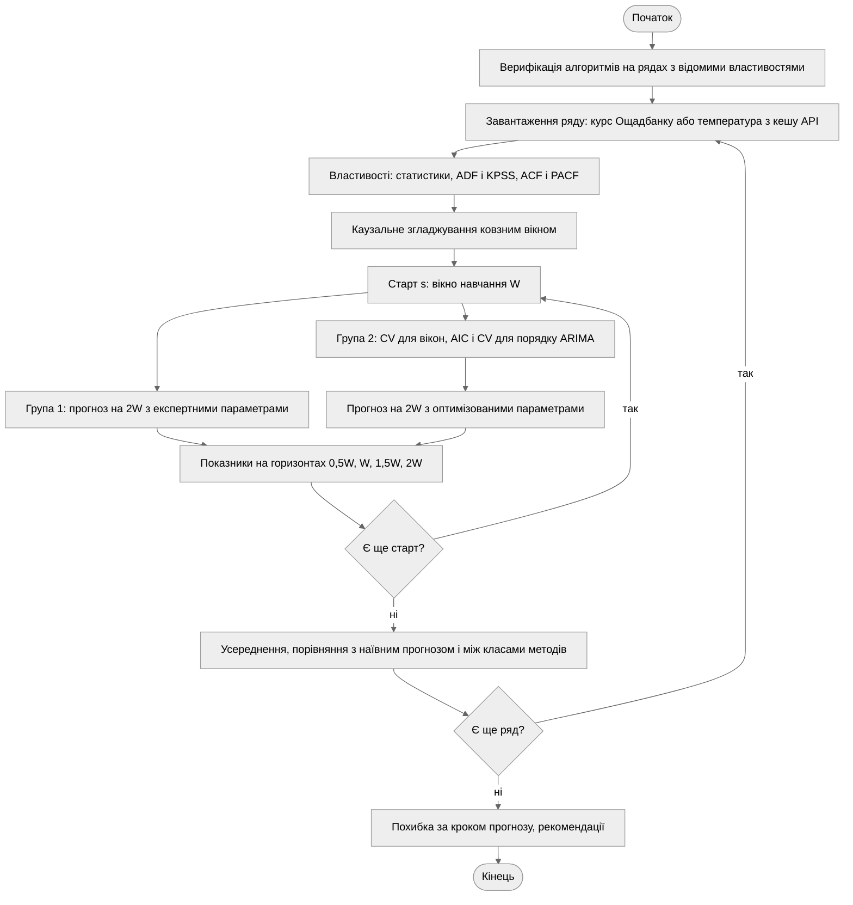

Рисунок 1 – Блок-схема алгоритму програми

Після верифікації алгоритмів кожен ряд проходить однаковий конвеєр. Для кожного старту
walk-forward перевірки виконуються дві гілки: група 1 прогнозує з фіксованими
параметрами, група 2 спершу підбирає параметри за вікном навчання, а потім прогнозує.
Обидві гілки оцінюються за тими самими показниками на тих самих горизонтах, тож
ефект оптимізації вимірюється напряму.

## 3.3. Опис структури проекту програми

```
project/
├── justfile           рецепти запуску та збірки звіту
├── pyproject.toml     залежності лабораторної роботи
├── data/              кеш температури Києва (CSV)
├── out/               графіки, які генерує програма
└── src/
    ├── main.py          точка входу
    ├── loaders.py       завантаження даних
    ├── properties.py    властивості ряду
    ├── smoothing.py     алгоритми ковзного вікна
    ├── arima.py         ARIMA, підбір порядку
    ├── learning.py      статистичне навчання
    ├── evaluation.py    метрики, бектест, CV
    ├── study.py         етапи для одного ряду
    ├── figures.py       зведені графіки
    ├── plots.py         оформлення графіків
    └── verify.py        верифікація алгоритмів
```

Рисунок 2 – Структура проекту

Алгоритми (`smoothing.py`, `arima.py`, `learning.py`) і оцінювання (`evaluation.py`)
не залежать від конкретного ряду. Відмінності між рядами – методи, параметри групи 1,
сітки оптимізації – задаються конфігурацією в `study.py`.

Використані бібліотеки: `numpy` – обчислення; `pandas` – ковзні вікна і таблиці;
`statsmodels` – ARIMA, тести ADF, KPSS і Льюнга–Бокса, ACF і PACF; `scipy` – статистики;
`requests` – запит до API; `matplotlib` – візуалізація.

## 3.4. Результати роботи програми

Усі результати отримано за `seed = 42` і відтворюються при повторному запуску.

### Етап 1. Властивості рядів

Таблиця 2 – Властивості рядів

| Ряд | $m$ | $\sigma$ | Асиметрія | Ексцес | $p_{ADF}$ | $p_{KPSS}$ | Стаціонарний |
| -------------------------- | -------------- | ------------- | --------------------- | ---------------- | --------------- | -------------- | ------------------------------- |
| Курс, грн | 36,481 | 4,374 | –0,761 | –0,972 | 0,253 | 0,010 | ні |
| Приріст курсу | 0,035 | 0,452 | 11,109 | 183,476 | < 0,001 | 0,100 | так |
| Температура, °C | 9,839 | 9,547 | –0,102 | –0,962 | 0,004 | 0,100 | так |
| Аномалія температури | 0,000 | 3,671 | –0,426 | 0,599 | < 0,001 | 0,100 | так |

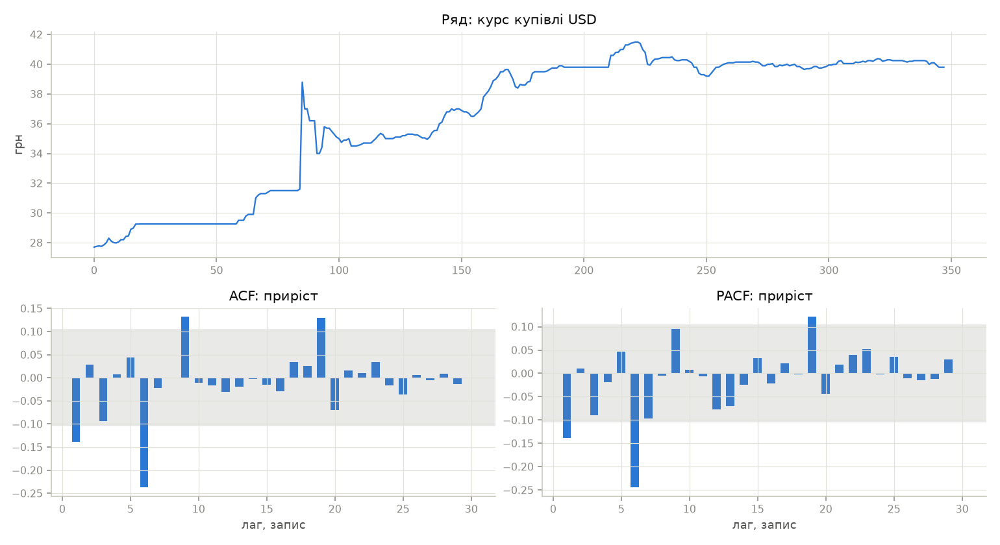

Рисунок 3 – Курс купівлі USD, ACF і PACF його приростів

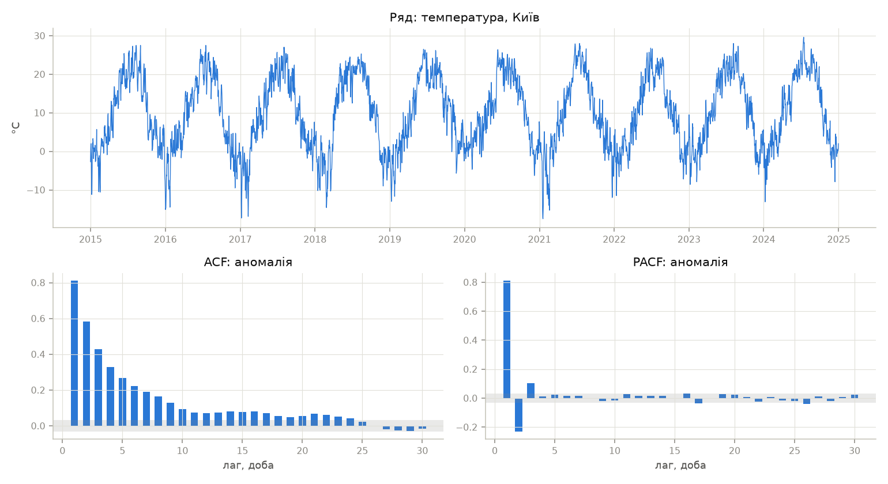

Рисунок 4 – Температура Києва, ACF і PACF аномалій

Курс нестаціонарний, його прирости стаціонарні, тобто $d = 1$. Автокореляція приростів
слабка: ACF(1) = –0,139, значущі лише окремі лаги PACF (1, 6, 19), хоча тест
Льюнга–Бокса відкидає некорельованість ($p = 6 \cdot 10^{-4}$). Ряд близький до
випадкового блукання, і для нього обрано ARIMA(1, 1, 1) – найпростішу модель, що
враховує короткий зв'язок приростів.

Температура стаціонарна вже без перетворень: сезонний цикл періодичний і не
накопичується. Аномалії (відхилення від тренду з трьома гармоніками) сильно
автокорельовані: ACF(1) = 0,813, PACF значуща на лагах 1–3. Для групи 1 обрано
регресію на три гармоніки з AR(1)-похибкою.

### Етап 2. Каузальне згладжування

Показники згладжування: СКВ відхилення $y - s$, зміщення (додатне – згладжена крива
запізнюється на зростанні) і гладкість – відношення СКВ приростів згладженої кривої
до СКВ приростів ряду.

Таблиця 3 – Каузальне згладжування курсу (СКВ приростів ряду 0,451 грн)

| Алгоритм | СКВ відхилення, грн | Зміщення, грн | Гладкість |
| --- | --- | --- | --- |
| SMA, $w = 10$ | 0,621 | 0,159 | 0,232 |
| WMA, $w = 10$ | 0,495 | 0,105 | 0,281 |
| Медіана, $w = 10$ | 0,777 | 0,156 | 0,451 |
| EMA, $\alpha = 0{,}18$ | 0,514 | 0,160 | 0,250 |
| Ковзний МНК, $w = 20$ | 0,572 | –0,007 | 0,328 |

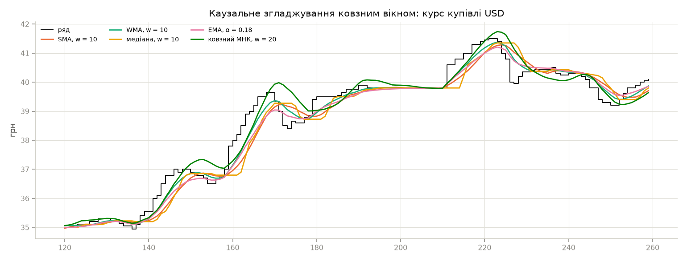

Рисунок 5 – Каузальне згладжування курсу ковзним вікном

Таблиця 4 – Каузальне згладжування температури (СКВ приростів ряду 2,252 °C)

| Алгоритм | СКВ відхилення, °C | Зміщення, °C | Гладкість |
| --- | --- | --- | --- |
| SMA, $w = 30$ | 4,130 | 0,004 | 0,103 |
| WMA, $w = 30$ | 3,502 | 0,003 | 0,124 |
| Медіана, $w = 30$ | 4,246 | –0,125 | 0,140 |
| EMA, $\alpha = 0{,}06$ | 3,789 | 0,006 | 0,116 |
| Ковзний МНК, $w = 60$ | 3,532 | –0,005 | 0,140 |

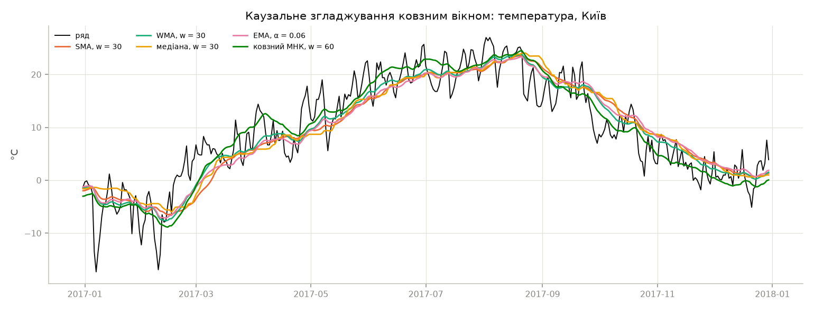

Рисунок 6 – Каузальне згладжування температури ковзним вікном

Усі ковзні середні на курсі, що росте, запізнюються на 0,10–0,16 грн. Ковзний МНК
запізнення не має (–0,007), бо продовжує локальний тренд, але на розворотах
проскакує: на рисунку 5 це видно біля записів 150, 170 і 222. WMA дає найменше
відхилення від ряду ціною трохи меншої гладкості, ніж у SMA: більша вага нових
відліків зменшує запізнення. Медіана найменш гладка: на ступінчастому курсі вона
перескакує між рівнями, зате ігнорує одиночні сплески. На температурі зміщення немає:
за рік сезонні зростання й спадання компенсуються.

### Етап 3. Екстраполяція з параметрами групи 1

Таблиця 5 – Параметри групи 1

| Метод | Курс | Температура |
| --- | --- | --- |
| SMA | $w = 10$ | $w = 30$ |
| WMA, медіана | $w = 10$ | – |
| EMA | $\alpha = 0{,}3$ | $\alpha = 0{,}1$ |
| Ковзний МНК | $w = 20$ | $w = 60$ |
| Сезонне ковзне середнє | – | 2 роки, ±7 діб |
| ARIMA | (1, 1, 1) | 3 гармоніки + AR(1) |
| МНК-поліном | степінь 2 | степінь 2 |
| МНК + гармоніки | – | 3 гармоніки |
| α-β фільтр | $N = 20$ | $N = 60$ |

Таблиця 6 – RMSE екстраполяції курсу, грн, 5 стартів

| Метод | 0,5W | 1W | 1,5W | 2W | MASE, 2W | MAPE, 2W, % |
| --- | --- | --- | --- | --- | --- | --- |
| Наївний | 1,959 | 3,491 | 3,985 | 4,162 | 19,401 | 9,679 |
| SMA | 2,047 | 3,578 | 4,073 | 4,251 | 19,799 | 9,910 |
| WMA | 2,004 | 3,523 | 4,015 | 4,192 | 19,541 | 9,767 |
| Медіана | 2,051 | 3,555 | 4,045 | 4,221 | 19,698 | 9,861 |
| EMA | 1,992 | 3,505 | 3,996 | 4,172 | 19,460 | 9,722 |
| Ковзний МНК | 2,692 | 4,619 | 6,311 | 8,026 | 35,149 | 17,656 |
| ARIMA | 1,984 | 3,509 | 4,002 | 4,179 | 19,474 | 9,725 |
| МНК-поліном | 4,801 | 9,275 | 15,963 | 24,810 | 101,470 | 50,857 |
| α-β фільтр | 2,329 | 3,929 | 5,275 | 6,587 | 28,954 | 14,517 |

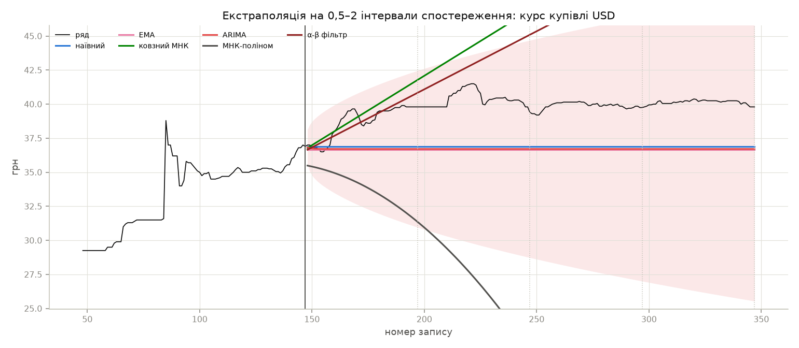

Рисунок 7 – Екстраполяція курсу на 0,5–2 інтервали з останнього старту

Таблиця 7 – RMSE екстраполяції температури, °C, 5 стартів

| Метод | 0,5W | 1W | 1,5W | 2W | MASE, 2W |
| --- | --- | --- | --- | --- | --- |
| Наївний | 14,429 | 14,292 | 14,224 | 14,273 | 6,891 |
| SMA | 13,910 | 13,887 | 13,845 | 13,873 | 6,612 |
| EMA | 13,531 | 13,500 | 13,449 | 13,475 | 6,399 |
| Ковзний МНК | 35,580 | 57,365 | 79,861 | 102,561 | 52,952 |
| Сезонне ковзне середнє | 4,305 | 4,245 | 4,104 | 4,040 | 1,849 |
| ARIMA | 4,337 | 4,424 | 4,410 | 4,489 | 2,070 |
| МНК-поліном | 16,627 | 31,076 | 53,081 | 81,813 | 38,516 |
| МНК + гармоніки | 4,341 | 4,438 | 4,429 | 4,507 | 2,082 |
| α-β фільтр | 39,334 | 64,813 | 91,004 | 117,385 | 60,439 |

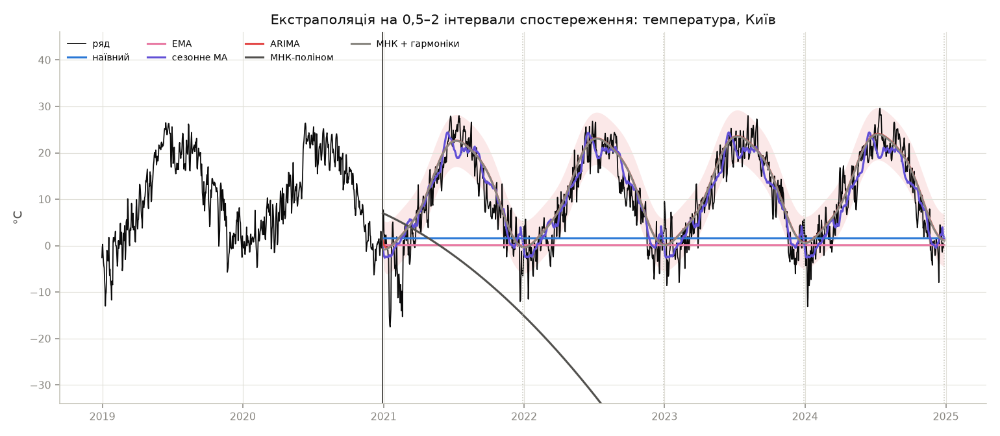

Рисунок 8 – Екстраполяція температури на 0,5–2 інтервали з останнього старту

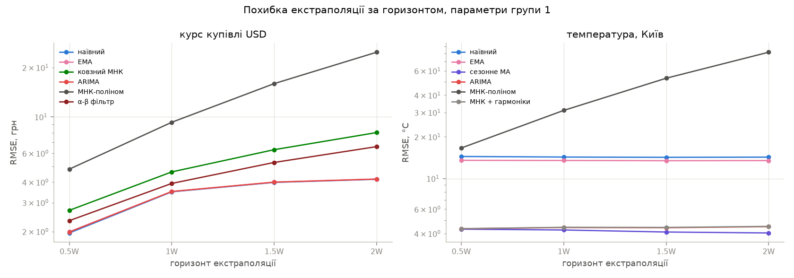

Рисунок 9 – RMSE екстраполяції за горизонтом, логарифмічна шкала

На курсі методи розділились на дві групи. Методи зі сталим прогнозом (SMA, WMA, медіана,
EMA) і ARIMA(1, 1, 1) мають RMSE у межах 2 % від наївного прогнозу. Жоден не кращий
за нього: для ряду, близького до випадкового блукання, найкращий прогноз – останнє
значення. Методи, що продовжують тренд (ковзний МНК, α-β фільтр, поліном), на
горизонті 2W помиляються в 1,6–6 разів сильніше. Тренд, оцінений на ділянці зростання,
продовжується далі, а курс після девальвації стабілізувався. Квадратичний поліном
на рисунку 7 іде вниз, бо на останньому вікні зростання сповільнювалось.

Покриття 90 % інтервалу ARIMA на курсі – 100 % на всіх горизонтах. Інтервал, ширший
за 20 грн на горизонті 2W, формально коректний, але практично малокорисний: дисперсію шуму завищує
стрибок 24.05.2022, що потрапив у вікно навчання.

На температурі методи без сезонної складової (SMA, EMA, наївний) дають RMSE 13,5–14,4 °C,
тобто розкид самого річного циклу. Сезонне ковзне середнє, ARIMA з гармоніками
і МНК з гармоніками мають 4,0–4,5 °C, що близько до СКВ аномалій (3,67 °C). На горизонті
2W найкраще сезонне ковзне середнє. Прогнози ARIMA і МНК з гармоніками на рисунку 8
майже збігаються: AR-складова згасає за кілька днів, і далі лишається та сама
гармонічна функція. Покриття інтервалу ARIMA – 82–85 % замість 90 %.

### Етап 4. Якість моделі ARIMA

Таблиця 8 – Якість моделей ARIMA на першому вікні

| Ряд | Модель | AIC | BIC | $p$ Льюнга–Бокса |
| --- | --- | --- | --- | --- |
| Курс | група 1: (1, 1, 1) | 240,54 | 248,33 | 0,871 |
| Курс | група 2: (1, 1, 1) + дрейф | 238,71 | 249,09 | 0,927 |
| Температура | група 1: 3 гармоніки + AR(1) | 3196,23 | 3242,16 | < 0,001 |
| Температура | група 2: 1 гармоніка + ARMA(2, 2) | 3131,21 | 3172,55 | 0,645 |

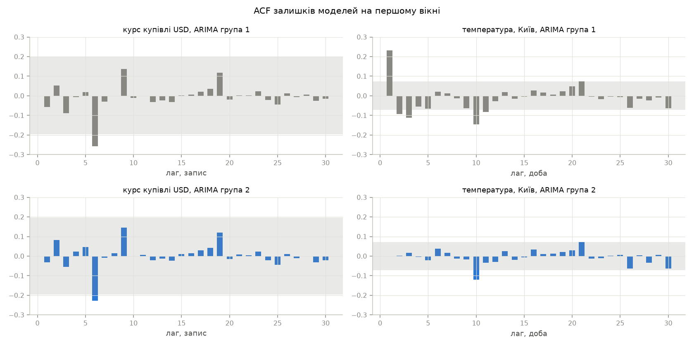

Рисунок 10 – ACF залишків моделей ARIMA груп 1 і 2 на першому вікні

Для курсу модель групи 1 адекватна: залишки некорельовані ($p = 0{,}871$), оцінки
$\varphi = 0{,}579$, $\theta = -0{,}754$ майже компенсують одна одну, тож модель
близька до випадкового блукання. Перебір 48 моделей дав найменший AIC для тієї самої
моделі з дрейфом 0,079 грн за запис, але за BIC вона гірша. Різниця AIC 1,8 мала.

Для температури модель групи 1 неадекватна: залишки AR(1) корельовані
($p < 0{,}001$), що відповідає значущим лагам 2–3 PACF. Перебір 36 моделей знизив AIC
на 65 одиниць і зробив залишки білими ($p = 0{,}645$). Одна гармоніка виявилась
достатньою: ту саму кількість гармонік обрала і крос-валідація МНК-моделі (етап 5), тож
вищі гармоніки на двох роках даних зайві.

### Етап 5. Оптимізація параметрів

Таблиця 9 – Параметри групи 2, обрані на п'яти стартах, курс

| Метод | Обрані значення |
| --- | --- |
| SMA, $w$ | 2; 3; 2; 2; 7 |
| WMA, $w$ | 2; 5; 3; 3; 20 |
| Медіана, $w$ | 2; 3; 2; 2; 20 |
| EMA, $\alpha$ | 1; 0,5; 0,5; 0,5; 0,2 |
| Ковзний МНК, $w$ | 10; 20; 75; 75; 10 |
| МНК-поліном, степінь | 3; 2; 1; 1; 0 |
| α-β фільтр, $N$ | 10; 20; 100; 50; 10 |
| ARIMA (AIC) | (1,1,1) + дрейф; (0,1,1); (0,1,1); (0,1,1); (1,1,1) + дрейф |
| ARIMA (CV) | (1,1,1) + дрейф; три рази (2,1,1) + дрейф; (1,1,0) |

Таблиця 10 – Параметри групи 2, обрані на п'яти стартах, температура

| Метод | Обрані значення |
| --- | --- |
| SMA, $w$ | 365 на всіх стартах |
| EMA, $\alpha$ | 0,01 на всіх стартах |
| Ковзний МНК, $w$ | 365; 365; 30; 30; 365 |
| Сезонне ковзне середнє | ±30 діб; 2 роки на чотирьох стартах, 1 рік на одному |
| МНК-поліном, степінь | 0 на всіх стартах |
| МНК + гармоніки, $K$ | 1; 1; 1; 1; 2 |
| α-β фільтр, $N$ | 365 на всіх стартах |
| ARIMA (AIC) | 1–3 гармоніки + ARMA(1,1), на першому старті ARMA(2,2) |
| ARIMA (CV) | 1 гармоніка + ARMA(1,1), на третьому старті ARMA(2,1) |

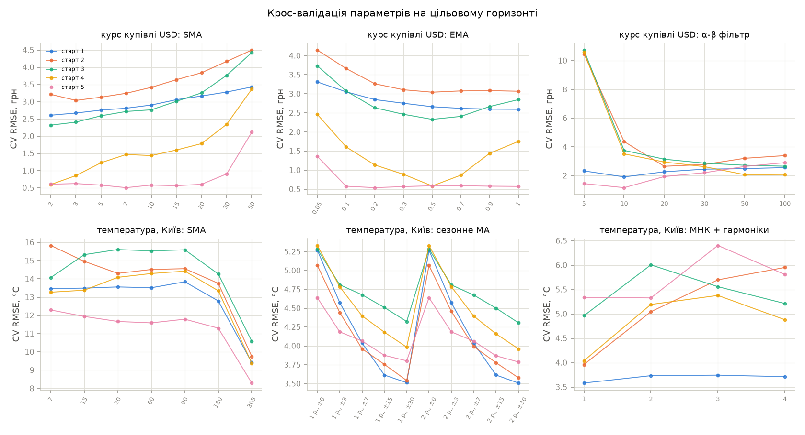

Рисунок 11 – CV-похибка залежно від параметра на кожному старті

Таблиця 11 – RMSE до і після оптимізації, курс, грн

| Метод | Група 1, 1W | Група 2, 1W | Група 1, 2W | Група 2, 2W | Кращий старт |
| --- | --- | --- | --- | --- | --- |
| SMA | 3,578 | 3,549 | 4,251 | 4,221 | 2 з 5 |
| WMA | 3,523 | 3,656 | 4,192 | 4,333 | 1 з 5 |
| Медіана | 3,555 | 3,777 | 4,221 | 4,455 | 2 з 5 |
| EMA | 3,505 | 3,584 | 4,172 | 4,259 | 2 з 5 |
| Ковзний МНК | 4,619 | 4,165 | 8,026 | 9,307 | 1 з 5 |
| МНК-поліном | 9,275 | 13,758 | 24,810 | 47,601 | 3 з 5 |
| α-β фільтр | 3,929 | 3,050 | 6,587 | 6,405 | 2 з 5 |
| ARIMA (AIC) | 3,509 | 3,196 | 4,179 | 5,108 | 2 з 5 |
| ARIMA (CV) | 3,509 | 1,868 | 4,179 | 4,876 | 1 з 5 |
| ARIMA(1, 1, 15) | 3,509 | 3,323 | 4,179 | 3,818 | 4 з 5 |

Таблиця 12 – RMSE до і після оптимізації, температура, °C

| Метод | Група 1, 1W | Група 2, 1W | Група 1, 2W | Група 2, 2W | Кращий старт |
| --- | --- | --- | --- | --- | --- |
| SMA | 13,887 | 9,669 | 13,873 | 9,479 | 5 з 5 |
| EMA | 13,500 | 9,806 | 13,475 | 9,645 | 5 з 5 |
| Ковзний МНК | 57,365 | 20,003 | 102,561 | 34,555 | 4 з 5 |
| Сезонне ковзне середнє | 4,245 | 4,121 | 4,040 | 3,920 | 5 з 5 |
| МНК-поліном | 31,076 | 9,659 | 81,813 | 9,471 | 5 з 5 |
| МНК + гармоніки | 4,438 | 4,237 | 4,507 | 4,383 | 3 з 5 |
| α-β фільтр | 64,813 | 11,470 | 117,385 | 14,432 | 5 з 5 |
| ARIMA (AIC) | 4,424 | 4,325 | 4,489 | 4,498 | 2 з 5 |
| ARIMA (CV) | 4,424 | 4,217 | 4,489 | 4,375 | 3 з 5 |

«Кращий старт» – на скількох стартах із п'яти оптимізований варіант мав меншу RMSE
на горизонті 2W.

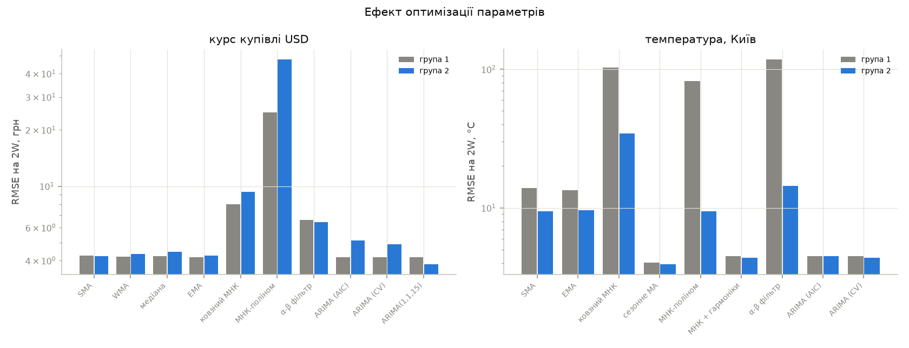

Рисунок 12 – RMSE на горизонті 2W з параметрами груп 1 і 2

На температурі оптимізація дієва для всіх методів. Сезонне ковзне середнє покращилось
на всіх п'яти стартах: CV обрала найширше вікно ±30 діб, що усереднює більше значень
і краще придушує погодний шум. Методи без сезонної складової CV привела до вироджених
варіантів: SMA з вікном 365, EMA з $\alpha = 0{,}01$, поліном нульового степеня,
α-β фільтр з пам'яттю 365. Усі вони дають середньорічну температуру. Похибка впала
з 13–117 °C до 9,5–14 °C, тобто оптимізація сама виявила, що найкращий несезонний
прогноз – кліматична норма. ARIMA (CV) покращила і RMSE, і стабільність вибору:
1 гармоніка + ARMA(1,1) на чотирьох стартах із п'яти.

На курсі оптимізація не дала стабільного виграшу. Для методів зі сталим прогнозом CV
обирає найменше вікно ($w = 2$–3, $\alpha \to 1$), тобто наближається до наївного
прогнозу, а він і так був межею якості. Для ARIMA і методів з трендом проявилась
принципова проблема: параметри підбираються на горизонті $H = W/4$, а перевіряються
на $2W$. ARIMA (CV) з дрейфом на горизонті 1W вдвічі точніша за модель групи 1
(1,868 проти 3,509 грн), бо тренд зростання курсу протягом $W$ записів зберігався.
На 2W цей тренд уже зламався, і похибка зросла. Поліном, для якого на перших стартах
CV обрала степені 3 і 2, підняв середню RMSE на 2W до 47,6 грн. AIC оптимізує підгонку на крок уперед і на довгий горизонт
не переноситься.

ARIMA(1, 1, 15) з прикладу до роботи на горизонті 2W випадково виявилась найкращою
(3,818 грн), але на 0,5W вона гірша за наївний прогноз (2,24 проти 1,96 грн), а 15
параметрів MA на 100 відліках – явне перенавчання. Кращий результат на довгому
горизонті – збіг з напрямком подальшого руху курсу, а не властивість моделі.

### Етап 6. Порівняння ковзного вікна і статистичного навчання

Для кожного методу взято кращий за RMSE на 2W варіант: з параметрами групи 1
або групи 2 (позначено *).

Таблиця 13 – Показники ефективності, курс, грн

| Метод | Клас | 0,5W | 1W | 2W | Зміщення, 2W | MASE, 2W | Ранг |
| --------------------------- | ---------------------- | --------------- | --------------- | --------------- | ----------------------- | ---------------- | ------------ |
| Наївний | еталон | 1,959 | 3,491 | 4,162 | –3,839 | 19,401 | 1 |
| EMA | ковзне вікно | 1,992 | 3,505 | 4,172 | –3,846 | 19,460 | 2 |
| ARIMA | ARIMA | 1,984 | 3,509 | 4,179 | –3,854 | 19,474 | 3 |
| WMA | ковзне вікно | 2,004 | 3,523 | 4,192 | –3,867 | 19,541 | 4 |
| SMA* | ковзне вікно | 2,022 | 3,549 | 4,221 | –3,899 | 19,682 | 5 |
| Медіана | ковзне вікно | 2,051 | 3,555 | 4,221 | –3,894 | 19,698 | 6 |
| α-β фільтр* | стат. навчання | 1,512 | 3,050 | 6,405 | 2,819 | 25,983 | 7 |
| Ковзний МНК | ковзне вікно | 2,692 | 4,619 | 8,026 | 1,892 | 35,149 | 8 |
| МНК-поліном | стат. навчання | 4,801 | 9,275 | 24,810 | 6,527 | 101,470 | 9 |

Таблиця 14 – Показники ефективності, температура, °C

| Метод | Клас | 0,5W | 1W | 2W | Зміщення, 2W | MASE, 2W | Ранг |
| --------------------------- | ---------------------- | --------------- | --------------- | --------------- | ----------------------- | ---------------- | ------------ |
| Сезонне MA* | ковзне вікно | 4,167 | 4,121 | 3,920 | –0,197 | 1,814 | 1 |
| ARIMA (CV) | ARIMA | 4,117 | 4,217 | 4,375 | 0,744 | 2,034 | 2 |
| МНК + гармоніки* | стат. навчання | 4,138 | 4,237 | 4,383 | 0,776 | 2,040 | 3 |
| МНК-поліном* | стат. навчання | 9,699 | 9,659 | 9,471 | –0,175 | 4,712 | 4 |
| SMA* | ковзне вікно | 9,702 | 9,669 | 9,479 | –0,111 | 4,718 | 5 |
| EMA* | ковзне вікно | 9,838 | 9,806 | 9,645 | –1,605 | 4,761 | 6 |
| Наївний | еталон | 14,429 | 14,292 | 14,273 | –10,466 | 6,891 | 7 |
| α-β фільтр* | стат. навчання | 10,523 | 11,470 | 14,432 | –8,940 | 6,976 | 8 |
| Ковзний МНК* | ковзне вікно | 13,817 | 20,003 | 26,992 | 27,499 | 17,078 | 9 |

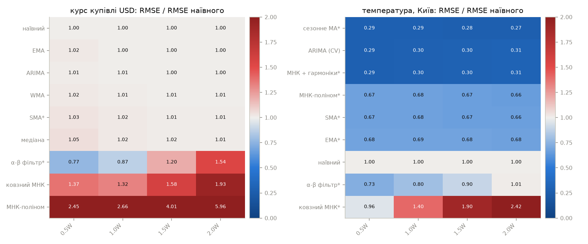

Рисунок 13 – RMSE методів відносно наївного прогнозу

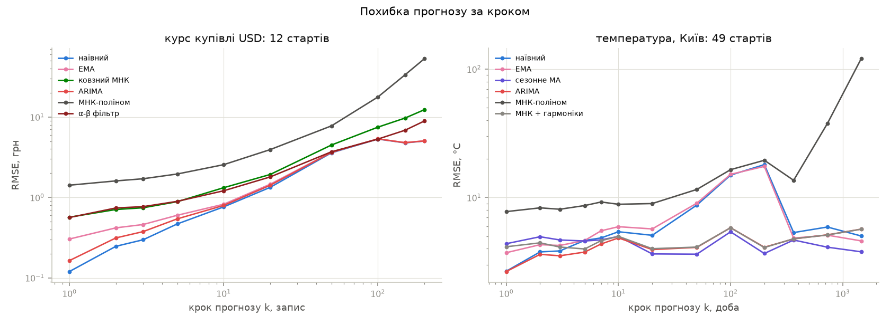

Рисунок 14 – RMSE прогнозу залежно від кроку $k$, параметри групи 1

Порівняння за горизонтами 0,5–2W приховує поведінку на коротких кроках, тому окремо
обчислено RMSE для кожного кроку $k$ з частими стартами: 12 для курсу, 49 для
температури (рисунок 14).

На курсі наївний прогноз найкращий на всіх кроках: 0,120 грн на першому кроці проти
0,164 у ARIMA і 0,304 у EMA. На температурі ARIMA найкраща на кроках 1–5
(2,66 °C на першому кроці проти 4,14 у МНК з гармоніками і 4,38 у сезонного
середнього). Це час кореляції аномалій: AR-складова передає відхилення сьогоднішньої
погоди на кілька днів уперед. Після 20 днів перевага переходить до сезонного ковзного
середнього, а на кроці 1460 воно має 3,79 °C проти 5,68 у ARIMA і МНК з гармоніками.
Детермінована гармонічна функція, оцінена за два роки, переносить їхні особливості
на чотири роки вперед, а середнє по днях різних років – ні.

## 3.5. Програмний код

Нижче наведено фрагменти, що безпосередньо реалізують моделі розділу 3.1. Повний код
проекту додається до звіту окремим архівом.

Прогноз алгоритмами ковзного вікна:

```python
def forecast_flat(train, h, w, kind="SMA"):
    tail = np.asarray(train[-w:], dtype=float)
    level = (
        np.median(tail)
        if kind == "median"
        else tail @ window_weights(len(tail), kind)
    )
    return np.full(h, level)


def forecast_line(train, h, w):
    level, slope = local_line(train, w)
    return level + slope * np.arange(1, h + 1)


def forecast_seasonal(train, h, years, half_width):
    train = np.asarray(train, dtype=float)
    n = len(train)
    out = np.empty(h)
    for k in range(h):
        first = int(np.ceil((k + 1 + half_width) / YEAR))
        values = []
        for m in range(first, first + years):
            centre = n + k - round(m * YEAR)
            lo, hi = (
                max(centre - half_width, 0),
                min(centre + half_width + 1, n),
            )
            if lo < hi:
                values.append(train[lo:hi])
        out[k] = np.concatenate(values).mean() if values else train[-1]
    return out
```

Підбір порядку ARIMA за AIC з перевіркою залишків:

```python
def select(
    y, p_max, d_values, q_max, harmonics=(0,), start=0, drifts=(False,)
):
    rows = grid(y, p_max, d_values, q_max, harmonics, start, drifts)
    passed = [row for row in rows if row[2] > 0.05]
    best = (passed or rows)[0]
    return best[3], best[4], best[5], rows
```

Walk-forward перевірка на горизонтах 0,5–2W:

```python
def backtest(series, window, origins, forecaster, horizons=HORIZONS):
    y = np.asarray(series, dtype=float)
    steps = int(max(horizons) * window)
    rows, paths = [], []
    for s in origins:
        train, test = y[s : s + window], y[s + window : s + window + steps]
        result = forecaster(train, steps, s)
        mean, interval = (
            result if isinstance(result, tuple) else (result, None)
        )
        mean = np.asarray(mean, dtype=float)
        paths.append((s, mean, interval))
        scale = naive_scale(train)
        for h in horizons:
            k = int(h * window)
            part = None if interval is None else interval[:k]
            rows.append(
                {"старт": s, "горизонт": h}
                | metrics(test[:k], mean[:k], scale, part)
            )
    table = pd.DataFrame(rows)
    return (
        table.groupby("горизонт")
        .mean(numeric_only=True)
        .drop(columns="старт"),
        table,
        paths,
    )
```

Крос-валідація параметрів усередині вікна навчання:

```python
def cv_score(train, forecaster, horizon, folds, start=0):
    train = np.asarray(train, dtype=float)
    cut_points = np.linspace(
        len(train) // 2, len(train) - horizon, folds
    ).astype(int)
    errors = []
    for cut in cut_points:
        e = (
            point(forecaster(train[:cut], horizon, start))
            - train[cut : cut + horizon]
        )
        errors.append(np.mean(e**2))
    return np.sqrt(np.mean(errors))


def tune(train, make_forecaster, candidates, horizon, folds, start=0):
    scores = {
        c: cv_score(train, make_forecaster(c), horizon, folds, start)
        for c in candidates
    }
    return min(scores, key=lambda c: scores[c]), scores
```

Вибір порядку ARIMA за CV серед найкращих за AIC:

```python
def arima_cv(cfg, chosen):
    space = cfg["arima_space"]

    def forecast(train, h, start):
        rows = arima.grid(train, start=start, **space)[:TOP_AIC]
        scores = {}
        for _, _, _, order, k, drift in rows:
            f = arima_forecaster(order, k, drift)
            scores[(order, k, drift)] = evaluation.cv_score(
                train, f, cfg["cv_horizon"], CV_FOLDS, start
            )
        best = min(scores, key=lambda c: scores[c])
        chosen.append(best)
        return arima.forecast(
            arima.fit(train, best[0], best[1], start, best[2]), h
        )

    return forecast
```

## 3.6. Аналіз результатів та верифікація

Таблиця 15 – Верифікація алгоритмів

| Перевірка | Задано | Отримано |
| --- | --- | --- |
| Оцінка ARIMA(1,1,1), $n = 300$, 50 реалізацій | $\varphi = 0{,}5$; $\theta = 0{,}3$ | $\varphi = 0{,}496 \pm 0{,}069$; $\theta = 0{,}310 \pm 0{,}087$ |
| Вибір порядку AIC + Льюнг–Бокс | (1, 1, 1) | у 30 з 50 реалізацій |
| Покриття 90 % інтервалу, AR(1), $\varphi = 0{,}8$ | 0,90 | 0,882 |
| Запізнення SMA, $w = 11$, тренд $b = 0{,}2$ | 1,000 | 1,000 |
| Запізнення EMA, $\alpha = 1/6$, тренд $b = 0{,}2$ | 1,000 | 1,000 |
| Екстраполяція прямої ковзним МНК і α-β фільтром | 0 | $1{,}4 \cdot 10^{-14}$ |
| Сезонне ковзне середнє на чистій синусоїді, амплітуда 10 | 0 | 0,065 |

Верифікація ARIMA. Оцінки параметрів незміщені в межах одного СКВ. AIC обирає
справжній порядок у 60 % випадків. Решта – близькі моделі, як-от (2,1,0) чи (0,1,2),
які на 300 відліках статистично не відрізнити від (1,1,1). Тому порядок, обраний
за AIC, у роботі розглядається як одна з рівноцінних моделей, а не як справжня
структура процесу. Звідси й підхід ARIMA (CV) – вибір серед кількох кращих за AIC
моделей за якістю прогнозу. Покриття інтервалу 88 % на модельному AR(1) підтверджує
правильність інтервалів. Отже, 82–85 % на температурі – властивість даних, а не похибка
реалізації: аномалії мають довшу пам'ять, ніж описує ARMA (у ЛР 4 показник Херста
0,67), тож невизначеність довгого прогнозу недооцінена.

Верифікація алгоритмів ковзного вікна. Запізнення SMA і EMA на лінійному тренді
збігається з теоретичним до третього знаку, екстраполяція прямої точна до похибки
округлення. Похибка сезонного середнього 0,065 при амплітуді 10 пояснюється зсувом
рік-аналога на 365 замість 365,25 доби.

Придатність результатів. Для температури сезонне ковзне середнє з оптимізованим вікном
дає RMSE 3,92 °C на горизонті до 4 років при СКВ аномалій 3,67 °C. Прогноз пояснює весь
сезонний цикл і зміщений лише на –0,2 °C. На горизонтах до 5 днів його доповнює ARIMA:
2,7–3,8 °C. Для курсу жоден метод не перевершив наївний прогноз, і це закономірність,
а не недолік реалізації: ряд з некорельованими приростами (Херст 0,51, ЛР 4) не містить
інформації про напрямок руху. Придатним результатом тут є рівень останнього вікна разом
з інтервалом невизначеності.

Рекомендації щодо вибору методу залежно від властивостей ряду наведено в таблиці 16.

Таблиця 16 – Рекомендації щодо вибору методу

| Властивості ряду | Рекомендовано | Не рекомендовано |
| --- | --- | --- |
| Нестаціонарний, прирости некорельовані (випадкове блукання), стрибки | наївний прогноз, EMA з $\alpha \to 1$, ARIMA(0,1,1); вікно мінімальне | екстраполяція тренду: ковзний МНК, поліном, α-β фільтр, дрейф ARIMA на горизонті понад вікно |
| Сезонний, стаціонарні аномалії, горизонт до часу кореляції (тут до 5 діб) | регресія на гармоніки з ARMA-похибкою, порядок за AIC з перевіркою Льюнга–Бокса | несезонні SMA і EMA |
| Сезонний, горизонт понад час кореляції | сезонне ковзне середнє з широким вікном (тут ±30 діб, 2 роки) | поліноміальна екстраполяція; гармоніки з кількох років без усереднення |
| Шумний ряд, потрібне згладжування в реальному часі | WMA (менше запізнення), медіана для рядів зі стрибками | центровані вікна – вони використовують майбутні відліки |
| Вибір параметрів | крос-валідація на цільовому горизонті | AIC як єдиний критерій для довгого прогнозу |

Обмеження. Перевірити горизонт $2W$ всередині вікна навчання неможливо, тому параметри
оптимізуються на $W/4$. Для методів зі сталим або сезонним прогнозом параметри
переносяться на довгий горизонт, для методів з трендом – ні. П'ять стартів на курсі
охоплюють один період історії 2022 року, тож висновки для курсу стосуються саме
режиму зі стрибками і фіксацією офіційного курсу.

# IV. Висновки

У роботі реалізовано обробку Time Series алгоритмами ковзного вікна (SMA, WMA, медіана,
EMA, ковзний МНК, сезонне ковзне середнє) та автокореляційними моделями ARIMA, зокрема
регресію на гармоніки з ARMA-похибкою. Методи порівняно з методами статистичного
навчання на двох рядах з протилежними властивостями. Виконано обидві групи вимог.

Екстраполяцію на 0,5–2 інтервали спостереження перевірено walk-forward методом.
На курсі валют методи зі сталим прогнозом і ARIMA(1,1,1) мають RMSE у межах 2 %
від наївного прогнозу (4,16 грн на 2W), а методи з екстраполяцією тренду – у 1,6–6
разів більшу. Ряд близький до випадкового блукання, і найкращий прогноз – останнє
значення. На температурі сезонне ковзне середнє, ARIMA з гармоніками і МНК
з гармоніками мають 4,0–4,5 °C проти 13,5–14,4 °C у несезонних методів.

Оптимізація параметрів дієва для сезонного ряду: сезонне ковзне середнє з вікном
±30 діб покращилось на всіх п'яти стартах до 3,92 °C. Підбір моделі ARIMA за AIC
з перевіркою Льюнга–Бокса зробив залишки білими ($p$ з < 0,001 до 0,645) і знизив AIC
на 65. Для курсу оптимізація лише наблизила методи до наївного прогнозу. Для моделей
з трендом виявлено обмеження: параметри, оптимальні на горизонті $W/4$, на горизонті
$2W$ погіршують прогноз.

Порівняння класів методів показало, що вирішальною є відповідність структури методу
властивостям ряду, а не клас методу. Сезонне ковзне середнє, модель ARIMA і МНК
з гармоніками на температурі мають близьку якість, а на курсі методи всіх класів
не кращі за наївний прогноз. На коротких кроках (до 5 діб) ARIMA точніша за сезонне
середнє в 1,6 раза, на кроках понад 20 діб – навпаки. За результатами сформовано
рекомендації щодо вибору методу залежно від стаціонарності, сезонності, пам'яті ряду
та горизонту прогнозу.

# Перелік джерел

1. Open-Meteo. Historical Weather API. URL: https://open-meteo.com/en/docs/historical-weather-api
