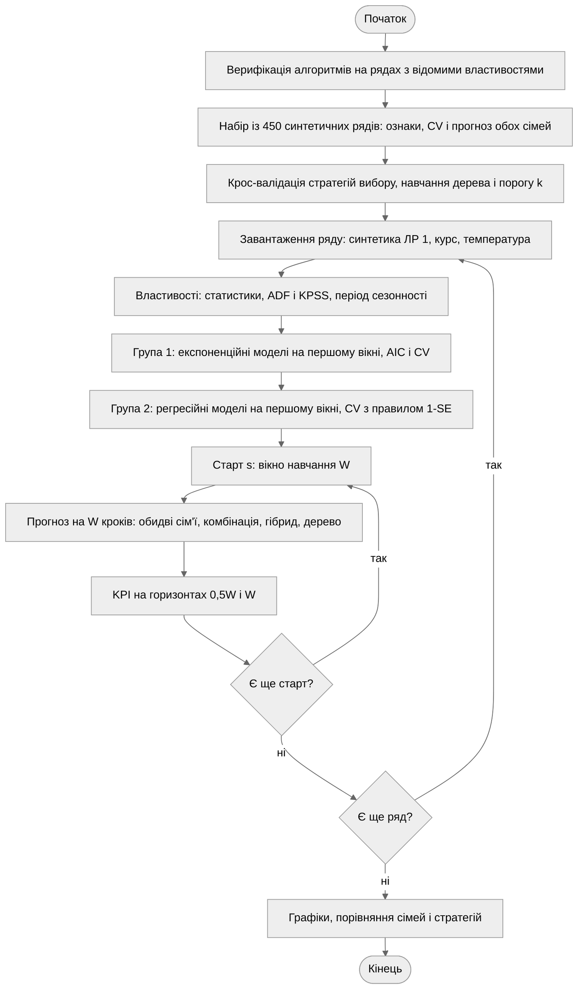
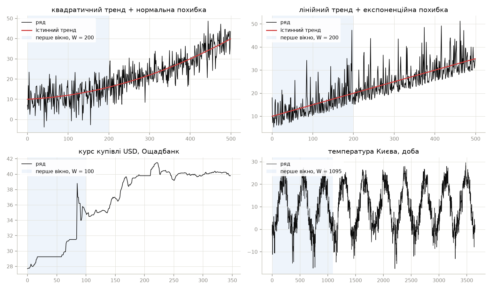
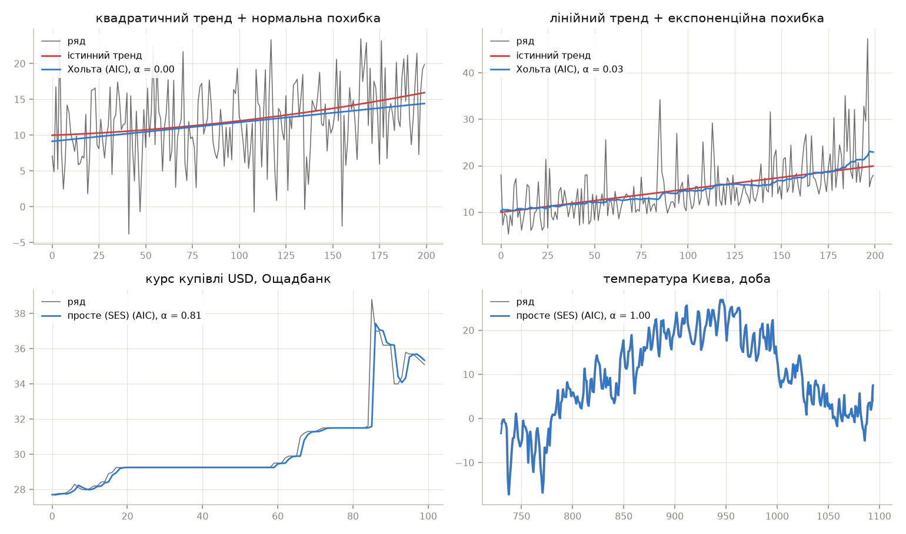
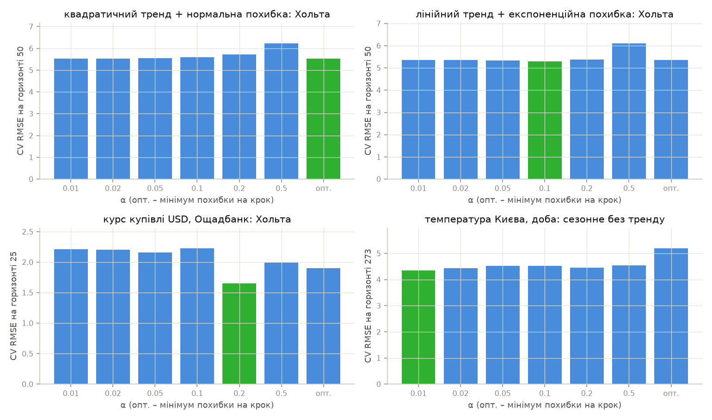
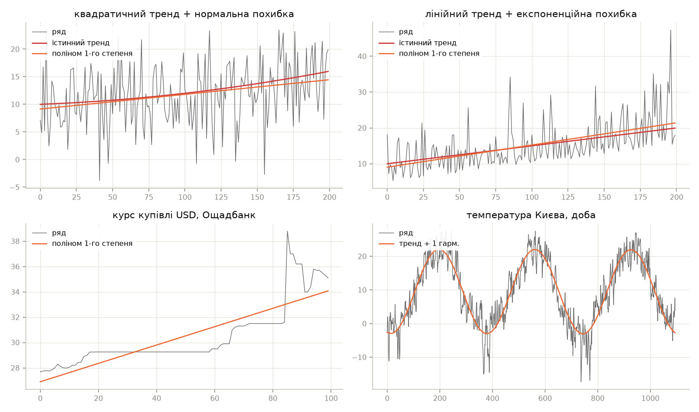
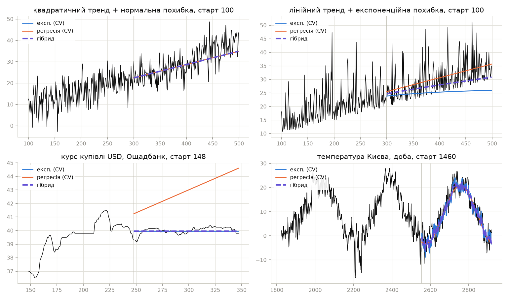
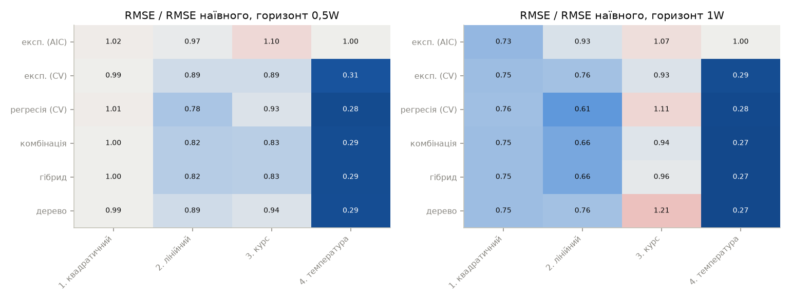
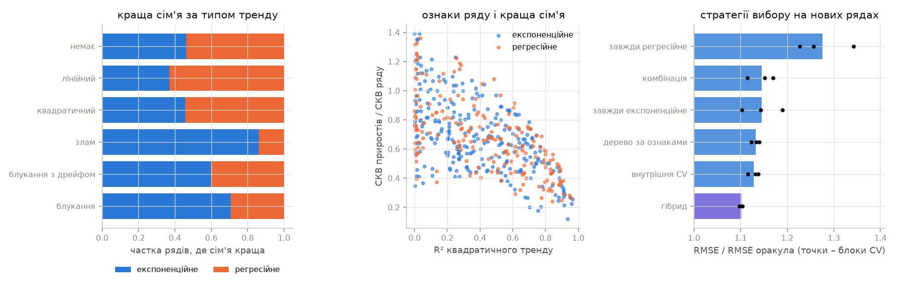

# І. Мета

Виявити, дослідити та узагальнити особливості реалізації процесів статистичного
навчання із застосуванням методів обробки Big Data масивів з використанням можливостей
мови програмування Python.

# ІІ. Завдання

Розробити програмний скрипт мовою Python, що розширює універсальну платформу обробки
Time Series експоненційним згладжуванням і регресійними моделями.

Група вимог 1. Експоненційне згладжування вхідних даних ЛР 1, 2 або самостійно обраних:

1. Дослідити дані та виявити їхні властивості.
2. Оптимально вибрати модель обробки – тип алгоритму експоненційного згладжування.
3. Обробити та екстраполювати вхідні дані.
4. Оцінити KPI моделі, результатів обробки та екстраполяції.
5. Побудувати графіки вхідних даних і результатів обробки та екстраполяції.

Група вимог 2. Ті самі етапи для обробки вхідних даних регресійними моделями.

Група вимог 3. Реалізувати R&D процеси для груп 1 і 2 та порівняти результати
експоненційного та регресійного оброблення одних і тих самих даних:

1. Оцінити KPI результатів обробки, екстраполяції та якість моделі.
2. Розробити рекомендації з ефективного використання експоненційного та регресійного
   згладжування.
3. На підставі рекомендацій розробити алгоритм вибору експоненційного або регресійного
   згладжування залежно від властивостей вхідних даних.

Обраний рівень складності – ІІ: реалізовано всі три групи вимог з власним алгоритмом
вибору за пунктом 3 групи 3.

Обробляються чотири ряди: два синтетичні ряди варіанта 8 з ЛР 1, де відомий істинний
тренд, і два реальні ряди з різними властивостями (таблиця 1).

Таблиця 1 – Вхідні дані

| Ряд | Модель або джерело | Обсяг | Вікно $W$ |
| ------------------------ | -------------------------------------------------- | ---------- | ---------- |
| 1. Квадратичний | $10^{-4} t^2 + 10^{-2} t + 10$, похибка $N(0;\ 5^2)$ | 500 | 200 |
| 2. Лінійний | $0{,}05 t + 10$, похибка $\text{Exp}(5) - 5$ | 500 | 200 |
| 3. Курс USD | курс купівлі, архів Ощадбанку | 348 | 100 |
| 4. Температура | середньодобова, Київ, Open-Meteo [1] | 3653 | 1095 |

Експоненційна похибка ряду 2 центрована: середнє нульове, але розподіл асиметричний,
з рідкими великими додатними викидами.

# ІІІ. Результати виконання лабораторної роботи

## 3.1. Синтезована математична модель

### 3.1.1. Експоненційне згладжування

Просте експоненційне згладжування (SES) оцінює рівень $l(t)$ рекурентно, прогноз
на $k$ кроків – сталий:

$$l(t) = \alpha\, y(t) + (1 - \alpha)\, l(t-1), \qquad \hat y(t+k) = l(t)$$

Модель Хольта додає нахил $b(t)$, модель із затуханням множить його на $\varphi < 1$:

$$l(t) = \alpha\, y(t) + (1 - \alpha)\,(l(t-1) + \varphi\, b(t-1))$$

$$b(t) = \beta\,(l(t) - l(t-1)) + (1 - \beta)\, \varphi\, b(t-1)$$

$$\hat y(t+k) = l(t) + (\varphi + \varphi^2 + \ldots + \varphi^k)\, b(t)$$

Без затухання $\varphi = 1$ і прогноз – пряма. Модель Хольта–Вінтерса додає
адитивну сезонну складову $c(t)$ з періодом $s$:

$$c(t) = \gamma\,(y(t) - l(t)) + (1 - \gamma)\, c(t-s)$$

$$\hat y(t+k) = l(t) + k\, b(t) + c(t + k - s)$$

Розглядаються шість структур: SES, Хольта, Хольта із затуханням, а для сезонного ряду
ще Хольта–Вінтерса, Хольта–Вінтерса із затуханням і сезонна модель без тренду.
Параметри $\alpha, \beta, \gamma, \varphi$ і початкові стани оцінюються мінімізацією
суми квадратів похибок прогнозу на один крок.

### 3.1.2. Регресійні моделі

Поліноміальна регресія за нормованим часом $\tau = t / W$:

$$y(t) = a_0 + \sum_{j=1}^{d} a_j\, \tau^j + \varepsilon(t), \qquad d = 1, 2, 3$$

Для сезонного ряду – лінійний тренд і $K$ гармонік періоду $s$:

$$y(t) = a_0 + a_1 \tau + \sum_{j=1}^{K} \left( c_j \cos \frac{2\pi j t}{s} + d_j \sin \frac{2\pi j t}{s} \right) + \varepsilon(t)$$

Багатовимірна регресія використовує як регресори $p$ попередніх значень ряду разом
з трендом і гармоніками:

$$y(t) = a_0 + \sum_{i=1}^{p} \phi_i\, y(t-i) + a_1 \tau + \sum_{j=1}^{K} (\ldots) + \varepsilon(t), \qquad p = 1, 3, 7$$

Коефіцієнти оцінюються МНК з малою гребеневою регуляризацією ($\lambda = 10^{-3}$),
що стабілізує розв'язок при майже колінеарних степенях часу. Прогноз
багатовимірної регресії рекурсивний: на кроці $k$ замість невідомих $y(t+k-i)$
підставляються власні прогнози.

### 3.1.3. Виявлення сезонності

Період $s$ визначається за періодограмою ряду без квадратичного тренду:

$$P(f) = \left| \sum_{t} r(t)\, e^{-2\pi i f t} \right|^2$$

Кандидат – найвищий локальний максимум $P(f)$ на частотах $f \le 1/4$, за винятком
трьох найнижчих. Сезонність визнається, якщо виконано дві умови:

1. Частка потужності піку (з двома сусідніми частотами) не менша за 0,1.
2. У спектрі перших різниць потужність на цій частоті перевищує медіану ±12 сусідніх
   частот щонайменше в 12 разів.

Друга умова відсіює випадкове блукання: після видалення тренду його рівні мають
«піки» на низьких частотах, а спектр різниць пласкі. Положення піку уточнюється
періодограмою з доповненням нулями до $16n$ відліків, бо сітка частот $1/n$ груба:
при $n = 200$ період 24 лежить між вузлами 22,2 і 25.

### 3.1.4. Вибір моделі

Експоненційні моделі вибираються двома способами:

1. За AIC: $\text{AIC} = n \ln(\text{SSE}/n) + 2k$, де $k$ – кількість параметрів і
   початкових станів. Критерій оцінює якість прогнозу на один крок.
2. За крос-валідацією (CV) на горизонті $H = W/4$. Вікно навчання ріжеться в чотирьох
   точках від $W/3$ до $W - H$ (для сезонних моделей – не раніше $2s$), з кожної
   прогнозується $H$ кроків. Спершу обирається структура з мінімальною CV-похибкою,
   потім для неї – $\alpha$ із сітки $\{0{,}01;\ 0{,}02;\ 0{,}05;\ 0{,}1;\ 0{,}2;\ 0{,}5\}$
   або оптимальне на крок.

Регресійні моделі вибираються за CV на тих самих точках з правилом однієї стандартної
похибки (1-SE): серед моделей, чия CV-похибка не перевищує мінімальну більш ніж на її
стандартну похибку, обирається модель з найменшою кількістю коефіцієнтів. Різниця
в межах розкиду між точками – шум, а складніша модель на довшому горизонті
екстраполюється гірше, ніж показує CV.

### 3.1.5. Показники якості

Екстраполяція перевіряється walk-forward: модель навчається на вікні
$y(s), \ldots, y(s+W-1)$ і прогнозує $W$ кроків. Показники на горизонтах $0{,}5W$
і $W$ рахуються за першими $hW$ прогнозами й усереднюються за стартами $s$.
Для $e = \hat y - y$:

$$\text{RMSE} = \sqrt{\overline{e^2}}, \quad \text{MAE} = \overline{|e|}, \quad \text{MAPE} = 100\, \overline{|e / y|}, \quad \text{зміщення} = \bar e$$

$$R^2 = 1 - \frac{\sum e^2}{\sum (y - \bar y)^2}$$

$R^2$ рахується відносно середнього тестового відрізка, тож від'ємне значення означає,
що прогноз гірший за невідоме наперед середнє майбутніх значень. Якість обробки
(згладжування) на синтетичних рядах оцінюється СКВ відхилення від істинного тренду,
на реальних – СКВ похибки на крок. Еталон – наївний прогноз $\hat y(t+k) = y(t)$.

### 3.1.6. Алгоритм вибору між сім'ями

Для нового ряду порівнюються чотири стратегії:

1. Дерево рішень за ознаками ряду (глибина 3, у листі не менше 15 рядів). Ознаки:
   $R^2$ квадратичного тренду, приріст $R^2$ від квадратичного члена (кривизна), частка
   сезонного піку, ACF(1) залишку тренду, ACF(1) приростів, $p$-значення ADF
   і відношення СКВ приростів до СКВ ряду (шум/рівень).
2. Внутрішня CV: сім'я з меншою CV-похибкою на тих самих точках розрізу вікна.
3. Комбінація: середнє прогнозів обох сімей.
4. Гібрид: одна сім'я, якщо її CV-похибка менша в $k$ разів, інакше комбінація:

$$\hat y = \begin{cases} \hat y_{exp}, & q \le 1/k \\ \hat y_{reg}, & q \ge k \\ (\hat y_{exp} + \hat y_{reg}) / 2, & \text{інакше} \end{cases} \qquad q = \frac{\text{CV}_{exp}}{\text{CV}_{reg}}$$

Поріг $k$ обирається з $\{1;\ 1{,}1;\ 1{,}25;\ 1{,}5;\ 2;\ 3;\ \infty\}$: $k = 1$ – чиста
внутрішня CV, $k = \infty$ – завжди комбінація.

Стратегії навчаються й оцінюються на 450 синтетичних рядах довжиною 300 з випадковими
властивостями. Тип тренду: немає, лінійний, квадратичний, випадкове блукання,
блукання з дрейфом або злам. З імовірністю 0,5 додається сезонність з періодом
12 або 24. Похибка – AR(1) з $\varphi \in [0;\ 0{,}8]$, у половині рядів з додатковою
експоненційною складовою. Для кожного ряду обидві сім'ї навчаються на перших 200
відліках і прогнозують 100. Якість стратегії – середнє відношення її RMSE до RMSE
кращої з двох сімей (оракула), оцінене трикратною крос-валідацією: дерево і поріг $k$
навчаються на 300 рядах, перевіряються на решті 150.

## 3.2. Блок-схема алгоритму та її опис



Рисунок 1 – Блок-схема алгоритму програми

Програма спершу перевіряє алгоритми на рядах з відомими параметрами. Далі будується
набір синтетичних рядів для алгоритму вибору: для кожного ряду обчислюються ознаки,
CV-похибки й прогнози обох сімей, після чого крос-валідацією оцінюються стратегії
вибору. Навчені на всьому наборі дерево і поріг $k$ застосовуються до чотирьох рядів
роботи. Для кожного ряду групи 1 і 2 показують вибір моделей на першому вікні,
а walk-forward перевірка порівнює всі методи на однакових стартах і горизонтах.

## 3.3. Опис структури проекту програми

```
project/
├── justfile           рецепти запуску та збірки звіту
├── pyproject.toml     залежності лабораторної роботи
├── data/              кеш температури Києва (CSV)
├── out/               графіки і кеш набору рядів селектора
└── src/
    ├── main.py          точка входу
    ├── loaders.py       завантаження даних
    ├── synthetic.py     синтетичні ряди
    ├── features.py      властивості, сезонність, ознаки
    ├── exponential.py   експоненційне згладжування
    ├── regression.py    регресійні моделі
    ├── selector.py      алгоритм вибору сім'ї
    ├── evaluation.py    KPI, walk-forward
    ├── study.py         етапи для одного ряду
    ├── figures.py       графіки
    ├── plots.py         оформлення графіків
    └── verify.py        верифікація алгоритмів
```

Рисунок 2 – Структура проекту

Моделі (`exponential.py`, `regression.py`) не залежать від конкретного ряду
й містять власний CV-вибір. `selector.py` використовує обидва модулі як чорні скриньки,
тож алгоритм вибору однаково працює і на синтетичних, і на реальних рядах.

Використані бібліотеки: `numpy` – обчислення і періодограма; `pandas` – таблиці;
`statsmodels` – експоненційне згладжування, тести ADF і KPSS; `scikit-learn` – гребенева
регресія і дерево рішень; `scipy` – статистики; `requests` – запит до API;
`matplotlib` – візуалізація.

## 3.4. Результати роботи програми

Усі результати отримано за `seed = 42` і відтворюються при повторному запуску.

### Етап 1. Властивості рядів



Рисунок 3 – Вхідні ряди і перше вікно навчання

Таблиця 2 – Властивості рядів (тести і ознаки – за першим вікном)

| Показник | 1. Квадратичний | 2. Лінійний | 3. Курс USD | 4. Температура |
| ------------------ | ----------------- | ------------- | ------------- | ---------------- |
| $m$ | 20,616 | 22,635 | 36,481 | 9,839 |
| $\sigma$ | 10,268 | 8,902 | 4,374 | 9,547 |
| Асиметрія | 0,325 | 0,353 | –0,761 | –0,102 |
| $p_{ADF}$ | < 0,001 | 0,928 | 0,777 | 0,197 |
| $p_{KPSS}$ | 0,010 | 0,010 | 0,010 | 0,100 |
| Період | – | – | – | 365 |
| $R^2$ тренду | 0,089 | 0,350 | 0,826 | 0,006 |
| Шум / рівень | 1,371 | 1,147 | 0,322 | 0,243 |

На синтетичних рядах тренд у вікні 200 відліків слабкий порівняно з шумом: $R^2$
тренду 0,09 і 0,35, СКВ приростів більша за СКВ ряду (від'ємна автокореляція приростів
білого шуму). KPSS для обох рядів відкидає стаціонарність навколо сталого рівня.
ADF на ряді 1 відкидає одиничний корінь, а на ряді 2 – ні ($p = 0{,}928$): рідкі великі
викиди експоненційної похибки знижують потужність тесту. Додатна асиметрія обох рядів
(0,33 і 0,35) створена трендом, а у ряду 2 – ще й похибкою.

Курс нестаціонарний ($p_{ADF} = 0{,}777$), з високим $R^2$ тренду 0,83 у першому вікні:
це ступінчасте зростання 2022 року, а не детермінований тренд. Для температури
детектор сам знайшов період 365 діб з часткою піку 0,843. На курсі й синтетичних рядах
сезонності не виявлено.

### Етап 2. Група 1 – експоненційне згладжування

Таблиця 3 – Експоненційні моделі на першому вікні синтетичних рядів

| Ряд | Модель | AIC | СКВ на крок | $\alpha$ | СКВ до тренду |
| ---------------------- | ------------------------ | ---------- | ------------ | -------- | -------------- |
| 1. Квадратичний | SES | 671,232 | 5,302 | 0,037 | 1,354 |
| | Хольта | 666,824 | 5,192 | 0,000 | 0,635 |
| | Хольта із затуханням | 670,459 | 5,213 | 0,000 | 0,768 |
| 2. Лінійний | SES | 667,889 | 5,258 | 0,080 | 1,211 |
| | Хольта | 664,028 | 5,156 | 0,032 | 0,773 |
| | Хольта із затуханням | 667,152 | 5,170 | 0,039 | 0,881 |

Таблиця 4 – Експоненційні моделі на першому вікні реальних рядів

| Ряд | Модель | AIC | СКВ на крок | $\alpha$ |
| ------------------ | ------------------------------------ | ---------- | ------------ | -------- |
| 3. Курс USD | SES | –42,684 | 0,792 | 0,811 |
| | Хольта | –40,090 | 0,786 | 0,791 |
| | Хольта із затуханням | –37,891 | 0,787 | 0,794 |
| 4. Температура | SES | 1854,939 | 2,328 | 1,000 |
| | Хольта | 1858,932 | 2,328 | 1,000 |
| | Хольта із затуханням | 1860,897 | 2,328 | 1,000 |
| | Хольта–Вінтерса | 2214,385 | 1,962 | 1,000 |
| | Хольта–Вінтерса із затуханням | 2201,411 | 1,949 | 1,000 |
| | Сезонна без тренду | 2195,666 | 1,949 | 1,000 |



Рисунок 4 – Згладжування моделлю, обраною за AIC, на першому вікні (температура – останній рік)

На синтетичних рядах AIC обирає модель Хольта. На квадратичному ряді
$\alpha \approx 0$ і $\beta \approx 0$: рівень і нахил майже не оновлюються, і модель
вироджується в пряму МНК. На лінійному ряді $\alpha = \beta = 0{,}032$ – модель повільно
підлаштовує рівень і нахил. В обох випадках Хольт найближчий до істинного тренду
(0,635 і 0,773 при СКВ шуму 5), а SES відстає від тренду, що росте (1,354 і 1,211).

На курсі $\alpha = 0{,}81$: найкраща оцінка рівня – майже останнє значення, як
для випадкового блукання. На температурі всі моделі мають $\alpha = 1$, і AIC обирає
SES. Сезонні моделі на 1095 добах мають близько 370 параметрів (365 початкових
сезонних станів), і штраф $2k$ переважує зменшення похибки на крок з 2,33 до 1,95 °C.
Прогноз SES з $\alpha = 1$ – наївний, тобто вибір за AIC для довгого прогнозу
температури непридатний.

Таблиця 5 – Вибір експоненційної моделі за CV на горизонті $W/4$

| Ряд | Структура | $\alpha$ | CV, опт. $\alpha$ | CV, обране $\alpha$ |
| ---------------------- | -------------------- | -------- | ----------------- | ------------------- |
| 1. Квадратичний | Хольта | опт. | 5,531 | 5,531 |
| 2. Лінійний | Хольта | 0,1 | 5,351 | 5,304 |
| 3. Курс USD | Хольта | 0,2 | 1,898 | 1,654 |
| 4. Температура | Сезонна без тренду | 0,01 | 5,198 | 4,342 |



Рисунок 5 – CV-похибка обраної структури залежно від $\alpha$ (зелений – мінімум)

CV на цільовому горизонті змінює вибір там, де AIC помиляється. Для температури
CV-похибка структур: SES 14,99, Хольта 17,49, Хольта–Вінтерса 12,61, Хольта–Вінтерса
із затуханням 5,33, сезонна без тренду 5,20 °C. Параметр $\alpha$, оптимальний на крок
(1,0), для прогнозу на 273 доби поганий: рівень прив'язується до погоди останнього дня.
З $\alpha = 0{,}01$ рівень усереднює кілька місяців, і CV-похибка падає з 5,20 до 4,34 °C.
На курсі $\alpha = 0{,}2$ замість 0,79 зменшує похибку з 1,90 до 1,65 грн.

### Етап 3. Група 2 – регресійні моделі

Таблиця 6 – Регресійні моделі на першому вікні, CV-похибка на горизонті $W/4$

| Модель | Коефіцієнтів | 1. Квадратичний | 2. Лінійний | 3. Курс USD |
| --------------- | -------------- | --------------- | ----------- | ----------- |
| Поліном 1 | 2 | 5,531 | 5,351 | 2,217 |
| Поліном 2 | 3 | 6,294 | 5,553 | 2,584 |
| Поліном 3 | 4 | 8,726 | 8,957 | 3,265 |
| Лаги 1..1 | 3 | 5,517 | 5,315 | 1,969 |
| Лаги 1..3 | 5 | 5,526 | 5,321 | 2,032 |
| Лаги 1..7 | 9 | 5,580 | 5,364 | 2,239 |
| Обрано (1-SE) | | поліном 1 | поліном 1 | поліном 1 |

Таблиця 7 – Регресійні моделі для температури, °C

| Модель | Коефіцієнтів | CV RMSE | SE | СКВ підгонки |
| ------------------------- | -------------- | ---------- | ------- | -------------- |
| Поліном 1 | 2 | 11,304 | 0,693 | 9,566 |
| Поліном 2 | 3 | 45,611 | 16,183 | 9,549 |
| Тренд + 1 гармоніка | 4 | 3,855 | 0,117 | 3,682 |
| Тренд + 2 гармоніки | 6 | 4,108 | 0,228 | 3,652 |
| Тренд + 3 гармоніки | 8 | 4,097 | 0,249 | 3,613 |
| Лаги 1..1 + гармоніки | 7 | 3,819 | 0,155 | 2,204 |
| Лаги 1..7 + гармоніки | 13 | 3,847 | 0,122 | 2,103 |



Рисунок 6 – Регресійна модель, обрана за CV, на першому вікні

На квадратичному ряді CV не обирає поліном 2-го степеня, хоча тренд квадратичний.
Причина – слабка кривизна у вікні: на 200 відліках квадратичний член змінює тренд лише
на 4 одиниці при СКВ шуму 5. При коротших відрізках усередині CV його оцінка нестійка,
і похибка екстраполяції зростає (6,29 проти 5,53). Поліном 3-го степеня на всіх рядах
екстраполюється найгірше, на температурі – до 105 °C CV-похибки.

На курсі найменша CV-похибка у регресії на один лаг (1,969), але різниця з поліномом 1
(2,217) менша за стандартну похибку 0,543, тож правило 1-SE обирає простішу модель.
На температурі гармоніка з трендом (3,855) і лаг з гармоніками (3,819) рівноцінні;
обрано модель з чотирма коефіцієнтами. Регресія на лаги має меншу похибку підгонки
(2,20 проти 3,68 °C), але на горизонті 273 доби лаги втрачають інформацію,
і рекурсивний прогноз сходиться до гармонічної складової.

Без правила 1-SE і з точками розрізу від $W/2$ CV на першому вікні курсу обирала
поліном 3-го степеня з похибкою на горизонті $W$ 44,7 грн. Дві зміни (точки від $W/3$
і правило 1-SE) зменшили середню RMSE регресії на курсі на горизонті $W$ з 10,87
до 2,28 грн.

### Етап 4. Група 3 – порівняння сімей на одних даних

Таблиця 8 – RMSE прогнозу на горизонті $W$, walk-forward

| Метод | 1. Квадратичний | 2. Лінійний | 3. Курс USD, грн | 4. Температура, °C |
| --------------- | --------------- | ----------- | ---------------- | ------------------ |
| Стартів | 3 | 3 | 5 | 5 |
| Наївний | 8,080 | 9,084 | 2,048 | 14,781 |
| Експ. (AIC) | 5,885 | 8,420 | 2,192 | 14,781 |
| Експ. (CV) | 6,033 | 6,938 | 1,909 | 4,300 |
| Регресія (CV) | 6,128 | 5,518 | 2,278 | 4,079 |
| Комбінація | 6,074 | 5,989 | 1,924 | 4,030 |
| Гібрид | 6,074 | 5,989 | 1,966 | 4,030 |
| Дерево | 6,033 | 6,937 | 2,487 | 4,058 |

Таблиця 9 – RMSE прогнозу на горизонті $0{,}5W$

| Метод | 1. Квадратичний | 2. Лінійний | 3. Курс USD, грн | 4. Температура, °C |
| --------------- | --------------- | ----------- | ---------------- | ------------------ |
| Наївний | 5,031 | 6,667 | 1,425 | 14,248 |
| Експ. (AIC) | 5,115 | 6,469 | 1,566 | 14,248 |
| Експ. (CV) | 4,978 | 5,955 | 1,270 | 4,485 |
| Регресія (CV) | 5,090 | 5,207 | 1,324 | 4,048 |
| Комбінація | 5,020 | 5,453 | 1,178 | 4,126 |
| Гібрид | 5,020 | 5,453 | 1,185 | 4,126 |
| Дерево | 4,978 | 5,955 | 1,333 | 4,180 |

Таблиця 10 – Інші KPI на горизонті $W$ для кращих методів

| Ряд | Метод | MAE | MAPE, % | Зміщення | $R^2$ |
| --------------- | ------------- | ------- | -------- | --------- | ------- |
| 1. Квадратичний | Експ. (AIC) | 4,753 | 19,434 | –1,432 | 0,065 |
| 2. Лінійний | Регресія (CV) | 4,560 | 17,079 | 1,988 | 0,095 |
| 3. Курс USD | Експ. (CV) | 1,650 | 4,238 | 1,075 | –9,015 |
| 4. Температура | Комбінація | 3,210 | – | 0,015 | 0,815 |



Рисунок 7 – Прогнози з останнього старту (температура – перший рік прогнозу)



Рисунок 8 – RMSE методів відносно наївного прогнозу

На синтетичних рядах обидві сім'ї зводяться до прямої, і різниця між ними визначається
тим, як модель оцінює нахил. На квадратичному ряді на горизонті $0{,}5W$ усі методи
в межах 2 % від наївного: за 100 кроків тренд зростає менше, ніж СКВ шуму. На горизонті
$W$ тренд уже помітний, і всі моделі на 24–27 % кращі за наївний прогноз; різниця між
ними (5,89–6,13) менша за 4 % і на трьох стартах незначуща. На лінійному ряді
з асиметричною похибкою регресія краща за експоненційну модель на 20 % (5,52 проти 6,94):
МНК-пряма за всім вікном стійка до одиничних викидів, а Хольт підлаштовує нахил під
останні викиди, на третьому старті обирається модель із затуханням. Хольт з параметрами
за AIC тут найгірший (8,42) і зміщений на +2,7.

На курсі експоненційна модель з CV найточніша на горизонті $W$ (1,91 грн, на 7 %
краще за наївний), а комбінація – на $0{,}5W$ (1,18 грн, на 17 % краще). Від'ємний
$R^2$ тут не означає непридатності: курс на більшості тестових відрізків майже
сталий, і невелика похибка рівня дає великий від'ємний $R^2$ відносно малої дисперсії.

На температурі експоненційна (4,30 °C) і регресійна (4,08 °C) сім'ї близькі,
а комбінація найкраща: 4,03 °C, $R^2 = 0{,}815$, зміщення 0,015 °C. Помилки сімей
частково некорельовані: сезонна експоненційна модель відтворює форму сезону з 365
станів, гармоніка – гладкий цикл, і усереднення зменшує обидві похибки.

### Етап 5. Алгоритм вибору

Таблиця 11 – Краща сім'я на наборі синтетичних рядів

| Тип тренду | Рядів | Експоненційне | Регресійне |
| ---------------------- | ------- | --------------- | ------------ |
| Немає | 67 | 31 | 36 |
| Лінійний | 84 | 31 | 53 |
| Квадратичний | 70 | 32 | 38 |
| Випадкове блукання | 82 | 58 | 24 |
| Блукання з дрейфом | 82 | 49 | 33 |
| Злам | 65 | 56 | 9 |
| Разом | 450 | 257 | 193 |

Таблиця 12 – Відношення RMSE стратегії до RMSE оракула на рядах поза навчанням

| Стратегія | Блок 1 | Блок 2 | Блок 3 | Середнє |
| ---------------------- | -------- | -------- | -------- | --------- |
| Поріг $k$ гібриду | 1,25 | 1,25 | 1,25 | – |
| Дерево за ознаками | 1,140 | 1,134 | 1,123 | 1,132 |
| Внутрішня CV | 1,115 | 1,131 | 1,138 | 1,128 |
| Комбінація | 1,170 | 1,152 | 1,114 | 1,145 |
| Гібрид | 1,104 | 1,097 | 1,103 | 1,101 |
| Завжди експоненційне | 1,143 | 1,190 | 1,102 | 1,145 |
| Завжди регресійне | 1,343 | 1,257 | 1,227 | 1,275 |



Рисунок 9 – Краща сім'я за типом тренду, ознаки рядів і якість стратегій вибору

Регресія виграє на лінійному тренді (53 з 84): глобальна пряма за всім вікном
оцінюється точніше за локальний нахил Хольта. Експоненційне згладжування виграє
на зламі тренду (56 з 65) і випадковому блуканні (58 з 82): воно адаптується
до останніх даних, а регресія екстраполює середній нахил вікна, що включає
дані до зламу. Для квадратичного тренду і ряду без тренду сім'ї майже рівноцінні.

Правила дерева, навченого на всьому наборі:

```
якщо кривизна ≤ 0.008:
    якщо кривизна ≤ 0.003:
        якщо кривизна ≤ 0.001:
            → регресійне (57 рядів)
        інакше (кривизна > 0.001):
            → експоненційне (71 рядів)
    інакше (кривизна > 0.003):
        → регресійне (58 рядів)
інакше (кривизна > 0.008):
    якщо R² тренду ≤ 0.757:
        → експоненційне (241 рядів)
    інакше (R² тренду > 0.757):
        → регресійне (23 рядів)
```

Рисунок 10 – Правила дерева рішень

Змістовне правило одне: ряд з помітною кривизною (злам, блукання), але без сильного
гладкого тренду ($R^2 \le 0{,}76$) – експоненційне згладжування, це 241 ряд із 450.
Чергування класів у вузьких діапазонах кривизни 0,001–0,008 – підгонка під шум
набору, а не закономірність. На нових рядах дерево (1,132) лише на 1 % краще
за стратегію «завжди експоненційне» (1,145). Ознаки пояснюють загальну тенденцію,
а на конкретному ряді виграш однієї сім'ї залежить від реалізації шуму. Кореляція
між логарифмом відношення CV-похибок і логарифмом відношення фактичних похибок – 0,34:
CV спирається на дані самого ряду і передбачає кращу сім'ю точніше за загальні ознаки,
хоча й неідеально.

Найкраща стратегія – гібрид (1,101). Він на 2–3 % кращий за дерево і чисту внутрішню CV,
на 4 % – за комбінацію і «завжди експоненційне», на 14 % – за «завжди регресійне»,
і стабільний: на всіх трьох блоках поріг $k = 1{,}25$, а відношення до оракула
1,097–1,104. Гібрид поєднує переваги двох стратегій: коли одна сім'я за CV явно
краща, береться вона, а коли сім'ї близькі й CV не може надійно їх розрізнити,
усереднення зменшує ризик обрати гіршу.

На реальних рядах гібрид з $k = 1{,}25$ на курсі вибирав експоненційну модель на трьох
стартах з п'яти й комбінацію на двох (RMSE 1,97 проти кращої 1,91 грн), на
температурі – комбінацію на всіх п'яти (4,03 °C, кращий результат). Дерево на курсі
на чотирьох стартах з п'яти обрало регресію і дало RMSE 2,49 грн – гірше за наївний
прогноз. Ступінчастий курс має високий $R^2$ тренду і кривизну, тож за ознаками схожий
на ряд з гладким трендом, хоча за динамікою це блукання зі стрибками.

## 3.5. Програмний код

Повний код наведено в архіві проекту. Нижче – ключові фрагменти.

Модель експоненційного згладжування і вибір структури та $\alpha$ за CV:

```python
def fit(y, spec, season=0, alpha=None):
    kwargs = dict(spec)
    if season:
        kwargs |= {"seasonal": "add", "seasonal_periods": season}
    with warnings.catch_warnings():
        warnings.simplefilter("ignore")
        model = ExponentialSmoothing(
            np.asarray(y, dtype=float),
            initialization_method="estimated",
            **kwargs,
        )
        return model.fit(optimized=True, smoothing_level=alpha)


def cv_rmse(train, spec, season, horizon, alpha=None, folds=CV_FOLDS):
    train = np.asarray(train, dtype=float)
    first = max(len(train) // 3, 2 * season)
    if first > len(train) - horizon:
        return np.inf
    cuts = np.linspace(first, len(train) - horizon, folds).astype(int)
    errors = []
    for c in cuts:
        f = fit(train[:c], spec, season, alpha).forecast(horizon)
        errors.append(np.mean((f - train[c : c + horizon]) ** 2))
    return float(np.sqrt(np.mean(errors)))


def select_cv(train, season, horizon):
    structures = {
        name: cv_rmse(train, spec, s, horizon)
        for name, (spec, s) in candidates(season).items()
    }
    best = min(structures, key=lambda k: structures[k])
    spec, s = candidates(season)[best]
    alphas = {a: cv_rmse(train, spec, s, horizon, a) for a in ALPHAS}
    alpha = min(alphas, key=lambda a: alphas[a])
    return best, alpha, structures, alphas
```

Регресія на лаги з рекурсивним прогнозом:

```python
def forecast_lags(train, h, lags, degree=1, season=0, harmonics=0):
    y = np.asarray(train, dtype=float)
    n = len(y)
    t = np.arange(n + h)
    exog = design(
        scaled(t, n), degree, season / n if season else 0, harmonics
    )
    x = np.column_stack([lag_matrix(y, lags), exog[lags:n]])
    model = Ridge(alpha=RIDGE_ALPHA).fit(x, y[lags:])
    fitted = np.r_[y[:lags], model.predict(x)]
    history = list(y[-lags:])
    out = np.empty(h)
    for k in range(h):
        row = np.r_[history[::-1][:lags], exog[n + k]]
        out[k] = model.predict(row[None, :])[0]
        history.append(out[k])
    return out, fitted
```

Вибір регресійної моделі з правилом 1-SE:

```python
def select(train, horizon, season=0):
    rows, cv, se, size = {}, {}, {}, {}
    for name, (kind, kw) in candidates(season).items():
        _, fitted = run(kind, train, 1, kw)
        errors = cv_folds(train, kind, kw, horizon)
        cv[name] = float(np.sqrt(np.mean(errors**2)))
        se[name] = float(errors.std(ddof=1) / np.sqrt(len(errors)))
        size[name] = complexity(kind, kw)
        rows[name] = {
            "CV RMSE": cv[name],
            "SE": se[name],
            "параметрів": size[name],
            "СКВ підгонки": float(
                np.sqrt(np.mean((np.asarray(train) - fitted) ** 2))
            ),
            "spec": (kind, kw),
        }
    best = min(cv, key=lambda k: cv[k])
    simple = [k for k in cv if cv[k] <= cv[best] + se[best]]
    choice = min(simple, key=lambda k: (size[k], cv[k]))
    return choice, rows
```

Детектор сезонності:

```python
def period(y, known=None):
    if known:
        return known, 1.0
    y = np.asarray(y, dtype=float)
    _, resid = poly_r2(y, 2)
    power, freqs, total = spectrum(resid)
    peaks = [
        i
        for i in range(3, len(freqs) - 1)
        if freqs[i] <= 1 / MIN_PERIOD
        and power[i] > power[i - 1]
        and power[i] > power[i + 1]
    ]
    if not peaks:
        return 0, 0.0
    i = max(peaks, key=lambda k: power[k])
    share = power[i - 1 : i + 2].sum() / total
    d_power, d_freqs, _ = spectrum(np.diff(y))
    j = int(np.argmin(np.abs(d_freqs - freqs[i])))
    ratio = d_power[max(j - 1, 1) : j + 2].max() / np.median(
        d_power[max(j - 12, 1) : j + 13]
    )
    if share < SEASON_SHARE or ratio < LOCAL_RATIO:
        return 0, share
    fine = np.fft.rfftfreq(PAD * len(resid))
    fine_power = (
        np.abs(np.fft.rfft(resid - resid.mean(), PAD * len(resid))) ** 2
    )
    band = (fine >= freqs[i - 1]) & (fine <= freqs[i + 1])
    return round(1 / fine[band][np.argmax(fine_power[band])]), share
```

Алгоритм вибору: прогнози обох сімей і гібрид:

```python
def family_forecasts(train, h, season):
    horizon = len(train) // 4
    best, alpha, _, alphas = exponential.select_cv(train, season, horizon)
    spec, s = exponential.candidates(season)[best]
    f_exp = exponential.fit(train, spec, s, alpha).forecast(h)
    name, rows = regression.select(train, horizon, season)
    kind, kw = rows[name]["spec"]
    f_reg = regression.run(kind, train, h, kw)[0]
    return {
        "forecast": {
            FAMILIES[0]: f_exp,
            FAMILIES[1]: f_reg,
            "комбінація": (f_exp + f_reg) / 2,
        },
        "CV": {
            FAMILIES[0]: alphas[alpha],
            FAMILIES[1]: rows[name]["CV RMSE"],
        },
        "моделі": {FAMILIES[0]: best, FAMILIES[1]: name},
    }


def hybrid_choice(cv_exp, cv_reg, k):
    q = np.asarray(cv_exp) / np.asarray(cv_reg)
    return np.where(
        q * k <= 1,
        FAMILIES[0],
        np.where(q >= k, FAMILIES[1], "комбінація"),
    )


def cross_validate(table, folds=3):
    parts = np.array_split(np.arange(len(table)), folds)
    runs = []
    for idx in parts:
        test = table.iloc[idx]
        train_part = table.drop(table.index[idx])
        tree, _ = train(train_part)
        k, _ = tune_threshold(train_part)
        scores = strategies(tree, k, test)
        runs.append(
            {"k": k} | {n: r["RMSE / оракул"] for n, r in scores.items()}
        )
    return runs
```

## 3.6. Аналіз результатів та верифікація

Таблиця 13 – Верифікація алгоритмів

| Перевірка | Задано | Отримано |
| ------------------------------------------------ | -------------------------- | ------------------------------ |
| SES на сталій + шум, 30 реалізацій | $\alpha \to 0$ | $0{,}002 \pm 0{,}006$ |
| SES на випадковому блуканні | $\alpha \to 1$ | $0{,}985 \pm 0{,}027$ |
| Хольт на лінійному тренді, нахил прогнозу | 0,2 | $0{,}1999 \pm 0{,}0006$ |
| Хольт–Вінтерс, $s = 12$, RMSE на сезон | $\sigma = 1$ | 0,997 |
| Поліном 2 на тренді варіанта 8, СКВ до тренду | $\sigma \sqrt{3/n} = 0{,}387$ | 0,380 |
| Регресія на лаг AR(1), коефіцієнт | $\varphi = 0{,}7$ | $0{,}690 \pm 0{,}042$ |
| Рекурсивний прогноз AR(1) проти $\mu + \varphi^h (y - \mu)$ | 0 | 0,031 |
| Детектор: сезонні ряди, точний період | 43 | 42 |
| Детектор: хибний період на несезонних / блуканнях | 0 | 3 з 57 / 1 зі 100 |

Верифікація експоненційних моделей. Оптимізація $\alpha$ відтворює теорію: для сталого
рівня з шумом найкраща оцінка – середнє всієї історії ($\alpha \to 0$), для
випадкового блукання – останнє значення ($\alpha \to 1$). Хольт відновлює нахил
до четвертого знаку, похибка прогнозу Хольта–Вінтерса на сезон дорівнює СКВ шуму,
тобто модель повністю вилучає тренд і сезонність.

Верифікація регресійних моделей. СКВ відхилення полінома від істинного тренду 0,380
відповідає теоретичній $\sigma\sqrt{(d+1)/n}$ для МНК з $d + 1 = 3$ коефіцієнтами.
Оцінка коефіцієнта AR(1) має відоме зміщення МНК донизу порядку $(1 + 3\varphi)/n$
($\approx 0{,}01$), а рекурсивний прогноз збігається з теоретичним згасанням
$\varphi^h$ з точністю 0,03 – різниця пояснюється оцінкою, а не алгоритмом.

Верифікація детектора сезонності. 42 з 43 періодів знайдено точно. Серед них і ряди
з періодом 24, що при $n = 200$ лежить між вузлами частотної сітки й без уточнення
з доповненням нулями визначався б як 25 або 22. Хибні спрацювання – 3 з 57 несезонних
рядів і 1 зі 100 випадкових блукань.

Придатність результатів. Для температури комбінація сімей дає RMSE 4,03 °C на
горизонті трьох років, $R^2 = 0{,}815$, без зміщення. Для курсу експоненційне
згладжування з $\alpha$ за CV на 7 % точніше за наївний прогноз на горизонті $W$.
Для синтетичних рядів кращі RMSE 5,89 і 5,52 при СКВ шуму 5: решту похибки дає
неточність нахилу, оціненого за 200 відліками.

Рекомендації щодо використання сімей наведено в таблиці 14.

Таблиця 14 – Рекомендації з використання експоненційного та регресійного згладжування

| Властивості ряду | Рекомендовано | Не рекомендовано |
| ----------------------------------------- | ------------------------------------------------- | -------------------------------------------- |
| Гладкий детермінований тренд, сильний шум, викиди | регресія: пряма МНК за всім вікном | Хольт із затуханням; поліном степеня 3 |
| Злам тренду, випадкове блукання, стрибки рівня | експоненційне згладжування (SES або Хольт) | глобальна регресія на час |
| Сезонність з довгим періодом (сотні відліків) | гармонічна регресія або сезонна експоненційна модель з малим $\alpha$; найкраще – їх середнє | Хольт–Вінтерс з $\alpha$, оптимальним на крок; вибір за AIC |
| Довгий горизонт прогнозу | вибір структури і $\alpha$ за CV на цільовому горизонті | AIC і похибка на крок як критерій |
| Кілька рівноцінних моделей | правило 1-SE (найпростіша) або комбінація | модель з найменшою CV-похибкою без урахування розкиду |
| Вибір сім'ї для нового ряду | гібрид: CV-похибки обох сімей, при близьких – комбінація | вибір лише за загальними ознаками ряду |

Обмеження. Горизонт $W$ всередині вікна навчання перевірити неможливо, тому вибір
іде на $W/4$. Це спрацювало для моделей зі сталим, лінійним і сезонним прогнозом, але
поліноми степеня 2–3 на короткому горизонті CV виглядають кращими, ніж є, – звідси
правило 1-SE. На синтетичних рядах лише три старти, тож різниці між методами
менше 3 % на них незначущі.

# IV. Висновки

У роботі реалізовано обробку Time Series експоненційним згладжуванням (SES, Хольта,
Хольта із затуханням, Хольта–Вінтерса, сезонна модель без тренду) і регресійними
моделями (поліноми, тренд з гармоніками, регресія на лаги з рекурсивним прогнозом).
Обидві сім'ї порівняно на чотирьох рядах: двох синтетичних з ЛР 1, курсі валют
і добовій температурі. Виконано всі три групи вимог.

Вибір експоненційної моделі за AIC дієвий для прогнозу на крок, але на довгому горизонті
помиляється. На температурі AIC обрав SES з $\alpha = 1$, тобто наївний прогноз
з RMSE 14,8 °C. Вибір структури й $\alpha$ за CV на цільовому горизонті дав сезонну
модель з $\alpha = 0{,}01$ і RMSE 4,30 °C. На курсі CV-вибір $\alpha = 0{,}2$ замість 0,79
зробив прогноз на 7 % точнішим за наївний.

Для регресійних моделей вирішальним виявився спосіб вибору. CV з першою точкою розрізу
на $W/3$ і правилом однієї стандартної похибки відкидає поліноми 2–3 степеня, які
екстраполюються нестійко: RMSE регресії на курсі на горизонті $W$ зменшилась з 10,87
до 2,28 грн. На температурі обрано тренд з однією гармонікою, RMSE 4,08 °C.

Порівняння на одних даних показало, що жодна сім'я не краща всюди. Регресія точніша
на лінійному тренді з асиметричною похибкою (5,52 проти 6,94), експоненційне
згладжування – на курсі (1,91 проти 2,28 грн), на квадратичному тренді сім'ї
рівноцінні, а на температурі найкраща комбінація обох (4,03 °C, $R^2 = 0{,}815$).
На 450 синтетичних рядах регресія виграє на лінійному тренді (63 % рядів),
експоненційне згладжування – на зламі тренду (86 %) і випадковому блуканні (71 %).

Розроблено алгоритм вибору сім'ї – гібрид: обирається сім'я, чия CV-похибка менша
щонайменше в 1,25 раза, інакше прогнози обох сімей усереднюються. На рядах поза
навчанням його RMSE в середньому на 10,1 % більша за оракула, тоді як у дерева рішень
за ознаками ряду – на 13,2 %, у чистої CV – на 12,8 %, у фіксованого вибору – на 14,5
і 27,5 %. Дерево дає зрозумілі правила (кривизна без сильного тренду – експоненційне
згладжування), але на курсі помиляється: ступінчастий ряд за ознаками схожий на
гладкий тренд. Гібрид на реальних рядах відрізняється від кращого методу на 0–3 %.
За результатами сформовано рекомендації щодо використання сімей залежно від типу
тренду, сезонності, шуму й горизонту прогнозу.

# Перелік джерел

1. Open-Meteo. Historical Weather API. URL: https://open-meteo.com/en/docs/historical-weather-api
