# І. Мета

Виявити, дослідити та узагальнити особливості реалізації процесів глибинного навчання
із застосуванням методів обробки Big Data масивів з використанням можливостей мови
програмування Python.

# ІІ. Завдання

Розробити програмний скрипт мовою Python, що розширює універсальну платформу обробки
Time Series прогнозуванням за допомогою штучних нейронних мереж.

Група вимог 1. Обробка та прогнозування поза межами інтервалу спостереження вхідних
даних ЛР 1, 2 або самостійно обраних з використанням штучної нейронної мережі:

1. Дослідити властивості, виконати декомпозицію та препроцесинг вхідних даних.
2. Обґрунтувати вибір типу нейромережі, її архітектури та функції втрат; структуру
   мережі представити графічно.
3. Спрогнозувати поведінку часового ряду на ділянці та поза межами ділянки
   спостереження.
4. Оцінити індикатори якості моделі даних та результатів.

Група вимог 2. Реалізувати групу 1 для двох типів нейромереж, дослідити структурні
рішення з контролем індикаторів якості, побудувати графіки і систематизувати
результати в таблиці.

Група вимог 3. Те саме для трьох типів нейромереж.

Рівень IV. Знайти та реалізувати оригінальне рішення однієї із задач: композитна
функція втрат; синтез оптимальної структури мережі за кількома індикаторами;
довготривала екстраполяція (мінімум 1/2 інтервалу спостереження); оптимальний поділ
даних на навчальні й тестові вибірки.

Обраний рівень складності – IV. Реалізовано групу 3 з трьома типами мереж
(багатошаровий перцептрон, LSTM, одновимірна згорткова мережа) і оригінальне рішення
задачі довготривалої екстраполяції на інтервал, що дорівнює всьому інтервалу
спостереження $W$. Структура мереж синтезується за трьома індикаторами ефективності.

Обробляються ті самі чотири ряди, що й у ЛР 6 (таблиця 1): два синтетичні ряди
варіанта 8 з ЛР 1 з відомим істинним трендом і два реальні ряди з різними
властивостями.

Таблиця 1 – Вхідні дані

| Ряд | Модель або джерело | Обсяг | Вікно $W$ | Вхід $L$ |
| ------------------- | ------------------------------------- | -------- | --------- | -------- |
| 1. Квадратичний | $10^{-4} t^2 + 10^{-2} t + 10$, похибка $N(0;\ 5^2)$ | 500 | 200 | 20 |
| 2. Лінійний | $0{,}05 t + 10$, похибка $\text{Exp}(5) - 5$ | 500 | 200 | 20 |
| 3. Курс USD | курс купівлі, архів Ощадбанку, 08.02.2022–06.02.2023 | 348 | 150 | 10 |
| 4. Температура | середньодобова, Київ, 2015–2024, Open-Meteo [1] | 3653 | 1095 | 30 |

$W$ – інтервал спостереження, на якому навчається модель; $L$ – кількість попередніх
значень на вході мережі.

# ІІІ. Результати виконання лабораторної роботи

## 3.1. Синтезована математична модель

### 3.1.1. Декомпозиція і препроцесинг

Ряд у вікні спостереження розкладається на детерміновану складову $D(t)$ і залишок:

$$y(t) = D(t) + r(t), \qquad D(t) = \sum_{k=0}^{p} \beta_k \left(\frac{t}{W}\right)^k + \sum_{j=1}^{K} \left( a_j \sin \frac{2\pi j t}{s} + b_j \cos \frac{2\pi j t}{s} \right)$$

Коефіцієнти оцінюються МНК. Гармоніки ($K = 2$) додаються лише для ряду з виявленим
періодом $s$; період визначається за періодограмою, як у ЛР 6. Степінь тренду
$p \in \{0, 1, 2\}$ обирається крос-валідацією з ковзним початком: модель,
навчена на $y(0), \ldots, y(c-1)$, прогнозує $h = W/4$ кроків для трьох точок розрізу
$c = W - h,\ W - 1{,}5h,\ W - 2h$. Серед степенів, чия CV-похибка не перевищує
мінімальну більш ніж на її стандартну похибку, береться найменший (правило 1-SE).

Перед навчанням вхідний ряд $x$ стандартизується за статистиками вікна:
$z = (x - m)/s_x$. Навчальні пари будуються ковзним вікном довжини $L$:

$$\mathbf{u}_j = (z_{j-L}, \ldots, z_{j-1}), \qquad v_j = z_j, \qquad j = L, \ldots, n - 1$$

Останні 20 % пар у хронологічному порядку відкладаються для валідації і ранньої
зупинки, тож мережа не бачить у градієнті найновішої частини вікна.

### 3.1.2. Типи нейромереж

Усі мережі розв'язують одну задачу – прогноз на крок $\hat z_j = f(\mathbf{u}_j)$, –
але по-різному обробляють вхідне вікно.

Багатошаровий перцептрон (MLP) – нелінійна авторегресія, вікно подається як вектор:

$$\mathbf{h}_1 = \text{ReLU}(W_1 \mathbf{u} + b_1), \quad \mathbf{h}_2 = \text{ReLU}(W_2 \mathbf{h}_1 + b_2), \quad \hat z = w_3^\top \mathbf{h}_2 + b_3$$

LSTM [2] читає вікно послідовно і зберігає стан комірки $c_t$, яким керують вентилі
забування $f_t$, входу $i_t$ і виходу $o_t$:

$$f_t = \sigma(W_f [h_{t-1}, u_t] + b_f), \qquad i_t = \sigma(W_i [h_{t-1}, u_t] + b_i)$$

$$o_t = \sigma(W_o [h_{t-1}, u_t] + b_o), \qquad \tilde c_t = \tanh(W_c [h_{t-1}, u_t] + b_c)$$

$$c_t = f_t \odot c_{t-1} + i_t \odot \tilde c_t, \qquad h_t = o_t \odot \tanh(c_t)$$

Прогноз – лінійний шар від останнього стану: $\hat z = w^\top h_L + b$.

Одновимірна згорткова мережа (CNN) шукає локальні шаблони у вікні двома згортками
з ядром $k = 3$, далі – повнозв'язні шари:

$$g_i^{(c)} = \text{ReLU}\left( \sum_{m=0}^{k-1} w_m^{(c)} u_{i+m} + b^{(c)} \right)$$

Вибір цих трьох типів покриває три способи врахування порядку значень у вікні:
MLP його не враховує (кожне значення – окрема ознака), LSTM враховує через рекурентний
стан і краще відтворює повільну динаміку, CNN – через локальні фільтри, інваріантні
до зсуву шаблону всередині вікна. Мережі мають 1–5 тис. параметрів: на вікні зі
140–1065 навчальних пар більша мережа запам'ятовує шум.

### 3.1.3. Функція втрат і навчання

Розглядаються дві функції втрат для $e = \hat z - z$:

$$\text{MSE} = \overline{e^2}, \qquad \text{Huber}_\delta = \overline{\begin{cases} e^2/2, & |e| \le \delta \\ \delta (|e| - \delta/2), & |e| > \delta \end{cases}}, \quad \delta = 1$$

MSE відповідає максимуму правдоподібності при нормальній похибці і мінімізує ту саму
величину, якою оцінюється прогноз (RMSE). Функція Хубера лінійна для великих похибок
і менш чутлива до рідких викидів, що важливо для ряду 2 з експоненційною похибкою
і стрибків курсу. Вибір між ними – частина синтезу структури (п. 3.1.5).

Оптимізатор Adam, крок $10^{-3}$, пакет 32 пари, не більше 300 епох. Навчання
зупиняється, коли валідаційні втрати не зменшуються 25 епох, і ваги повертаються до
епохи з мінімумом.

### 3.1.4. Стратегії екстраполяції

Мережа прогнозує на один крок, тож прогноз поза вікном рекурсивний: кожен прогноз
стає останнім елементом входу наступного кроку:

$$\hat z_{n+h} = f(\hat z_{n+h-L}, \ldots, \hat z_{n+h-1}), \qquad h = 1, \ldots, H$$

Порівнюються три стратегії, що відрізняються рядом, на якому навчається мережа:

1. Рівні: мережа на $z = (y - m)/s_x$, прогноз $\hat y = m + s_x \hat z$.
2. Прирости: мережа на $\Delta y(t) = y(t) - y(t-1)$, прогноз
   $\hat y(n-1+h) = y(n-1) + \sum_{i=1}^{h} \widehat{\Delta y}(n-1+i)$.
3. Гібрид: мережа на залишку $r(t) = y(t) - D(t)$, прогноз
   $\hat y(n+h) = D(n+h) + \hat r(n+h)$.

Ансамбль – середнє прогнозів трьох мереж однієї стратегії.

### 3.1.5. Синтез структури мережі за кількома індикаторами

Для кожного типу мережі перебираються два розміри (ширина $u = 16$ або 32) і дві
функції втрати. Кожен варіант навчається за гібридною стратегією на першому вікні всіх
чотирьох рядів з двома різними ініціалізаціями. На відкладених 20 % пар обчислюються
два індикатори якості в одиницях стандартизованого залишку:

1. СКВ прогнозу на крок.
2. СКВ рекурсивного прогнозу на всю відкладену ділянку – індикатор якості
   екстраполяції.

Третій індикатор – кількість параметрів. У межах кожного ряду варіанти одного типу
ранжуються за кожним індикатором, ранги усереднюються за індикаторами й рядами, і для
типу обирається варіант з найменшим середнім рангом. Ранжування робить індикатори
різних масштабів порівнянними без підбору ваг.

### 3.1.6. Довготривала екстраполяція: оригінальне рішення

Чиста нейромережа погано екстраполює на довгий горизонт. На рівнях рекурсія сходиться
до нерухомої точки $f(c, \ldots, c) = c$ поблизу середнього вікна і втрачає тренд.
На приростах похибка кожного кроку накопичується в сумі, і прогноз розходиться.
Запропоноване рішення має три складові.

Перша – гібридна стратегія: довготривалу поведінку задає $D(t)$ зі структурою,
обраною крос-валідацією на горизонті $W/4$, а мережа моделює лише стаціонарний залишок.

Друга – вага вкладу мережі за автокореляцією залишку. Залишок прогнозований лише
доти, доки він корельований з останніми спостереженнями. Далі рекурсія мережі вже
не несе інформації, а її зміщення додає похибку. Тому мережевий прогноз залишку
зважується вибірковою автокореляцією $\hat\rho(h)$ залишку у вікні:

$$\hat y(n+h) = D(n+h) + w_h \left( \hat y^{\,гібрид}(n+h) - D(n+h) \right)$$

$$w_h = \begin{cases} \hat\rho(h), & h < h_0 \\ 0, & h \ge h_0 \end{cases}$$

де $h_0$ – перший лаг з $\hat\rho(h) \le 0$.

Третя – адаптивний вибір стратегії за внутрішньою валідацією. Останні $W/4$ точок
вікна відкладаються, мережі всіх трьох стратегій навчаються на решті й прогнозують
відкладену ділянку. Структура $D(t)$ при цьому та сама, що на повному вікні,
переоцінюються лише коефіцієнти: на коротшому вікні періодограма може не виділити
річний період температури, і гібрид виродився б у стратегію на рівнях. Обирається
стратегія з найменшою RMSE ансамблю, і прогноз будується її ансамблем на повному вікні
(для гібриду – з вагою ACF).

### 3.1.7. Показники якості

Екстраполяція перевіряється walk-forward: модель навчається на вікні
$y(s), \ldots, y(s+W-1)$ і прогнозує $W$ кроків, тобто горизонт удвічі більший
за мінімально потрібну половину інтервалу спостереження. Для кожного ряду – три старти
$s$. Показники рахуються на горизонтах $0{,}1W$, $0{,}5W$ і $W$ за першими $hW$
прогнозами й усереднюються за стартами. Для $e = \hat y - y$:

$$\text{RMSE} = \sqrt{\overline{e^2}}, \quad \text{MAE} = \overline{|e|}, \quad \text{MAPE} = 100\, \overline{|e / y|}, \quad \text{зміщення} = \bar e$$

$$R^2 = 1 - \frac{\sum e^2}{\sum (y - \bar y)^2}$$

Якість моделі на ділянці спостереження оцінюється прогнозом на крок, для синтетичних
рядів – ще й СКВ відхилення від істинного тренду. Еталон для екстраполяції – наївний
прогноз $\hat y(n+h) = y(n-1)$.

## 3.2. Блок-схема алгоритму та її опис

```mermaid
%%{init: {'theme':'neutral', 'flowchart': {'rankSpacing': 26, 'nodeSpacing': 26, 'wrappingWidth': 640}}}%%
flowchart TD
    A([Початок]) --> B[Верифікація мереж і стратегій на AR&#40;1&#41;, синусоїді і лінійному тренді]
    B --> C[Завантаження рядів: синтетика ЛР 1, курс, температура]
    C --> D[Властивості першого вікна: статистики, ADF і KPSS, період, декомпозиція D&#40;t&#41; + r&#40;t&#41;]
    D --> E[Синтез структури: 3 типи × 2 розміри × 2 функції втрат × 4 ряди × 2 ініціалізації]
    E --> F[Ранжування за трьома індикаторами, вибір структури кожного типу]
    F --> G[Старт s: вікно W, степінь і період D&#40;t&#41;]
    G --> H[Навчання 3 мереж × 3 стратегії на вікні і на вікні без останніх W/4]
    H --> I[Ансамблі, гібрид з вагою ACF, адаптивний вибір стратегії]
    I --> J[Прогноз на крок у вікні і рекурсивний прогноз на W кроків]
    J --> K{Є ще старт?}
    K -- так --> G
    K -- ні --> L{Є ще ряд?}
    L -- так --> G
    L -- ні --> M[KPI на горизонтах 0,1W, 0,5W і W, графіки і таблиці]
    M --> N([Кінець])
```

Рисунок 1 – Блок-схема алгоритму програми

Програма спершу перевіряє мережі і стратегії на сигналах з відомою поведінкою. Далі для
кожного ряду обчислюються властивості першого вікна і декомпозиція. Синтез структури
навчає 96 варіантів мереж і для кожного типу обирає розмір і функцію втрат. З обраними
структурами для кожного старту навчаються 18 мереж: три типи на трьох стратегіях,
на повному вікні і на вікні без останньої чверті для внутрішньої валідації. Навчання
незалежних мереж виконується паралельно в пулі процесів, а результати кешуються.

## 3.3. Опис структури проекту програми

```
project/
├── justfile           рецепти запуску та збірки звіту
├── pyproject.toml     залежності лабораторної роботи
├── data/              кеш температури Києва (CSV)
├── out/               графіки, зведення архітектур, кеш навчених мереж
└── src/
    ├── main.py          точка входу
    ├── loaders.py       завантаження даних
    ├── synthetic.py     синтетичні ряди
    ├── features.py      властивості, сезонність, автокореляція
    ├── networks.py      архітектури, навчання, рекурсивний прогноз
    ├── strategies.py    декомпозиція D(t), стратегії, вага ACF
    ├── runner.py        паралельне навчання з кешем
    ├── study.py         синтез структури, прогноз, адаптивний вибір
    ├── evaluation.py    KPI, walk-forward
    ├── figures.py       графіки і схеми мереж
    ├── plots.py         оформлення графіків
    └── verify.py        верифікація
```

Рисунок 2 – Структура проекту

`networks.py` не знає про стратегії: він навчає мережу прогнозу на крок для будь-якого
стандартизованого ряду. `strategies.py` готує цей ряд (рівні, прирости або залишок)
і відновлює прогноз у вихідному масштабі. Схеми обраних мереж малюються з самих
моделей Keras, а текстові зведення шарів зберігаються в `out/architectures.txt`.

Використані бібліотеки: `keras` 3 з бекендом PyTorch [3] – нейромережі; `numpy` –
обчислення, МНК і періодограма; `pandas` – таблиці; `statsmodels` – тести ADF і KPSS;
`scipy` – статистики; `requests` – запит до API; `matplotlib` – візуалізація.

## 3.4. Результати роботи програми

Усі результати отримано за `seed = 42` для даних і фіксованих ініціалізацій мереж;
вони відтворюються при повторному запуску.

### Етап 1. Властивості і декомпозиція рядів

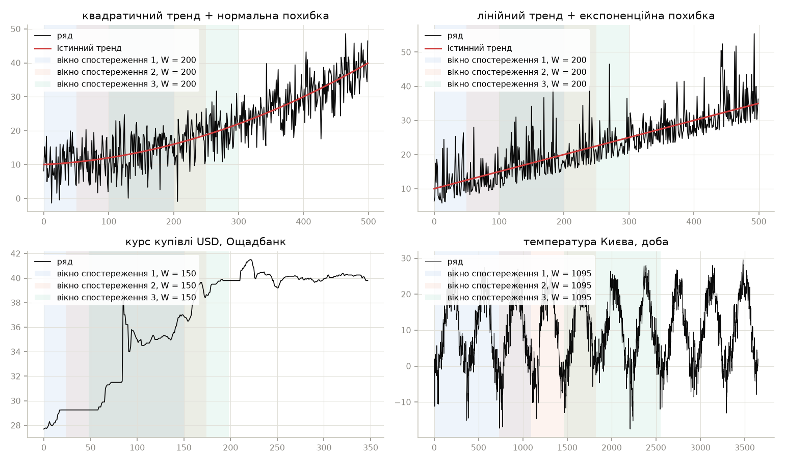

Рисунок 3 – Вхідні ряди і вікна спостереження трьох стартів

Таблиця 2 – Властивості рядів і декомпозиція першого вікна

| Показник | 1. Квадратичний | 2. Лінійний | 3. Курс USD | 4. Температура |
| ------------------------ | ---------------- | ------------ | ------------ | ---------------- |
| $m$ | 20,686 | 22,537 | 36,481 | 9,839 |
| $\sigma$ | 10,127 | 8,862 | 4,374 | 9,547 |
| Асиметрія | 0,316 | 0,481 | –0,761 | –0,102 |
| $p_{ADF}$ | < 0,001 | 0,034 | 0,900 | 0,197 |
| $p_{KPSS}$ | 0,010 | 0,010 | 0,010 | 0,100 |
| Період $s$ | – | – | – | 365 |
| CV тренду, степінь 0 | 5,889 | 7,460 | 4,927 | 3,773 |
| CV тренду, степінь 1 | 5,109 | 5,898 | 1,761 | 3,891 |
| CV тренду, степінь 2 | 5,724 | 6,921 | 3,914 | 4,714 |
| Обрано $D(t)$ | лінійний | лінійний | лінійний | сталий + 2 гармоніки |
| $R^2$ складової $D(t)$ | 0,135 | 0,230 | 0,855 | 0,855 |
| СКВ залишку | 4,931 | 5,173 | 1,175 | 3,652 |
| ACF залишку, лаг 1 | 0,047 | –0,075 | 0,841 | 0,796 |
| ACF залишку, лаг 2 | –0,094 | 0,096 | 0,739 | 0,534 |
| ACF залишку, лаг 5 | –0,010 | 0,296 | 0,496 | 0,153 |
| $p_{ADF}$ залишку | < 0,001 | < 0,001 | 0,006 | < 0,001 |

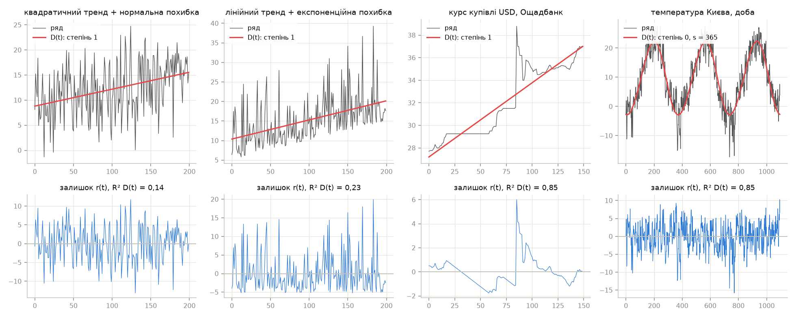

Рисунок 4 – Декомпозиція першого вікна на $D(t)$ і залишок

Усі чотири ряди нестаціонарні за KPSS, а курс – і за ADF ($p = 0{,}900$). Після
вилучення $D(t)$ залишок стаціонарний на всіх рядах ($p_{ADF} \le 0{,}006$), тобто
декомпозиція переводить ряд у форму, з якою мережа може працювати на будь-якому
горизонті.

На синтетичних рядах СКВ залишку (4,93 і 5,17) близька до СКВ шуму 5, а автокореляція
залишку мала: залишок – майже білий шум, і мережі на ньому прогнозувати нічого.
Лаг 5 на ряді 2 (0,296) – випадковий сплеск на 200 точках. На квадратичному ряді CV
обирає лінійний тренд: на 200 відліках квадратичний член змінює тренд лише на
4 одиниці при СКВ шуму 5.

На курсі і температурі залишок сильно корельований (ACF(1) 0,84 і 0,80), і саме тут
мережа може покращити прогноз на кілька кроків. Для курсу лінійний $D(t)$ – наближення
ступінчастого ряду зі стрибком посередині вікна, тож його залишок має структуру
стрибка (рисунок 4). Для температури детектор знайшов період 365 діб, а CV обрала
сталий рівень з двома гармоніками.

### Етап 2. Синтез структури мереж

Таблиця 3 – Варіанти структури, середнє за чотирма рядами і двома ініціалізаціями

+---------+----------+--------+------------+-------+----------+-----------+--------+
| Мережа  | Розмір   | Втрати | Параметрів | Епох  | СКВ      | СКВ       | Ранг   |
|         |          |        |            |       | на крок  | рекурсії  |        |
+=========+==========+========+============+=======+==========+===========+========+
| MLP     | малий    | MSE    | 1217       | 48,1  | 0,660    | 0,778     | 2,417  |
|         +----------+--------+------------+-------+----------+-----------+--------+
|         | малий    | Huber  | 1217       | 27,1  | 0,662    | 0,803     | 2,583  |
|         +----------+--------+------------+-------+----------+-----------+--------+
|         | базовий  | MSE    | 3457       | 34,9  | 0,642    | 0,805     | 2,167  |
|         +----------+--------+------------+-------+----------+-----------+--------+
|         | базовий  | Huber  | 3457       | 18,1  | 0,652    | 0,796     | 2,833  |
+---------+----------+--------+------------+-------+----------+-----------+--------+
| LSTM    | малий    | MSE    | 1169       | 77,0  | 0,644    | 0,770     | 1,917  |
|         +----------+--------+------------+-------+----------+-----------+--------+
|         | малий    | Huber  | 1169       | 45,0  | 0,664    | 0,774     | 2,667  |
|         +----------+--------+------------+-------+----------+-----------+--------+
|         | базовий  | MSE    | 4385       | 39,5  | 0,643    | 0,771     | 2,750  |
|         +----------+--------+------------+-------+----------+-----------+--------+
|         | базовий  | Huber  | 4385       | 41,9  | 0,641    | 0,774     | 2,667  |
+---------+----------+--------+------------+-------+----------+-----------+--------+
| CNN     | малий    | MSE    | 4977       | 29,4  | 0,646    | 0,772     | 2,083  |
|         +----------+--------+------------+-------+----------+-----------+--------+
|         | малий    | Huber  | 4977       | 19,5  | 0,653    | 0,806     | 3,000  |
|         +----------+--------+------------+-------+----------+-----------+--------+
|         | базовий  | MSE    | 19681      | 28,6  | 0,631    | 0,780     | 2,167  |
|         +----------+--------+------------+-------+----------+-----------+--------+
|         | базовий  | Huber  | 19681      | 10,8  | 0,640    | 0,796     | 2,750  |
+---------+----------+--------+------------+-------+----------+-----------+--------+

Кількість параметрів у таблиці 3 наведена для входу $L = 20$; для курсу ($L = 10$)
і температури ($L = 30$) вона змінюється лише в першому шарі MLP і шарі після згорток CNN.

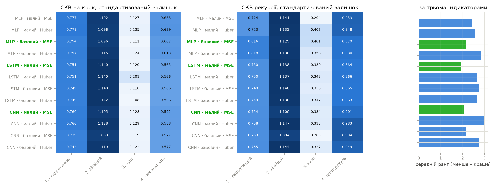

Рисунок 5 – Індикатори варіантів структури за рядами і середній ранг (зелений – обрано)

Обрано MLP базового розміру, LSTM і CNN малого розміру, усі з MSE. Схеми обраних
мереж наведено на рисунку 6.

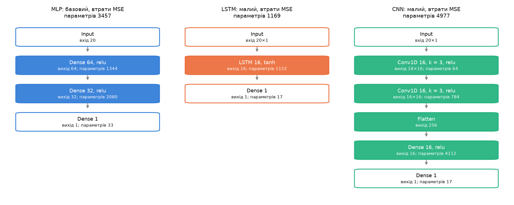

Рисунок 6 – Архітектура обраних мереж (вхід $L = 20$)

Різниця між варіантами за СКВ на крок невелика: 0,631–0,664 в одиницях стандартизованого
залишку, менше за 5 %. Найчутливіший індикатор – СКВ рекурсії: функція Хубера з малим
розміром погіршує її в MLP і CNN на 3–4 % (0,803 проти 0,778, 0,806 проти 0,772).
Найбільше – на рядах, де великі відхилення залишку змістовні: на курсі в MLP
(0,406 проти 0,294) і на температурі в CNN (0,983 проти 0,901). З Хубером навчання
зупиняється в 1,5–2,7 раза раніше, і мережа менше підлаштовується під такі відхилення.
Перевага Хубера очікувалася на ряді 2 з викидами, але й там різниця не перевищує 0,05
і має різний знак для різних мереж. Тому для всіх типів обрано MSE.

Базовий розмір CNN має вчетверо більше параметрів за малий (19681 проти 4977) і найкращу
СКВ на крок (0,631), але гіршу СКВ рекурсії (0,780 проти 0,772). Багатший опис вікна
краще підганяє наступне значення і швидше накопичує похибку в рекурсії. Для MLP той
самий ефект менший, і базовий розмір виграв завдяки похибці на крок. Ранжування за
трьома індикаторами обирає компактнішу мережу там, де виграш складнішої лише в одному
індикаторі.

### Етап 3. Навчання і прогноз на ділянці спостереження

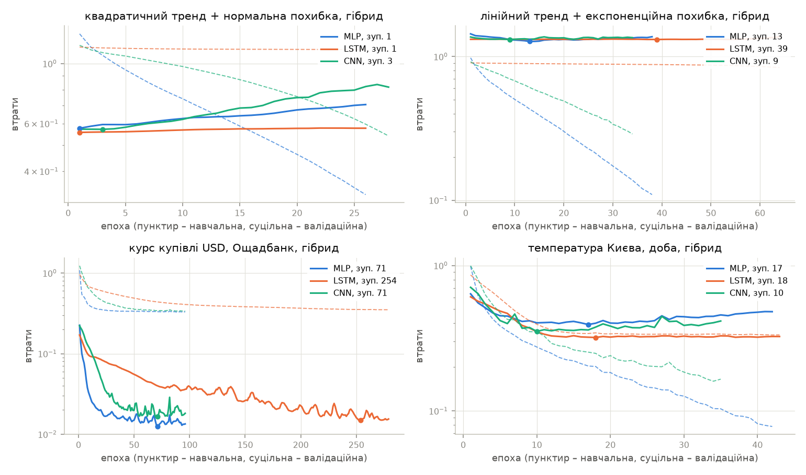

Рисунок 7 – Навчальні (пунктир) і валідаційні (суцільна) втрати, гібрид, перший старт

На синтетичних рядах валідаційні втрати мінімальні вже на 1–13-й епохі, а далі
зростають, тоді як навчальні падають: мережа починає запам'ятовувати білий шум,
і рання зупинка повертає ваги майже початкового стану. Це правильна поведінка для
залишку без автокореляції. На курсі навчання триває 71–254 епохи, і валідаційні втрати
падають на порядок: залишок курсу має структуру. На температурі зупинка на 10–18-й
епохі при валідаційних втратах 0,32–0,40 – близько до $1 - \hat\rho(1)^2 = 0{,}37$,
частки дисперсії залишку, непрогнозованої за попереднім значенням.

Таблиця 4 – Прогноз на крок на ділянці спостереження першого старту: RMSE і СКВ до істинного тренду

| Метод | Ряд 1 | Ряд 1, тренд | Ряд 2 | Ряд 2, тренд | Ряд 3, грн | Ряд 4, °C |
| ---------------- | -------- | ---------- | -------- | ---------- | ---------- | --------- |
| MLP, рівні | 4,144 | 2,228 | 4,821 | 2,490 | 0,811 | 1,907 |
| LSTM, рівні | 5,200 | 1,368 | 4,879 | 1,524 | 0,913 | 2,190 |
| CNN, рівні | 4,462 | 1,962 | 4,747 | 1,745 | 0,916 | 2,054 |
| MLP, прирости | 6,211 | 4,536 | 3,833 | 3,852 | 0,685 | 2,031 |
| LSTM, прирости | 5,220 | 1,852 | 5,166 | 1,220 | 0,693 | 2,192 |
| CNN, прирости | 6,731 | 4,956 | 3,697 | 3,848 | 0,685 | 2,098 |
| MLP, гібрид | 5,048 | 1,686 | 3,962 | 2,606 | 0,607 | 1,761 |
| LSTM, гібрид | 5,000 | 0,441 | 5,083 | 0,670 | 0,628 | 2,115 |
| CNN, гібрид | 4,883 | 0,531 | 4,650 | 1,432 | 0,617 | 2,047 |

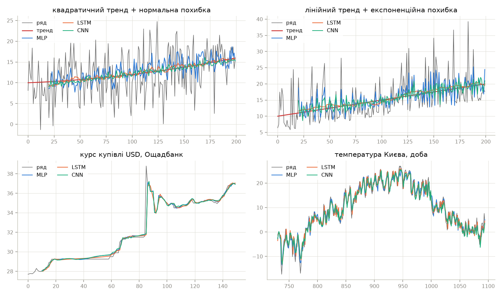

Рисунок 8 – Прогноз на крок гібридними мережами на ділянці спостереження
(температура – останній рік вікна)

Прогноз на крок на ділянці спостереження частково збігається з навчальними даними,
тож RMSE до ряду тут оптимістична. На ряді 1 MLP на рівнях має RMSE 4,14 – менше
за СКВ шуму 5, тобто мережа частково запам'ятала шум. Чесніший індикатор для
синтетики – СКВ до істинного тренду. За ним найкраща LSTM на гібридній стратегії
(0,441 і 0,670): лінійний $D(t)$ задає тренд, а мережа на білому залишку майже нічого
не додає. MLP і CNN на приростах найгірші (3,8–5,0): прогноз приросту білого шуму
дорівнює $-r(t-1)$, і мережа переносить шум у прогноз рівня.

На курсі і температурі гібридна стратегія дає найменшу похибку на крок для кожного
типу мережі: 0,607–0,628 грн і 1,76–2,12 °C. Різниця між типами мереж менша, ніж між
стратегіями. MLP на температурі точніший за LSTM (1,76 проти 2,12 °C): при $L = 30$
кожне значення вікна – окрема ознака, і повнозв'язний шар легко виділяє
вагу останніх днів.

### Етап 4. Прогноз поза ділянкою спостереження

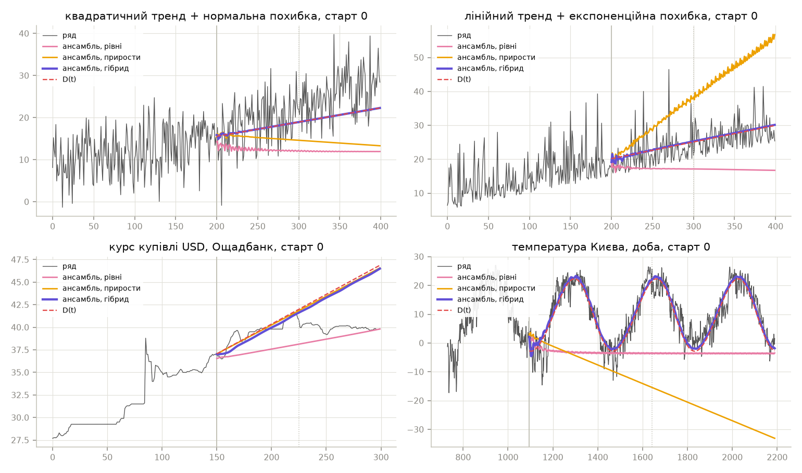

Рисунок 9 – Ансамблі трьох стратегій і $D(t)$, перший старт (вертикалі – $W$ і $1{,}5W$)

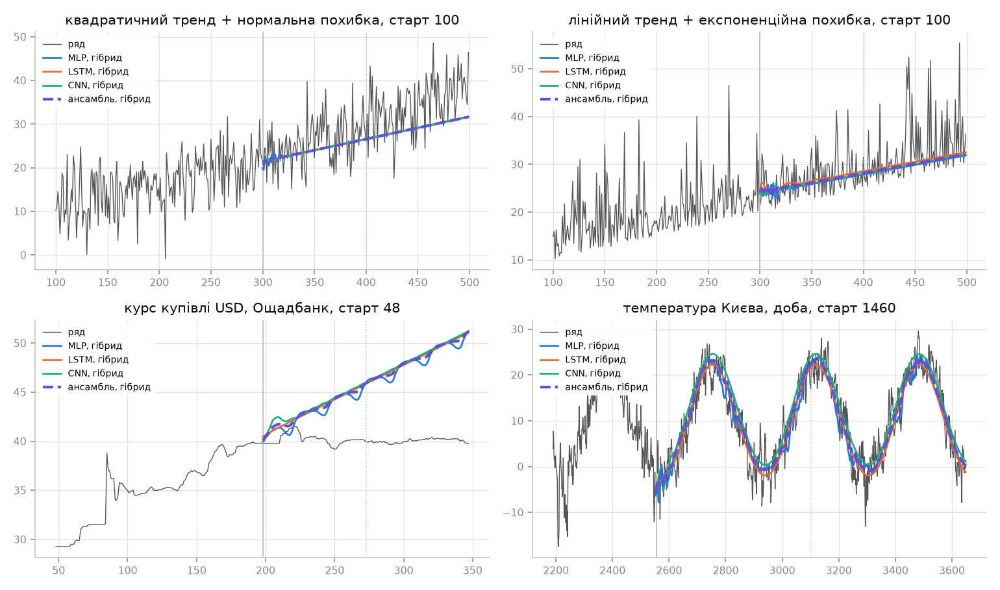

Рисунок 10 – Прогнози гібридних мереж з останнього старту

Таблиця 5 – RMSE прогнозу на горизонті $W$, walk-forward, три старти

| Метод | 1. Квадратичний | 2. Лінійний | 3. Курс, грн | 4. Темп., °C |
| ------------------- | --------------- | ----------- | ------------ | ------------ |
| Наївний | 12,106 | 7,623 | 1,696 | 15,266 |
| $D(t)$ | 6,341 | 4,816 | 5,046 | 3,702 |
| MLP, рівні | 13,837 | 11,392 | 4,701 | 60,922 |
| LSTM, рівні | 13,074 | 9,147 | 3,165 | 15,499 |
| CNN, рівні | 12,273 | 10,316 | 1,149 | 14,637 |
| Ансамбль, рівні | 13,047 | 10,256 | 2,487 | 29,533 |
| MLP, прирости | 12,862 | 7,847 | 5,596 | 37,593 |
| LSTM, прирости | 14,185 | 23,656 | 4,643 | 100,027 |
| CNN, прирости | 6,811 | 12,037 | 4,314 | 39,810 |
| Ансамбль, прирости | 9,334 | 13,985 | 4,849 | 57,860 |
| MLP, гібрид | 6,377 | 4,860 | 4,836 | 3,925 |
| LSTM, гібрид | 6,373 | 4,786 | 4,895 | 3,777 |
| CNN, гібрид | 6,338 | 4,818 | 4,844 | 3,946 |
| Ансамбль, гібрид | 6,361 | 4,807 | 4,855 | 3,793 |
| Гібрид, вага ACF | 6,341 | 4,816 | 5,046 | 3,700 |
| Адаптивний | 7,671 | 4,816 | 4,993 | 3,700 |

Таблиця 6 – RMSE прогнозу на горизонті $0{,}1W$

| Метод | 1. Квадратичний | 2. Лінійний | 3. Курс, грн | 4. Темп., °C |
| ------------------- | --------------- | ----------- | ------------ | ------------ |
| Наївний | 6,906 | 4,144 | 0,740 | 8,147 |
| $D(t)$ | 5,150 | 3,190 | 0,715 | 4,683 |
| CNN, рівні | 5,738 | 3,819 | 0,474 | 6,161 |
| Ансамбль, рівні | 5,986 | 3,763 | 0,908 | 6,618 |
| Ансамбль, прирости | 6,131 | 3,764 | 0,524 | 10,253 |
| LSTM, гібрид | 5,201 | 2,943 | 0,691 | 4,679 |
| Ансамбль, гібрид | 5,104 | 3,118 | 0,761 | 4,775 |
| Гібрид, вага ACF | 5,151 | 3,190 | 0,682 | 4,675 |
| Адаптивний | 5,188 | 3,190 | 0,689 | 4,675 |

Таблиця 7 – RMSE прогнозу на горизонті $0{,}5W$

| Метод | 1. Квадратичний | 2. Лінійний | 3. Курс, грн | 4. Темп., °C |
| ------------------- | --------------- | ----------- | ------------ | ------------ |
| Наївний | 8,346 | 5,735 | 1,731 | 14,741 |
| $D(t)$ | 5,211 | 4,219 | 2,038 | 3,812 |
| CNN, рівні | 8,085 | 7,260 | 0,979 | 13,969 |
| Ансамбль, рівні | 8,750 | 7,107 | 2,034 | 20,265 |
| Ансамбль, прирости | 6,811 | 8,352 | 1,752 | 34,083 |
| LSTM, гібрид | 5,238 | 4,202 | 1,977 | 3,901 |
| Ансамбль, гібрид | 5,216 | 4,206 | 1,965 | 3,983 |
| Гібрид, вага ACF | 5,212 | 4,219 | 2,038 | 3,809 |
| Адаптивний | 5,614 | 4,219 | 2,028 | 3,809 |

Таблиця 8 – Інші KPI на горизонті $W$

| Ряд | Метод | MAE | Зміщення | $R^2$ |
| --------------- | ---------------- | ------ | -------- | ------- |
| 1. Квадратичний | Гібрид, вага ACF | 5,158 | –3,420 | 0,082 |
| 2. Лінійний | LSTM, гібрид | 3,485 | 0,039 | 0,286 |
| 3. Курс USD | CNN, рівні | 0,976 | –0,006 | –3,451 |
| 3. Курс USD | Наївний | 1,573 | –1,546 | –6,178 |
| 4. Температура | Гібрид, вага ACF | 2,980 | –0,291 | 0,843 |

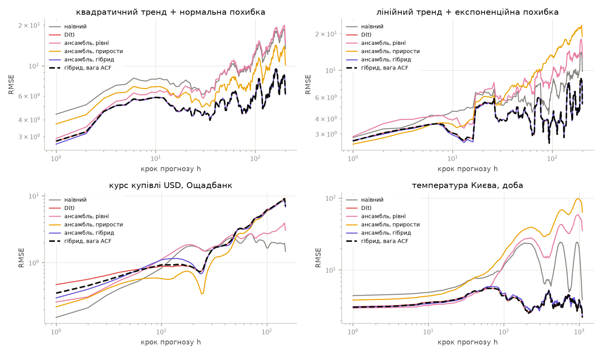

Рисунок 11 – RMSE на кожному кроці прогнозу, середнє за стартами (логарифмічні осі)

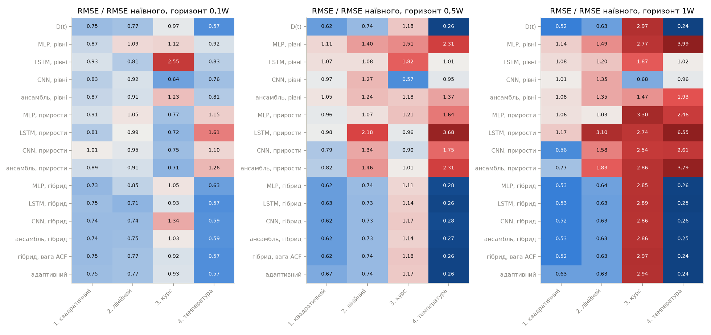

Рисунок 12 – RMSE методів відносно наївного прогнозу на трьох горизонтах

Мережі без декомпозиції на довгому горизонті непридатні (рисунки 9, 11). На рівнях
рекурсія за 20–50 кроків сходиться до сталого значення поблизу середнього вікна:
на трендових рядах прогноз відстає від тренду (зміщення –10…–11 на ряді 1), на
температурі сезонний цикл зникає, і RMSE ансамблю 29,5 °C – гірше за наївний прогноз.
MLP на рівнях температури дає 60,9 °C: на одному зі стартів його рекурсія вийшла
за діапазон даних і розійшлася до –254 °C.
На приростах похибки накопичуються в сумі, і прогноз іде по прямій з хибним нахилом:
LSTM на приростах температури – 100 °C на горизонті $W$, на ряді 2 – 23,7.

Гібридна стратегія тримає похибку на рівні $D(t)$ на всьому інтервалі: на температурі
3,70–3,95 °C ($R^2 = 0{,}84$) на горизонті трьох років, на синтетичних рядах 6,3–6,4
і 4,8–4,9 при СКВ шуму 5. Це в 1,6–4,1 раза точніше за наївний прогноз. На ряді 1
залишається зміщення –3,4: лінійний $D(t)$ не враховує кривизну квадратичного тренду,
яка на горизонті $W$ вже помітна.

Внесок мережі в гібрид видно лише на перших кроках (рисунок 11). На температурі
RMSE гібридних мереж на кроці 1 – 2,20–2,82 °C проти 4,23 °C у $D(t)$, бо залишок
корельований: після холодного дня наступний теж буде холодним. Середня за перші
5 кроків похибка вже майже однакова (4,24 проти 4,43 °C), що відповідає згасанню
ACF залишку до 0,15 на лагу 5. На курсі на кроці 1 – 0,11–0,39 проти 0,51 грн.
Далі рекурсія мережі сходиться до власної нерухомої точки, яка трохи відрізняється
від нуля. Тому на горизонтах $0{,}5W$ і $W$ ансамбль гібрида
на температурі на 3–5 % гірший за саме $D(t)$ (3,98 проти 3,81 °C), а зміщення
зростає з 0,00 до 0,87 °C. Вага ACF прибирає цей ефект: прогноз з вагою на горизонтах
$0{,}5W$ і $W$ збігається з $D(t)$ або трохи кращий (3,809 і 3,700 °C), а на
$0{,}1W$ – найточніший з усіх методів (4,675 °C). На синтетичних рядах залишок
некорельований, вага ACF близька до нуля з першого кроку, і метод дорівнює $D(t)$.

На ряді 2 найточніша на горизонтах $0{,}1W$ – $W$ LSTM на гібридній стратегії
(2,94, 4,20, 4,79), а зміщення на горизонті $W$ лише 0,04. При експоненційній похибці
залишок асиметричний, і рекурсія LSTM виправляє зміщення середнього, яке МНК-пряма
дає через рідкі великі викиди.

Курс – виняток. Ряд складається з плато і стрибків, і лінійний $D(t)$, оцінений
на вікні зі стрибком, екстраполює зростання, якого після фіксації курсу вже немає
(рисунок 10). Тому всі методи з трендом на горизонті $W$ майже втричі гірші
за наївний прогноз. Найточніша тут CNN на рівнях: 0,47, 0,98 і 1,15 грн на трьох
горизонтах, на 32–43 % краще за наївний, без зміщення. Рекурсія на рівнях сходиться
до значення поблизу останніх спостережень, а для ряду з плато це правильна гіпотеза.
LSTM і MLP на рівнях курсу менш стабільні: їхні нерухомі точки зсунуті на 2–3 грн.

### Етап 5. Адаптивний вибір стратегії

Таблиця 9 – RMSE ансамблів на відкладених $W/4$ точках вікна і обрана стратегія

+-----------------+-------+--------+----------+--------+----------+
| Ряд             | Старт | Рівні  | Прирости | Гібрид | Обрано   |
+=================+=======+========+==========+========+==========+
| 1. Квадратичний | 0     | 5,680  | 4,365    | 4,372  | прирости |
|                 +-------+--------+----------+--------+----------+
|                 | 50    | 6,537  | 5,051    | 5,051  | гібрид   |
|                 +-------+--------+----------+--------+----------+
|                 | 100   | 7,275  | 11,087   | 5,072  | гібрид   |
+-----------------+-------+--------+----------+--------+----------+
| 2. Лінійний     | 0     | 6,731  | 8,189    | 6,000  | гібрид   |
|                 +-------+--------+----------+--------+----------+
|                 | 50    | 5,501  | 5,115    | 4,832  | гібрид   |
|                 +-------+--------+----------+--------+----------+
|                 | 100   | 6,527  | 6,992    | 4,867  | гібрид   |
+-----------------+-------+--------+----------+--------+----------+
| 3. Курс USD     | 0     | 1,466  | 0,560    | 1,020  | прирости |
|                 +-------+--------+----------+--------+----------+
|                 | 24    | 2,374  | 1,769    | 0,748  | гібрид   |
|                 +-------+--------+----------+--------+----------+
|                 | 48    | 2,519  | 0,842    | 0,540  | гібрид   |
+-----------------+-------+--------+----------+--------+----------+
| 4. Температура  | 0     | 10,887 | 9,436    | 3,352  | гібрид   |
|                 +-------+--------+----------+--------+----------+
|                 | 730   | 18,442 | 20,766   | 3,914  | гібрид   |
|                 +-------+--------+----------+--------+----------+
|                 | 1460  | 14,742 | 14,358   | 3,604  | гібрид   |
+-----------------+-------+--------+----------+--------+----------+

Гібрид обрано на 10 стартах з 12. На температурі й лінійному ряді вибір однозначний:
на відкладеній чверті вікна гібрид точніший за інші стратегії на лінійному ряді
на 6–30 %, на температурі – у 2,8–5,3 раза, і адаптивний метод збігається з кращим. Дві помилки – на першому старті ряду 1 і курсу.
На ряді 1 прирости виграли внутрішню валідацію на 0,007 (4,365 проти 4,372) – це
шум, але цього вистачило, щоб на горизонті $W$ взяти стратегію з RMSE 10,3 замість 6,3.
Через це адаптивний метод на ряді 1 на 21 % гірший за гібрид з вагою ACF
(7,67 проти 6,34). На курсі вибір приростів на першому старті був правильним
для відкладеної ділянки, але не для подальших 150 днів плато.

Найкращою стратегією внутрішня валідація на курсі CNN на рівнях не визначає: вона
порівнює ансамблі, а на рівнях ансамбль псують нестабільні MLP і LSTM.

## 3.5. Програмний код

Повний код наведено в архіві проекту. Нижче – ключові фрагменти.

Архітектури мереж і навчання з ранньою зупинкою:

```python
def build(kind, lookback, units):
    layers = keras.layers
    if kind == "MLP":
        inputs = keras.Input((lookback,), name="window")
        x = layers.Dense(2 * units, activation="relu", name="dense_1")(inputs)
        x = layers.Dense(units, activation="relu", name="dense_2")(x)
    elif kind == "LSTM":
        inputs = keras.Input((lookback, 1), name="window")
        x = layers.LSTM(units, name="lstm")(inputs)
    else:
        inputs = keras.Input((lookback, 1), name="window")
        x = layers.Conv1D(units, KERNEL, activation="relu", name="conv_1")(inputs)
        x = layers.Conv1D(units, KERNEL, activation="relu", name="conv_2")(x)
        x = layers.Flatten(name="flatten")(x)
        x = layers.Dense(units, activation="relu", name="dense")(x)
    outputs = layers.Dense(1, name="output")(x)
    return keras.Model(inputs, outputs, name=kind)


def fit(kind, x, lookback, units, loss, seed):
    keras.utils.set_random_seed(seed)
    model = build(kind, lookback, units)
    model.compile(optimizer=keras.optimizers.Adam(LR), loss=loss_fn(loss))
    inputs, targets = windows(x, lookback)
    stop = keras.callbacks.EarlyStopping(
        patience=PATIENCE, restore_best_weights=True
    )
    history = model.fit(
        shaped(kind, inputs),
        targets,
        epochs=EPOCHS,
        batch_size=BATCH,
        validation_split=VAL_SHARE,
        callbacks=[stop],
        verbose=0,
    )
    return model, {
        "loss": history.history["loss"],
        "val_loss": history.history["val_loss"],
        "параметрів": model.count_params(),
        "епох": int(np.argmin(history.history["val_loss"])) + 1,
    }


def recursive(model, kind, history, lookback, steps):
    buffer = list(np.asarray(history[-lookback:], dtype="float32"))
    out = np.empty(steps)
    for h in range(steps):
        out[h] = predict(model, kind, [buffer[-lookback:]])[0]
        buffer.append(out[h])
    return out
```

Вибір степеня тренду $D(t)$ за CV з правилом 1-SE:

```python
def select_degree(y, period):
    y = np.asarray(y, dtype=float)
    n = len(y)
    h = n // 4
    cuts = [n - h - k * h // 2 for k in range(CV_FOLDS)]
    scores = {}
    for degree in DEGREES:
        errors = []
        for c in cuts:
            d = deterministic(y[:c], degree, period)
            e = d(np.arange(c, c + h)) - y[c : c + h]
            errors.append(np.sqrt(np.mean(e**2)))
        scores[degree] = (
            np.mean(errors),
            np.std(errors, ddof=1) / np.sqrt(CV_FOLDS),
        )
    best = min(scores, key=lambda k: scores[k][0])
    limit = scores[best][0] + scores[best][1]
    choice = min(k for k in DEGREES if scores[k][0] <= limit)
    return choice, {k: v[0] for k, v in scores.items()}
```

Три стратегії екстраполяції:

```python
def run(strategy, kind, y, steps, spec):
    y = np.asarray(y, dtype=float)
    n, lookback = len(y), spec["lookback"]
    if strategy == "рівні":
        base = y
    elif strategy == "прирости":
        base = np.diff(y)
    else:
        d = deterministic(y, spec["degree"], spec["period"])
        base = y - d(np.arange(n))
    z, m, s = standardize(base)
    model, info = networks.fit(
        kind, z, lookback, spec["units"], spec["loss"], spec["seed"]
    )
    info |= validation(model, kind, z, lookback)
    step = m + s * networks.one_step(model, kind, z, lookback)
    future = m + s * networks.recursive(model, kind, z, lookback, steps)
    fitted = np.full(n, np.nan)
    if strategy == "рівні":
        fitted[lookback:] = step
        forecast = future
    elif strategy == "прирости":
        fitted[lookback + 1 :] = y[lookback:-1] + step
        forecast = y[-1] + np.cumsum(future)
    else:
        fitted[lookback:] = d(np.arange(lookback, n)) + step
        forecast = d(np.arange(n, n + steps)) + future
    return {"forecast": forecast, "fitted": fitted} | info
```

Синтез структури за середнім рангом трьох індикаторів:

```python
INDICATORS = ("СКВ на крок", "СКВ рекурсії", "параметрів")

keys = ["мережа", "розмір", "втрати", "ряд"]
table = raw.groupby(keys, sort=False).mean(numeric_only=True)
table = table.drop(columns="seed").reset_index()
ranks = table.copy()
for ind in INDICATORS:
    ranks[ind] = table.groupby(["мережа", "ряд"])[ind].rank()
ranks["ранг"] = ranks[list(INDICATORS)].mean(axis=1)
score = ranks.groupby(keys[:3], sort=False)["ранг"].mean()
chosen = {}
for kind in networks.KINDS:
    size, loss = score.loc[kind].idxmin()
    chosen[kind] = {"розмір": size, "втрати": loss}
```

Вага ACF і адаптивний вибір стратегії:

```python
def acf_weight(resid, steps):
    rho = features.acf(resid, range(1, steps + 1))
    stop = np.argmax(rho <= 0) if np.any(rho <= 0) else steps
    rho[stop:] = 0.0
    return rho


def damped(train, degree, period, hybrid):
    n = len(train)
    d = strategies.deterministic(train, degree, period)
    trend = d(np.arange(n, n + len(hybrid)))
    weight = strategies.acf_weight(train - d(np.arange(n)), len(hybrid))
    return trend + weight * (hybrid - trend)


def adaptive_scores(cfg, s, chosen, results, degree, period):
    w = cfg["window"]
    hold = w // HOLDOUT
    actual = cfg["series"][s + w - hold : s + w]
    scores = {}
    for strategy in strategies.STRATEGIES:
        paths = [
            results[
                f"inner|{cfg['key']}|{s}|{kind}|{strategy}|"
                f"{chosen[kind]['розмір']}|{chosen[kind]['втрати']}|"
                f"{degree}|{period}"
            ]["forecast"]
            for kind in networks.KINDS
        ]
        path = np.mean(paths, axis=0)
        if strategy == "гібрид":
            train = cfg["series"][s : s + w - hold]
            path = damped(train, degree, period, path)
        scores[strategy] = np.sqrt(np.mean((path - actual) ** 2))
    return scores
```

## 3.6. Аналіз результатів та верифікація

Таблиця 10 – Верифікація мереж і стратегій, середнє за двома реалізаціями

| Перевірка | Теорія | MLP | LSTM | CNN |
| ------------------------------------------------ | -------- | -------- | -------- | -------- |
| AR(1), $\varphi = 0{,}7$: СКВ на крок / $\sigma$ | ≈ 1 | 0,954 | 0,935 | 0,906 |
| AR(1): max відхилення рекурсії від $\mu + \varphi^h (y - \mu)$, 20 кроків | ≈ 0 | 0,441 | 0,493 | 1,014 |
| Синусоїда, період 25, шум 0,1: СКВ рекурсії до сигналу, 4 періоди | < 0,1 | 0,076 | 0,045 | 0,071 |
| Тренд $0{,}2t$, 300 кроків: СКВ до тренду, рівні | – | 28,791 | 37,153 | 6,794 |
| Те саме, прирости | – | 5,293 | 5,277 | 7,219 |
| Те саме, гібрид | ≈ 0 | 0,168 | 0,209 | 0,138 |

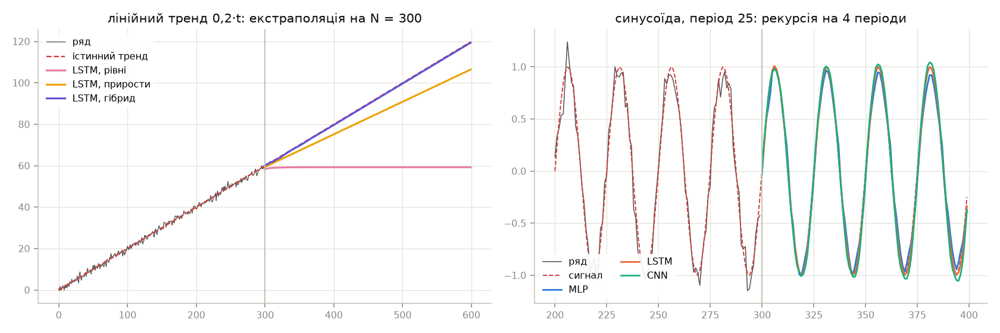

Рисунок 13 – Екстраполяція лінійного тренду трьома стратегіями і синусоїди трьома мережами

Верифікація прогнозу на крок. На AR(1) з $\sigma = 1$ теоретично найкращий прогноз
на крок має похибку $\sigma$. Мережі дають 0,91–0,95 – трохи менше, бо прогноз
рахується на навчальних даних. Рекурсивний прогноз відтворює теоретичне згасання
$\varphi^h$ з відхиленням 0,44–0,49 для MLP і LSTM; у CNN відхилення 1,0: при $L = 5$
дві згортки з ядром 3 залишають лише одну позицію, і залежність від останнього значення
оцінюється грубіше.

Верифікація рекурсії. На синусоїді з шумом 0,1 усі мережі після 100 кроків рекурсії
(4 періоди) тримають фазу й амплітуду з похибкою 0,045–0,076 – меншою за шум.
Рекурсія мережі стабільна, якщо ряд стаціонарний і вікно $L$ перевищує період.

Верифікація стратегій. На лінійному тренді без декомпозиції мережа на рівнях
насичується на останньому значенні вікна (рисунок 13), похибка 6,8–37,2 на 300 кроках.
На приростах нахил оцінюється з похибкою, яка накопичується лінійно: 5,3–7,2.
Гібрид відновлює тренд з похибкою 0,14–0,21 при шумі 1. Саме це спостерігається
й на реальних рядах (етап 4), тож поведінка стратегій зумовлена способом екстраполяції,
а не конкретними даними.

Придатність результатів. Для температури гібрид з вагою ACF дає RMSE 3,70 °C
на горизонті трьох років, $R^2 = 0{,}843$, зміщення –0,29 °C, що в 4,1 раза точніше
за наївний прогноз. Для синтетичних рядів RMSE 6,34 і 4,79–4,82 при СКВ шуму 5.
Для курсу найкраща CNN на рівнях: 1,15 грн на 150 днях, на 32 % краще за наївний
прогноз. Рекомендації за результатами наведено в таблиці 11.

Таблиця 11 – Рекомендації з використання нейромереж для прогнозу Time Series

| Властивості ряду і задача | Рекомендовано | Не рекомендовано |
| ------------------------------------------ | -------------------------------------------- | ---------------------------------------- |
| Тренд, довгий горизонт (≥ 0,5 інтервалу спостереження) | декомпозиція: $D(t)$ з CV + мережа на залишку | мережа на рівнях або приростах |
| Сезонність з довгим періодом | гармоніки в $D(t)$; вікно мережі коротке | вікно $L$, що має охопити період |
| Залишок – білий шум | $D(t)$ без мережі або з вагою ACF | довге навчання без ранньої зупинки |
| Корельований залишок, короткий горизонт | гібрид, LSTM або MLP | $D(t)$ без мережі |
| Ступінчастий ряд, плато після стрибка | CNN на рівнях, наївний прогноз | глобальний тренд $D(t)$ |
| Вибір розміру і функції втрат | ранжування за похибкою на крок, рекурсії і кількістю параметрів | лише похибка на крок |
| Вибір стратегії для нового ряду | внутрішня валідація на відкладеній частині вікна | вибір за однією реалізацією без запасу |

Обмеження. Внутрішня валідація на $W/4$ не перевіряє горизонт $W$, тож вибір
стратегії, що виграла з різницею в 0,2 %, ненадійний (ряд 1, старт 0). Практичне
покращення – вимагати від стратегії перевагу над гібридом більшу за розкид між
мережами ансамблю. На кожному ряді лише три старти, тому різниці між мережами
однієї стратегії менше 3 % незначущі. Лінійний $D(t)$ для курсу – неправильна
модель ряду зі стрибками; для нього потрібна модель режимів, а не глобальний тренд.

# IV. Висновки

У роботі реалізовано прогнозування Time Series трьома типами нейромереж:
багатошаровим перцептроном, LSTM і одновимірною згортковою мережею. Мережі навчаються
на трьох стратегіях – на рівнях ряду, на приростах і на залишку після детермінованої
складової – і перевіряються walk-forward на чотирьох рядах: двох синтетичних з ЛР 1,
курсі валют і добовій температурі. Виконано групи вимог 1–3 і завдання рівня IV.

Препроцесинг і декомпозиція визначили результат більше, ніж тип мережі. Після
вилучення $D(t)$ (тренд зі степенем за CV, для температури – дві гармоніки
річного періоду) залишок стаціонарний на всіх рядах. На синтетичних рядах він майже
білий шум (ACF(1) 0,05 і –0,08), на курсі й температурі – корельований
(ACF(1) 0,84 і 0,80).

Структура мереж синтезована ранжуванням за трьома індикаторами: похибкою на крок,
похибкою рекурсивного прогнозу на відкладеній ділянці і кількістю параметрів. Обрано
MLP 20–64–32–1 (3457 параметрів), LSTM з 16 комірками (1169) і CNN з двома згортками
по 16 фільтрів (4977), усі з функцією втрат MSE. Функція Хубера не дала переваги навіть
на ряді з експоненційною похибкою і погіршила рекурсію на 3–4 %, а більша CNN, точніша
на крок, гірше екстраполює.

Мережі без декомпозиції для довготривалої екстраполяції непридатні. На рівнях рекурсія
сходиться до сталого значення і втрачає тренд і сезонність (на температурі RMSE
ансамблю 29,5 °C на горизонті $W$ проти 15,3 °C у наївного прогнозу), на приростах
прогноз розходиться (до 100 °C). Ті самі ефекти відтворено на сигналах з відомою
поведінкою.

Оригінальне рішення задачі довготривалої екстраполяції – гібрид $D(t)$ і мережі
на залишку з вагою вкладу мережі за автокореляцією залишку та адаптивним вибором
стратегії за внутрішньою валідацією. Воно тримає похибку на всьому інтервалі $W$,
удвічі більшому за мінімально потрібний: температура – 3,70 °C на горизонті 1095 днів
($R^2 = 0{,}843$), синтетичні ряди – 6,34 і 4,82 при шумі 5, у 1,6–4,1 раза точніше
за наївний прогноз. Мережа на залишку покращує прогноз лише на горизонті кореляції
залишку, на температурі – перші кілька днів. Далі вага ACF обнуляє її вклад і
прибирає зміщення рекурсії, яке без ваги погіршувало гібрид на 3–5 %. Адаптивний вибір
обрав гібрид на 10 стартах з 12. На курсі зі стрибками глобальний тренд хибний, і
кращою виявилась CNN на рівнях (1,15 грн на 150 днях, на 32 % краще за наївний прогноз).

# Перелік джерел

1. Open-Meteo. Historical Weather API. URL: https://open-meteo.com/en/docs/historical-weather-api
2. Hochreiter S., Schmidhuber J. Long short-term memory. Neural Computation. 1997. Vol. 9, No. 8. P. 1735–1780.
3. Keras 3 API documentation. URL: https://keras.io/api/
