# І. Мета

Виявити, дослідити та узагальнити особливості реалізації процесів з обробки часових
рядів для конкретних проектних задач обробки Big Data масивів з використанням
можливостей мови програмування Python.

# ІІ. Завдання

Розробити програмний скрипт мовою Python, що реалізує функціонал за обраним рівнем
складності.

Рівень I, варіант 8. Розробити програмний скрипт, що реалізує:

1. Парсинг файлу параметрів Pr_1.xls.
2. Попередній аналіз даних.
3. Визначення показників ефективності – продажів та прибутку.
4. Визначення математичної моделі даних відповідно до МНК.
5. Визначення динаміки зміни прибутку за регіонами (таблиця, графік, файл).

Рівень II. Розробити програмний скрипт, що реалізує аналіз даних, поданих у файлі
Data_Set_8.xlsx, або самостійно обраних процесів. Обов'язковою вимогою є аналіз множини
процесів, поданих часовими рядами з різними властивостями.

Рівень III. Провести R&D дослідження та розробити технологію обробки часових рядів з
багатофакторним аналізом результатів, отриманих за трьома класами алгоритмів обробки:
статистичне навчання, апроксимація, глибинне навчання. Обробці різними методами
підлягає один і той самий часовий ряд. Оцінка має бути інтегрованою з результатів
застосування методів трьох класів. Технологію реалізувати в скриптовій формі і показати
на реальних часових рядах.

Виконано всі три рівні. Файл Data_Set_8.xlsx містить 15 замовлень за один місяць і
часового ряду не утворює, тому рівні II і III виконано на чотирьох самостійно обраних
економічних показниках з різними властивостями (таблиця 1). Ті самі ряди обробляються
трьома класами методів на рівні III.

Таблиця 1 – Вхідні дані

| Ряд | Джерело | Період | Обсяг |
| ---------------- | ------------------------------------- | ------------ | --------- |
| Продажі мережі магазинів | Pr_1.xls: 27 797 продажів, 199 магазинів, 5 регіонів | 2021 рік, щодня | 365 днів |
| Курс UAH/USD | офіційний курс НБУ [1], середній за місяць | 09.1996–09.2026 | 361 |
| ІСЦ України | місячна інфляція НБУ [1], ланцюговий індекс, грудень 2006 = 100 | 01.2007–09.2026 | 237 |
| Роздрібна торгівля США | FRED, RSXFSN, без сезонного коригування [2] | 01.1992–09.2026 | 417 |
| Нафта Brent | FRED, DCOILBRENTEU, середня за місяць [2] | 05.1987–09.2026 | 473 |

# ІІІ. Результати виконання лабораторної роботи

## 3.1. Синтезована математична модель

### 3.1.1. Показники ефективності продажів

Для кожного продажу з кількістю $q$, ціною $p$ і собівартістю одиниці $c$:

$$V = q p, \qquad C = q c, \qquad P = V - C = q (p - c), \qquad R = \frac{P}{V} \cdot 100\ \%$$

де $V$ – виручка, $C$ – витрати, $P$ – прибуток, $R$ – рентабельність. Повернення
($q < 0$) входять у суми зі знаком мінус. Показники агрегуються за місяцями і регіонами.
Регіон магазину береться з довідника, що лежить у тому ж аркуші праворуч від продажів.
Назву «Днепро-Слобідський» у файлі виправлено на «Дніпро-Слобідський».

Динаміка прибутку регіону – місячна зміна і частка регіону в прибутку місяця:

$$\Delta P_m = \frac{P_m - P_{m-1}}{|P_{m-1}|} \cdot 100\ \%, \qquad S_{rm} = \frac{P_{rm}}{\sum_r P_{rm}} \cdot 100\ \%$$

Модуль у знаменнику зберігає знак зміни, коли попередній місяць збитковий.

### 3.1.2. МНК-модель і очищення аномалій

Добовий прибуток описується поліномом нормованого часу $\tau = t/n$:

$$\hat y(\tau) = \sum_{k=0}^{m} c_k \tau^k, \qquad C = (F^\mathsf{T} F)^{-1} F^\mathsf{T} Y$$

Степінь $m \in \{1, \dots, 5\}$ обирається за найменшою RMSE на відкладених останніх 20 %
вибірки. Перед підгонкою аномальні виміри замінюються лінійною інтерполяцією.
Детектор порівнює залишок після ковзної медіани з порогом
$k \hat\sigma$, де $\hat\sigma = 1{,}4826 \cdot \text{MAD}$, а
$k = \Phi^{-1}(1 - \alpha/2n)$, $\alpha = 0{,}05$, – поправка Бонферроні на обсяг вибірки.

### 3.1.3. Властивості процесів

Економічні показники зростають мультиплікативно, тому їхні властивості оцінюються за
логарифмічними приростами $r_t = \ln y_t - \ln y_{t-1}$:

- тренд – $R^2$ квадратичного полінома за часом;
- стаціонарність – тест Дікі–Фуллера (ADF) для рівнів і приростів;
- річна сезонність – $\rho_{12}(r) > 3/\sqrt{n}$, тобто автокореляція приростів на
  лагу 12 значуща із запасом. Рівні для цього не годяться: тренд дає високу ACF на будь-якому
  лагу;
- волатильність – $\sigma_r$, ексцес і $\rho_1(r)$;
- шоки – прирости з $|r_t - \text{med}(r)| > k \sigma_r$, $k = \Phi^{-1}(1 - \alpha/2n)$.

За цими ознаками ряд відноситься до одного з типів: тренд із сильною сезонністю
($\rho_{12} > 0{,}5$), гладкий тренд ($R^2 > 0{,}9$, $\sigma_r < 3\ \%$), волатильний
процес без стійкого тренду ($R^2 < 0{,}8$) або випадкове блукання зі стрибками.

### 3.1.4. Три класи методів обробки

Кожен метод отримує ділянку спостереження $W = 120$ місяців і прогнозує 24 місяці.
Наявність річної сезонності визначається на цій ділянці за 3.1.3.

Статистичне навчання:

- МНК-поліном степеня $m \in \{1, 2, 3\}$ з вибором за відкладеним хвостом,
  прогноз $\hat y(n + h) = \sum c_k ((n + h)/n)^k$;
- адаптивний α-β фільтр. Коефіцієнти $\alpha_n = 2(2n - 1)/n(n + 1)$,
  $\beta_n = 6/n(n + 1)$ відповідають рекурентному МНК, CUSUM нормованих нев'язок
  перезапускає пам'ять при розладці. Прогноз з кінцевого стану: $\hat y(n + h) = x_n + v_n h$.

Апроксимація:

- експоненційне згладжування: просте, Хольта, із затуханням тренду, Хольта–Вінтерса
  для сезонного ряду. Структура і параметр $\alpha$ обираються за CV-похибкою на
  горизонті $W/4$;
- регресійне згладжування: поліном за часом, тренд з $K$ гармоніками річного періоду
  ($K \le 6$, повний ряд Фур'є), регресія на лаги $1 \dots p$ з рекурсивним прогнозом.
  Модель обирається за CV з правилом однієї стандартної похибки.

Глибинне навчання – три мережі в стратегії «гібрид»: детермінована складова $D(t)$
(поліном степеня 0–2 за CV плюс дві гармоніки за наявності сезонності) і мережа на
залишку з рекурсивним прогнозом:

$$\hat y(n + h) = D(n + h) + \hat r(n + h), \qquad \hat r(t) = f(r_{t-1}, \dots, r_{t-L}), \quad L = 12$$

Використано MLP 12–64–32–1, LSTM з 16 комірками та CNN з двома згортками по 16 фільтрів
(ядро 3), функція втрат MSE, рання зупинка за 20 % навчальних пар.

Як еталон обчислюється наївний прогноз: останнє значення або, для сезонного ряду,
значення того самого місяця попереднього року.

### 3.1.5. Часткові критерії і схема компромісів

Методи перевіряються walk-forward: шість стартів $s$ рівномірно по ряду, на кожному
метод бачить $y[s : s + W]$ і прогнозує 24 місяці. Часткові критерії методу,
усі мінімізуються:

| Критерій | Зміст | Вага $\lambda_k$ |
| ---------------------- | ---------------------------------------- | --------- |
| RMSE 6, RMSE 12, RMSE 24 | точність на горизонтах 6, 12 і 24 місяці, середнє за стартами | 0,2 |
| $|$зміщення$|$ 24 | середній модуль систематичної похибки на 24 місяцях | 0,15 |
| розкид RMSE 24 | СКВ RMSE між стартами – стабільність методу | 0,15 |
| lg мс | $\lg(1 + t_{\text{мс}})$ – обчислювальна вартість | 0,1 |

Вартість береться в порядках величини. В абсолютних секундах мережі (0,3–1,3 с) на тлі
МНК (2 мс) мали б частку, близьку до одиниці, і цей один критерій визначив би рейтинг.

Інтегральна оцінка – нелінійна схема компромісів, застосована в [3] для багатофакторної
оцінки:

$$y^0_{ik} = \frac{y_{ik}}{\sum_j y_{jk}}, \qquad Y_i = \sum_k \lambda_k \left(1 - y^0_{ik}\right)^{-1} \to \min, \qquad \sum_k \lambda_k = 1$$

Нормування на суму робить критерії безрозмірними. Штраф $(1 - y^0)^{-1}$ зростає
нелінійно, коли частковий критерій наближається до межі, тому метод з одним дуже поганим
критерієм програє рівномірно непоганому.

Стійкість висновку до суб'єктивних ваг перевіряється перерахунком рангів з рівними і
з ентропійними вагами:

$$E_k = -\frac{1}{\ln m} \sum_i y^0_{ik} \ln y^0_{ik}, \qquad \lambda_k = \frac{1 - E_k}{\sum_j (1 - E_j)}$$

### 3.1.6. Інтегрований прогноз трьох класів

Оригінальна частина технології – прогноз, що об'єднує результати трьох класів на
кожному старті без знання майбутнього.

1. Внутрішня валідація: кожен із семи методів навчається на ділянці без останніх
   12 місяців і прогнозує їх. За RMSE, MAE і $|$зміщенням$|$ на цих 12 місяцях
   обчислюється $Y_i$ за схемою компромісів з рівними вагами.
2. Лідер класу $c$ – метод класу з найменшим $Y$.
3. Прогноз лідерів, навчених на повній ділянці $W$, зважується:

$$\hat y = \sum_{c} w_c \hat y_c, \qquad w_c = \frac{(Y_c - 1)^{-1}}{\sum_j (Y_j - 1)^{-1}}$$

Величина $Y - 1 = \sum_k \lambda_k y^0_k / (1 - y^0_k)$ дорівнює нулю для методу без
похибки, тому вага обернена до частки похибки методу. Клас, моделі якого не описують
ряд, отримує малу вагу автоматично. Для порівняння обчислюється адаптивний вибір –
прогноз одного методу з найменшим $Y$ серед усіх семи.

## 3.2. Блок-схема алгоритму та її опис

```mermaid
%%{init: {'theme':'neutral', 'flowchart': {'rankSpacing': 26, 'nodeSpacing': 26, 'wrappingWidth': 640}}}%%
flowchart TD
    A([Початок]) --> B[Парсинг Pr_1.xls, приєднання довідника регіонів]
    B --> C[Попередній аналіз, показники ефективності за місяцями і регіонами]
    C --> D[Динаміка прибутку за регіонами, МНК-моделі добового прибутку, файл xlsx]
    D --> E[Завантаження курсу, ІСЦ, роздробу США, Brent з кешем]
    E --> F[Властивості рядів: тренд, ADF, сезонність, волатильність, шоки, МНК]
    F --> G[Старт s: ділянка W = 120 місяців, сезонність, степінь D&#40;t&#41;]
    G --> H[7 методів трьох класів на ділянці без останніх 12 місяців і на повній ділянці]
    H --> I[Внутрішня валідація: Y методів, лідери класів, ваги, інтегрований прогноз]
    I --> J{Є ще старт?}
    J -- так --> G
    J -- ні --> K{Є ще ряд?}
    K -- так --> G
    K -- ні --> L[Часткові критерії, схема компромісів, ранги за трьома наборами ваг]
    L --> M[Верифікація на сигналах з відомою структурою]
    M --> N([Кінець])
```

Рисунок 1 – Блок-схема алгоритму програми

Рівень I виконується над таблицею продажів: після парсингу і приєднання регіонів
обчислюються показники, динаміка і МНК-моделі, результат зберігається у файл. Рівень II
аналізує властивості чотирьох рядів. На рівні III для кожного ряду і кожного старту
навчається сім методів двічі – на ділянці без останніх 12 місяців для внутрішньої
валідації і на повній ділянці для прогнозу. Мережі навчаються паралельно в пулі
процесів, результати кешуються на диску. Після всіх стартів часткові критерії
зводяться в інтегральну оцінку.

## 3.3. Опис структури проекту програми

```
project/
├── justfile           рецепти запуску та збірки звіту
├── pyproject.toml     залежності лабораторної роботи
├── data/              кеш рядів НБУ і FRED (CSV)
├── out/               графіки, profit_by_region.xlsx, кеш навчених мереж
└── src/
    ├── main.py          точка входу, рівні I–III і верифікація
    ├── loaders.py       Pr_1.xls, API НБУ, FRED
    ├── level1.py        показники ефективності, динаміка за регіонами
    ├── level2.py        властивості процесів, тип ряду
    ├── level3.py        три класи методів, інтегрований прогноз
    ├── integral.py      схема компромісів, ентропійні ваги
    ├── learn.py         МНК-поліном, вибір степеня
    ├── detect.py        виявлення аномалій
    ├── filters.py       α-β фільтр
    ├── adaptive.py      адаптивна пам'ять фільтра, CUSUM
    ├── exponential.py   експоненційне згладжування
    ├── regression.py    регресійне згладжування
    ├── features.py      стаціонарність, сезонність, ACF
    ├── networks.py      MLP, LSTM, CNN
    ├── strategies.py    гібрид D(t) + мережа на залишку
    ├── runner.py        паралельне навчання з кешем
    ├── figures.py       графіки
    ├── plots.py         оформлення графіків
    └── verify.py        верифікація
```

Рисунок 2 – Структура проекту

Модулі методів не знають про економічні ряди: кожен приймає ділянку спостереження і
горизонт і повертає прогноз. `level3.py` збирає їх у три класи і проводить
walk-forward, `integral.py` реалізує схему компромісів окремо від методів і
використовується двічі – для внутрішньої валідації на кожному старті і для підсумкового
рейтингу.

Використані бібліотеки: `pandas` – парсинг Excel і таблиці; `numpy` – МНК, фільтр,
схема компромісів; `statsmodels` – експоненційне згладжування і тест ADF; `scikit-learn` –
регресія; `keras` 3 з бекендом PyTorch [4] – нейромережі; `requests` – запити до API;
`matplotlib` – візуалізація.

## 3.4. Результати роботи програми

### Етап 1. Рівень I: продажі мережі магазинів

Попередній аналіз: 27 797 продажів, пропусків немає, усі 199 магазинів мають регіон.
Відкинуто один службовий рядок-маркер «Стоп». Продажі є кожного дня року. Є 91
повернення і 5 224 продажі за ціною, нижчою за собівартість. У типовому продажу
1–2 одиниці, але трапляється до 107 одиниць.

Таблиця 2 – Показники ефективності за регіонами, грн

| Регіон | Продано, од. | Виручка | Витрати | Прибуток | Рентабельність, % |
| ------------------- | ----------- | ------------ | ------------ | ----------- | --------------- |
| Центральний | 11 608 | 902 667,6 | 791 231,3 | 111 436,4 | 12,3 |
| Дніпро-Слобідський | 12 656 | 915 566,6 | 820 706,3 | 94 860,3 | 10,4 |
| Західний | 10 454 | 805 112,3 | 717 395,9 | 87 716,4 | 10,9 |
| Південний | 7 555 | 584 871,7 | 514 336,3 | 70 535,4 | 12,1 |
| Схід | 807 | 60 439,2 | 52 036,6 | 8 402,6 | 13,9 |
| Усього | 43 080 | 3 268 657,4 | 2 895 706,4 | 372 951,0 | 11,4 |

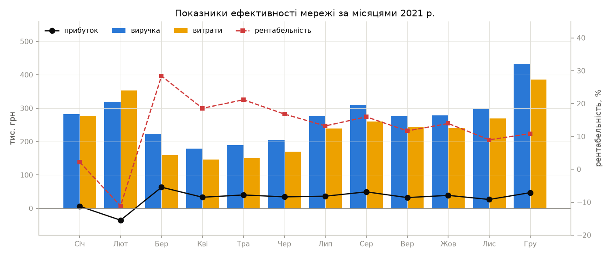

Рисунок 3 – Виручка, витрати, прибуток і рентабельність мережі за місяцями

Лютий збитковий (–35,4 тис. грн), січень майже нульовий (рентабельність 2,2 %). Нижче
собівартості продано 52 % позицій у січні і 74 % у лютому проти 2–15 % в інші місяці.
Так виглядає сезонний розпродаж. Після нього рентабельність стрибає до 28,4 % у березні
і далі поступово знижується до 9–11 % наприкінці року, а виручка зростає до піку в
грудні.

Таблиця 3 – Динаміка прибутку за регіонами, грн

| Місяць | Дніпро-Слобідський | Західний | Південний | Схід | Центральний |
| ---------- | ------------------ | ---------- | ----------- | -------- | ------------ |
| Січень | –1 127 | 4 157 | 859 | 38 | 2 376 |
| Лютий | –13 912 | –7 183 | –4 879 | –1 057 | –8 410 |
| Березень | 15 729 | 15 678 | 13 770 | 1 252 | 16 981 |
| Квітень | 9 759 | 7 149 | 5 842 | 654 | 9 890 |
| Травень | 11 286 | 9 248 | 7 227 | 899 | 11 522 |
| Червень | 9 242 | 7 609 | 6 193 | 735 | 10 625 |
| Липень | 9 908 | 7 664 | 6 786 | 641 | 11 490 |
| Серпень | 14 247 | 11 333 | 7 476 | 2 971 | 13 390 |
| Вересень | 9 170 | 7 774 | 5 449 | 385 | 9 531 |
| Жовтень | 11 448 | 8 764 | 7 126 | 646 | 10 903 |
| Листопад | 6 585 | 5 485 | 5 759 | 213 | 8 574 |
| Грудень | 12 527 | 10 038 | 8 927 | 1 025 | 14 565 |

Таблиця 4 – Місячна зміна прибутку за регіонами, %

| Місяць | Дніпро-Слобідський | Західний | Південний | Схід | Центральний |
| ---------- | ------------------ | ---------- | ----------- | -------- | ------------ |
| Лютий | –1 134,6 | –272,8 | –667,7 | –2 918,7 | –453,9 |
| Березень | 213,1 | 318,3 | 382,2 | 218,4 | 301,9 |
| Квітень | –38,0 | –54,4 | –57,6 | –47,8 | –41,8 |
| Травень | 15,6 | 29,4 | 23,7 | 37,6 | 16,5 |
| Червень | –18,1 | –17,7 | –14,3 | –18,2 | –7,8 |
| Липень | 7,2 | 0,7 | 9,6 | –12,8 | 8,1 |
| Серпень | 43,8 | 47,9 | 10,2 | 363,6 | 16,5 |
| Вересень | –35,6 | –31,4 | –27,1 | –87,0 | –28,8 |
| Жовтень | 24,8 | 12,7 | 30,8 | 67,7 | 14,4 |
| Листопад | –42,5 | –37,4 | –19,2 | –67,0 | –21,4 |
| Грудень | 90,2 | 83,0 | 55,0 | 380,4 | 69,9 |

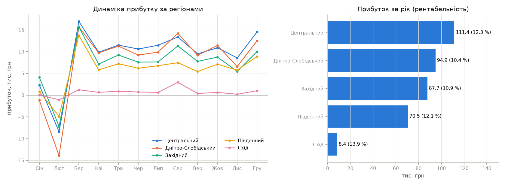

Рисунок 4 – Динаміка прибутку за регіонами і прибуток за рік

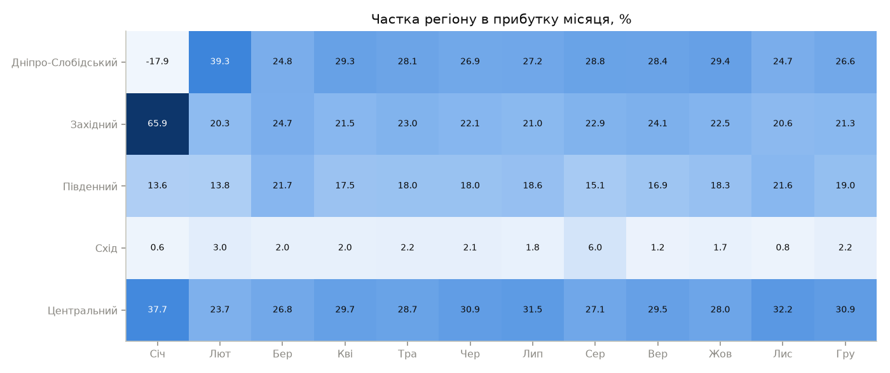

Рисунок 5 – Частка регіону в прибутку місяця

Динаміка всіх регіонів синхронна: однакові знаки зміни в усі місяці, крім липня для
Сходу. Отже, коливання задає спільна для мережі цінова політика. Центральний
регіон найприбутковіший (111,4 тис. грн), Схід дає лише 2 % прибутку (18 магазинів
і 807 проданих одиниць), але має найвищу рентабельність 13,9 %. Частки регіонів з
березня стабільні: Центральний 26–32 %, Дніпро-Слобідський 25–29 %, Західний 20–25 %,
Південний 15–22 %. У січні частки спотворені тим, що прибуток місяця близький до нуля.
Сума прибутку регіонів збігається із загальним прибутком з точністю до округлення.
Таблиці 2–4 разом з МНК-моделями збережено у файл profit_by_region.xlsx.

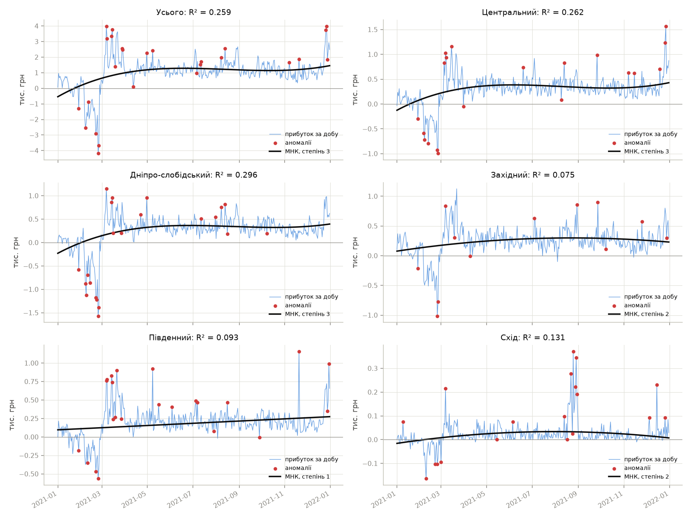

Рисунок 6 – Добовий прибуток, виявлені аномалії і МНК-моделі

Таблиця 5 – МНК-моделі добового прибутку

| Ряд | Аномалій | Степінь | $R^2$ |
| ------------------ | -- | -- | ----- |
| Усього | 26 | 3 | 0,259 |
| Центральний | 20 | 3 | 0,262 |
| Дніпро-Слобідський | 22 | 3 | 0,296 |
| Західний | 12 | 2 | 0,075 |
| Південний | 23 | 1 | 0,093 |
| Схід | 19 | 2 | 0,131 |

Тренд добового прибутку пояснює лише 8–30 % дисперсії: добові коливання (кілька
десятків продажів на день) значно більші за зміну рівня протягом року. Кубічна модель
загального прибутку відтворює збитковий початок року, вихід на плато з квітня і
зростання в грудні. Аномалії – дні розпродажу в лютому і пікові дні в березні і грудні.

### Етап 2. Рівень II: множина економічних процесів

Таблиця 6 – Властивості економічних рядів

| Показник | Курс | ІСЦ | Роздріб США | Brent |
| ------------------------ | -------------- | -------------- | -------------- | -------------- |
| $R^2$ квадратичного тренду | 0,952 | 0,989 | 0,942 | 0,567 |
| p ADF рівнів | 0,996 | 1,000 | 0,994 | 0,450 |
| p ADF приростів | < 0,001 | 0,006 | 0,001 | < 0,001 |
| середній приріст, % за місяць | 0,90 | 0,96 | 0,39 | 0,38 |
| $\sigma_r$, % | 3,98 | 1,44 | 10,08 | 9,97 |
| $\rho_1(r)$ | 0,263 | 0,624 | –0,364 | 0,262 |
| $\rho_{12}(r)$ | 0,089 | 0,226 | 0,917 | –0,004 |
| ексцес приростів | 47,9 | 27,2 | 2,0 | 5,8 |
| шоків | 6 | 2 | 0 | 4 |
| МНК: степінь, $R^2$ | 2; 0,952 | 2; 0,989 | 4; 0,956 | 1; 0,544 |
| тип процесу | випадкове блукання зі стрибками | гладкий тренд, слабка сезонність | тренд + сильна сезонність | волатильний, без стійкого тренду |

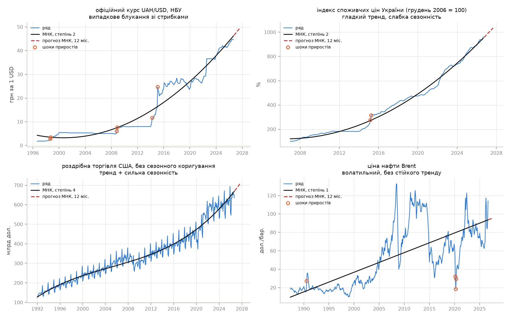

Рисунок 7 – Ряди, МНК-тренди, прогноз на 12 місяців і шоки приростів

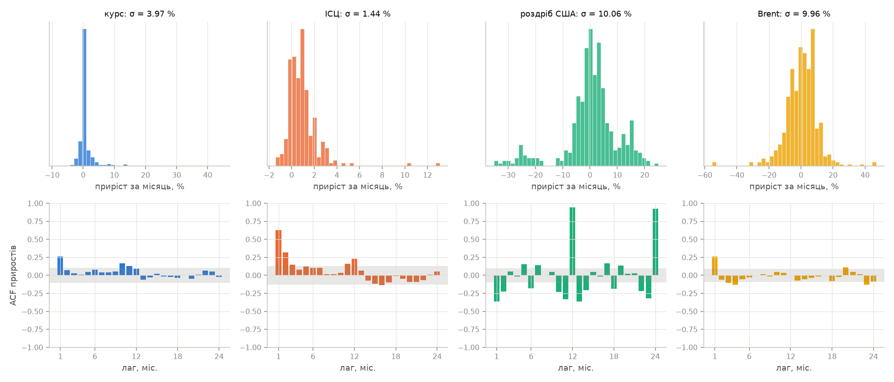

Рисунок 8 – Розподіл місячних приростів і їх автокореляція (сіра смуга – межа $\pm 2/\sqrt{n}$)

Усі чотири ряди нестаціонарні в рівнях і стаціонарні в приростах, але інші властивості
різні.

Курс – випадкове блукання зі стрибками. Роками він фіксований (2000–2008, 2010–2013,
2022–2023), тому ексцес приростів 47,9. Шоки припадають на кризи: 1998 р. (+24 %
за місяць), 2008 р. (+17 і +23 %), 2014–2015 рр. (+16 і +44,5 %). Глобальний
квадратичний тренд формально пояснює 95 % дисперсії, але це ілюзія: між стрибками ряд
не відповідає параболі.

ІСЦ – гладкий тренд з найменшою волатильністю (1,44 %) і найсильнішою інерцією
($\rho_1 = 0{,}62$): інфляція одного місяця схожа на попередню. Шоки – березень і
квітень 2015 р. (+10,3 і +13,1 %). Значуща $\rho_{12} = 0{,}23$ відображає слабку
сезонність цін.

Роздріб США має виразну річну сезонність ($\rho_{12} = 0{,}92$): січневе падіння на
21–35 % щороку і грудневий пік. Тому окремих шоків немає, сезонні коливання
перевищують навіть провал 2020 р. Від'ємна $\rho_1$ – наслідок чергування сезонних
підйомів і спадів.

Brent – волатильний процес без стійкого тренду ($R^2 = 0{,}57$): цикли 2008, 2014 і
2020 рр., шоки в серпні 1990 р. (+46 %) і в березні–травні 2020 р. (–55 % двічі і +47 %).
МНК-прогноз для нього найменш надійний.

### Етап 3. Рівень III: три класи методів та інтегрована оцінка

Ділянка спостереження $W = 120$ місяців, шість стартів на кожному ряду. Роки початку
прогнозу: курс – 2006–2024, ІСЦ – 2017–2024, роздріб – 2002–2024, Brent – 1997–2024.
Річну сезонність виявлено на всіх шести ділянках роздробу і на жодній ділянці інших
рядів. Слабка сезонність ІСЦ на 120 місяцях незначуща.

Таблиця 7 – Курс UAH/USD: часткові критерії та інтегральний показник

| Метод | RMSE 6 | RMSE 12 | RMSE 24 | $|$зм.$|$ 24 | СКВ 24 | с | U 24 | $Y$ | ранг |
| ----------------- | --------- | --------- | --------- | --------- | --------- | --------- | --------- | --------- | --------- |
| експоненційне | 0,866 | 1,371 | 2,863 | 1,907 | 3,360 | 0,095 | 1,022 | 1,084 | 1 |
| α-β фільтр | 1,158 | 2,008 | 3,518 | 2,756 | 3,565 | 0,010 | 1,256 | 1,102 | 2 |
| інтегрований | 1,029 | 1,848 | 2,976 | 2,389 | 3,433 | 5,954 | 1,063 | 1,108 | 3 |
| адаптивний вибір | 1,326 | 2,067 | 3,278 | 2,695 | 3,638 | 5,954 | 1,171 | 1,120 | 4 |
| LSTM | 1,574 | 2,265 | 3,412 | 2,926 | 3,389 | 1,138 | 1,218 | 1,123 | 5 |
| MLP | 1,780 | 2,500 | 3,335 | 2,772 | 3,427 | 0,345 | 1,191 | 1,124 | 6 |
| CNN | 1,604 | 2,641 | 3,643 | 3,086 | 3,688 | 0,855 | 1,301 | 1,131 | 7 |
| регресійне | 2,461 | 2,963 | 4,062 | 3,524 | 2,650 | 0,026 | 1,451 | 1,142 | 8 |
| МНК-поліном | 3,208 | 4,124 | 6,171 | 5,498 | 4,038 | 0,002 | 2,203 | 1,209 | 9 |
| наївний | 0,597 | 0,962 | 2,801 | 1,953 | 3,601 | 0,000 | 1,000 | – | – |

Таблиця 8 – ІСЦ України: часткові критерії та інтегральний показник

| Метод | RMSE 6 | RMSE 12 | RMSE 24 | $|$зм.$|$ 24 | СКВ 24 | с | U 24 | $Y$ | ранг |
| ----------------- | --------- | --------- | --------- | --------- | --------- | --------- | --------- | --------- | --------- |
| α-β фільтр | 17,65 | 26,68 | 43,30 | 37,74 | 12,39 | 0,009 | 0,601 | 1,083 | 1 |
| MLP | 19,54 | 25,88 | 40,88 | 33,66 | 26,66 | 0,570 | 0,568 | 1,102 | 2 |
| інтегрований | 21,53 | 26,94 | 43,64 | 37,18 | 22,30 | 5,765 | 0,606 | 1,111 | 3 |
| CNN | 20,11 | 30,28 | 47,90 | 41,78 | 31,16 | 0,686 | 0,665 | 1,117 | 4 |
| адаптивний вибір | 22,37 | 30,11 | 52,79 | 45,49 | 19,62 | 5,765 | 0,733 | 1,121 | 5 |
| експоненційне | 22,60 | 31,97 | 52,21 | 45,52 | 34,47 | 0,138 | 0,725 | 1,123 | 6 |
| LSTM | 28,68 | 36,23 | 50,60 | 45,44 | 32,44 | 1,342 | 0,702 | 1,137 | 7 |
| регресійне | 45,44 | 52,16 | 62,31 | 58,39 | 27,75 | 0,025 | 0,865 | 1,170 | 8 |
| МНК-поліном | 39,17 | 48,76 | 74,29 | 66,32 | 40,68 | 0,002 | 1,031 | 1,176 | 9 |
| наївний | 18,87 | 37,26 | 72,03 | 61,98 | 38,67 | 0,000 | 1,000 | – | – |

Таблиця 9 – Роздрібна торгівля США: часткові критерії та інтегральний показник

| Метод | RMSE 6 | RMSE 12 | RMSE 24 | $|$зм.$|$ 24 | СКВ 24 | с | U 24 | $Y$ | ранг |
| ----------------- | --------- | --------- | --------- | --------- | --------- | --------- | --------- | --------- | --------- |
| експоненційне | 13,68 | 12,48 | 18,75 | 12,44 | 17,15 | 0,763 | 0,589 | 1,095 | 1 |
| адаптивний вибір | 13,66 | 12,65 | 19,77 | 12,48 | 17,15 | 6,783 | 0,620 | 1,102 | 2 |
| інтегрований | 15,24 | 14,12 | 20,50 | 12,36 | 17,48 | 6,783 | 0,644 | 1,107 | 3 |
| MLP | 14,37 | 14,47 | 23,22 | 13,84 | 20,48 | 0,813 | 0,729 | 1,109 | 4 |
| CNN | 17,74 | 15,73 | 25,00 | 12,08 | 20,35 | 0,900 | 0,785 | 1,115 | 5 |
| регресійне | 24,25 | 21,90 | 26,67 | 14,06 | 19,11 | 0,042 | 0,837 | 1,128 | 6 |
| LSTM | 24,41 | 22,31 | 29,27 | 14,73 | 14,78 | 1,259 | 0,919 | 1,135 | 7 |
| α-β фільтр | 32,32 | 30,71 | 36,57 | 18,48 | 16,38 | 0,009 | 1,148 | 1,164 | 8 |
| МНК-поліном | 34,19 | 33,18 | 40,63 | 24,81 | 16,99 | 0,002 | 1,275 | 1,184 | 9 |
| наївний | 16,61 | 17,81 | 31,86 | 26,72 | 23,13 | 0,000 | 1,000 | – | – |

Таблиця 10 – Нафта Brent: часткові критерії та інтегральний показник

| Метод | RMSE 6 | RMSE 12 | RMSE 24 | $|$зм.$|$ 24 | СКВ 24 | с | U 24 | $Y$ | ранг |
| ----------------- | --------- | --------- | --------- | --------- | --------- | --------- | --------- | --------- | --------- |
| LSTM | 10,48 | 11,70 | 17,47 | 7,72 | 8,02 | 1,173 | 0,862 | 1,106 | 1 |
| інтегрований | 7,83 | 11,46 | 19,25 | 10,60 | 13,06 | 4,924 | 0,950 | 1,115 | 2 |
| експоненційне | 6,15 | 13,21 | 22,01 | 14,81 | 15,95 | 0,100 | 1,085 | 1,118 | 3 |
| CNN | 12,73 | 16,03 | 16,91 | 5,37 | 10,26 | 0,816 | 0,834 | 1,119 | 4 |
| MLP | 13,10 | 15,49 | 18,22 | 6,62 | 9,91 | 0,367 | 0,899 | 1,120 | 5 |
| адаптивний вибір | 7,98 | 12,30 | 22,23 | 14,32 | 13,95 | 4,924 | 1,097 | 1,129 | 6 |
| МНК-поліном | 11,50 | 15,47 | 23,08 | 15,30 | 19,06 | 0,002 | 1,139 | 1,137 | 7 |
| регресійне | 8,66 | 15,77 | 23,90 | 17,22 | 20,35 | 0,026 | 1,179 | 1,141 | 8 |
| α-β фільтр | 7,38 | 16,62 | 26,24 | 18,92 | 26,38 | 0,009 | 1,294 | 1,153 | 9 |
| наївний | 5,53 | 11,22 | 20,27 | 13,17 | 14,79 | 0,000 | 1,000 | – | – |

У таблицях 7–10 «$|$зм.$|$ 24» – модуль зміщення, «СКВ 24» – розкид RMSE 24 між
стартами, «с» – середній час навчання і прогнозу в секундах (у схему входить як
$\lg(1 + t_{\text{мс}})$), U 24 – коефіцієнт Тейла, відношення RMSE 24 до наївного
прогнозу. Для інтегрованого прогнозу і адаптивного вибору час – сума всіх семи
методів на обох ділянках.

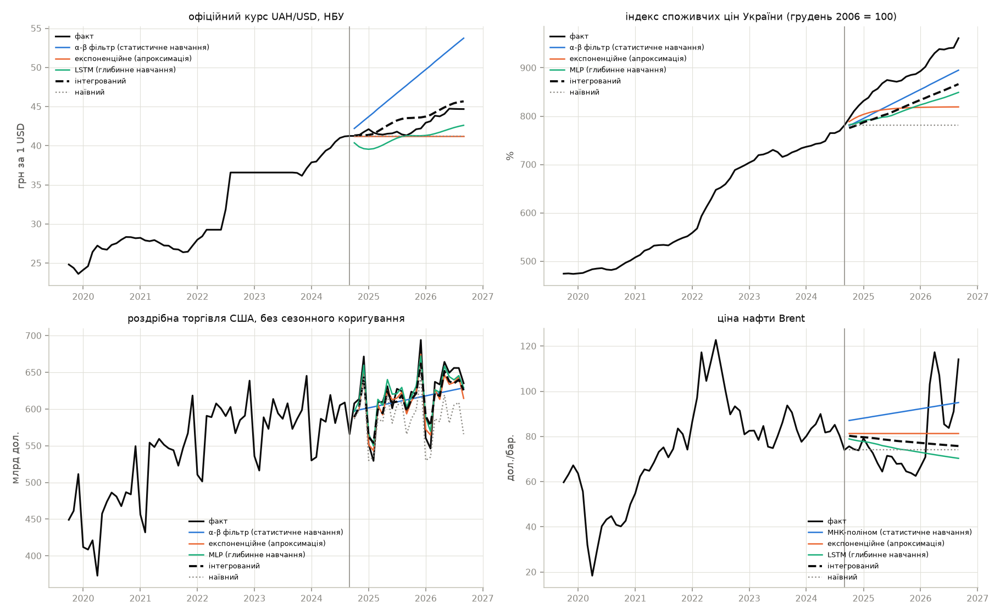

Рисунок 9 – Прогноз з останнього старту: кращий метод кожного класу, інтегрований і
наївний прогнози

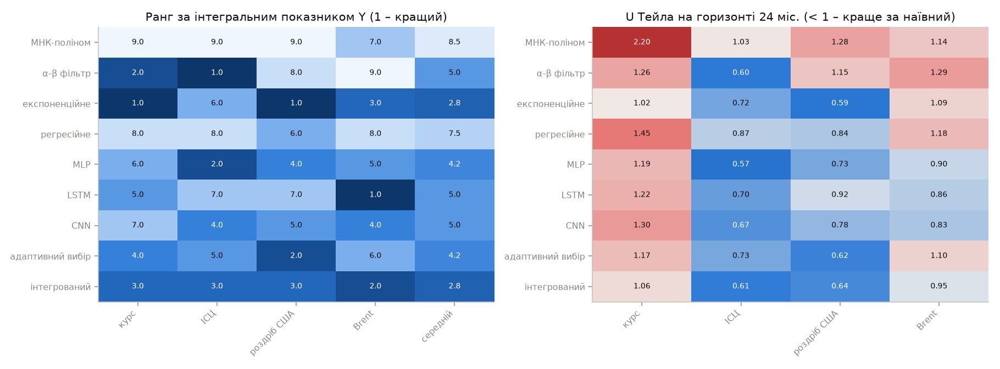

Рисунок 10 – Ранг методів за інтегральним показником і коефіцієнт Тейла на 24 місяцях

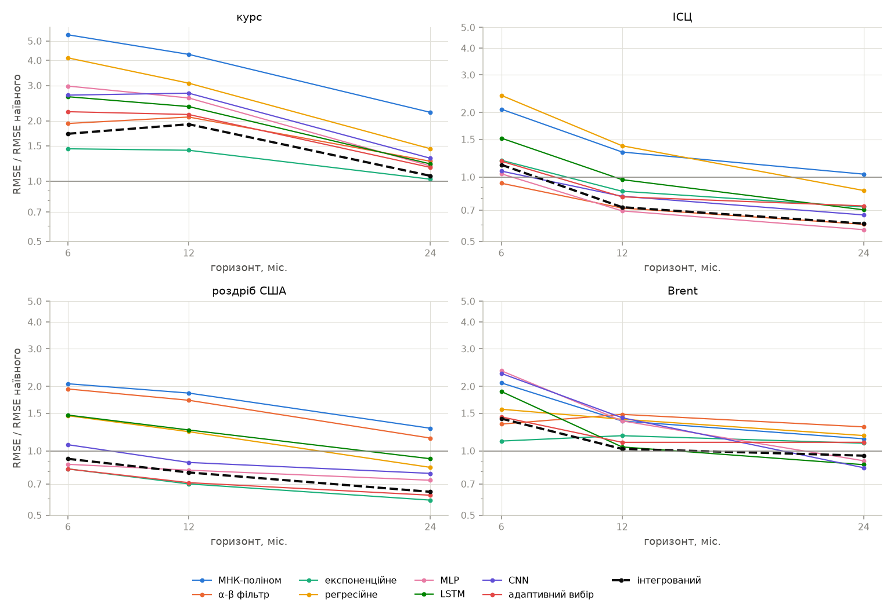

Рисунок 11 – RMSE методів відносно наївного прогнозу на горизонтах 6, 12 і 24 місяці

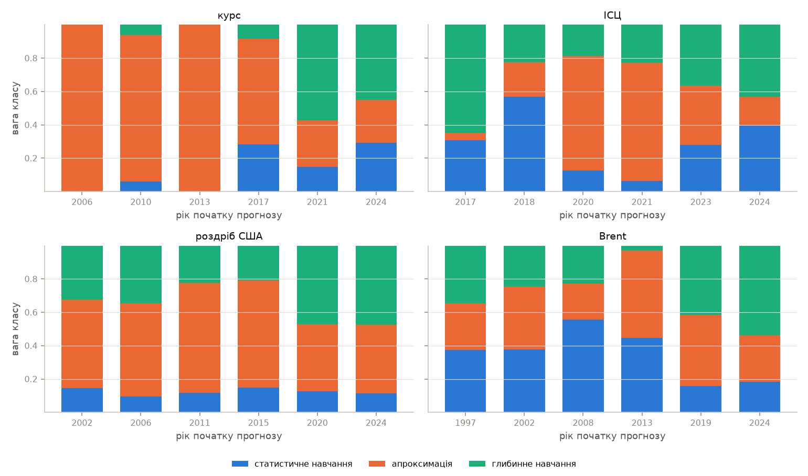

Рисунок 12 – Ваги класів в інтегрованому прогнозі на кожному старті

Таблиця 11 – Перший метод за трьома наборами ваг і ранг інтегрованого прогнозу

| Ряд | Задані ваги | Рівні ваги | Ентропійні ваги | Ранг інтегрованого |
| ------------- | ----------------- | ----------------- | ----------------- | ---------------- |
| Курс | експоненційне | експоненційне | α-β фільтр | 3 / 3 / 5 |
| ІСЦ | α-β фільтр | α-β фільтр | α-β фільтр | 3 / 3 / 7 |
| Роздріб США | експоненційне | експоненційне | експоненційне | 3 / 4 / 6 |
| Brent | LSTM | LSTM | МНК-поліном | 2 / 5 / 8 |

Ранг інтегрованого прогнозу в таблиці 11 наведено для заданих, рівних і ентропійних ваг
відповідно. Задані й рівні ваги дають однакового переможця на всіх рядах. Ентропійні ваги віддають
вартості 0,37–0,41 сумарної ваги, бо час обчислень методів різниться на три порядки,
а похибки – у межах двох разів. Тому за ентропійними вагами вигравати починають дешеві
методи, а інтегрований прогноз, найдорожчий, опускається. Ентропійне зважування міряє
розкид критерію і нічого не каже про його важливість, тому для цієї задачі непридатне як
єдиний набір ваг.

## 3.5. Програмний код

Повний код наведено в архіві проекту. Нижче – ключові фрагменти.

Показники ефективності і динаміка прибутку за регіонами:

```python
def indicators(frame):
    frame = frame.copy()
    frame["revenue"] = frame["qty"] * frame["price"]
    frame["costs"] = frame["qty"] * frame["cost"]
    frame["profit"] = frame["revenue"] - frame["costs"]
    frame["month_no"] = frame["date"].dt.month
    return frame


def dynamics(frame):
    profit = frame.pivot_table(
        "profit", "month_no", "region", aggfunc="sum"
    ).fillna(0.0)
    profit.index = [MONTHS[m - 1] for m in profit.index]
    change = 100 * profit.diff() / profit.shift().abs()
    share = 100 * profit.div(profit.sum(axis=1), axis=0)
    return profit, change, share
```

Нелінійна схема компромісів:

```python
def normalize(matrix):
    x = np.asarray(matrix, dtype=float)
    total = x.sum(axis=0)
    return np.divide(x, total, out=np.zeros_like(x), where=total > 0)


def compromise(matrix, weights):
    w = np.asarray(weights, dtype=float)
    return (w / w.sum() / (1.0 - normalize(matrix))).sum(axis=1)
```

Інтегрований прогноз трьох класів на одному старті:

```python
def integrate(inner, truth, full):
    table = pd.DataFrame(
        {m: errors(truth, inner[m]) for m in METHODS}
    ).T
    y = integral.rate(table, dict.fromkeys(INNER, 1.0))["Y"]
    leaders = {
        c: min(ms, key=lambda m: y[m]) for c, ms in CLASSES.items()
    }
    w = np.array([1.0 / max(y[m] - 1.0, 1e-12) for m in leaders.values()])
    w /= w.sum()
    forecast = sum(
        wi * full[m] for wi, m in zip(w, leaders.values(), strict=True)
    )
    weights = dict(zip(leaders, w, strict=True))
    return forecast, full[y.idxmin()], {
        "leaders": leaders, "weights": weights, "Y": y
    }
```

Прогноз адаптивним α-β фільтром з кінцевого стану:

```python
def alpha_beta(train, steps, period):
    _, _, memory, _, _ = adaptive.run(train, 2)
    x, v, _ = filters.fit_state(train[-memory[-1] :], 2)
    return x + v * np.arange(1, steps + 1)
```

## 3.6. Аналіз результатів та верифікація

### Верифікація

Схему компромісів перевірено на матрицях з відомою відповіддю. Альтернатива, кращої
за всіма критеріями, отримує менший $Y$. Множення критерію на 1000 не змінює рангів.
З альтернатив з однаковою сумою нормованих критеріїв (0,5 і 0,1 проти 0,3 і 0,3)
рівномірна краща. Усі три перевірки виконано.

Технологію рівня III цілком перевірено на трьох сигналах довжиною 180 місяців з
відомою структурою, по дві реалізації, три старти. Перевірялися три твердження:
кращий метод досягає рівня шуму, інтегрований прогноз близький до кращого, а клас без
моделі сезонності відсікається.

1. Лінійний тренд $100 + 0{,}5t$ з шумом $N(0;\ 3^2)$. Точна модель є в усіх трьох
   класах.
2. Той самий тренд плюс річна синусоїда з амплітудою 15. Поліном і α-β фільтр її не
   описують.
3. Несиметричний цикл періоду 7 з амплітудою 15 і шумом $N(0;\ 1{,}5^2)$. Його не
   описують поліном, α-β фільтр і річні гармоніки, але описує регресія на лаги і мережа
   на залишку.

У таблиці 12 RMSE обчислено на 24 кроках, останні три стовпці – середні ваги класів
в інтегрованому прогнозі.

Таблиця 12 – Верифікація на сигналах з відомою структурою

| Сигнал, реалізація | Кращий метод | Кращий, RMSE / σ | Інтегр., RMSE / σ | Стат. навч. | Апрокс. | Глиб. навч. |
| -------------------- | --------------- | ---------- | ---------- | --------- | --------- | --------- |
| лінійний тренд, 1 | експоненційне | 1,078 | 1,094 | 0,314 | 0,314 | 0,372 |
| лінійний тренд, 2 | MLP | 1,040 | 1,039 | 0,340 | 0,315 | 0,345 |
| тренд + сезон 12, 1 | регресійне | 1,107 | 1,138 | 0,093 | 0,445 | 0,462 |
| тренд + сезон 12, 2 | регресійне | 1,040 | 1,164 | 0,130 | 0,429 | 0,441 |
| цикл 7, 1 | MLP | 1,121 | 1,253 | 0,041 | 0,348 | 0,612 |
| цикл 7, 2 | CNN | 1,068 | 1,405 | 0,047 | 0,385 | 0,568 |

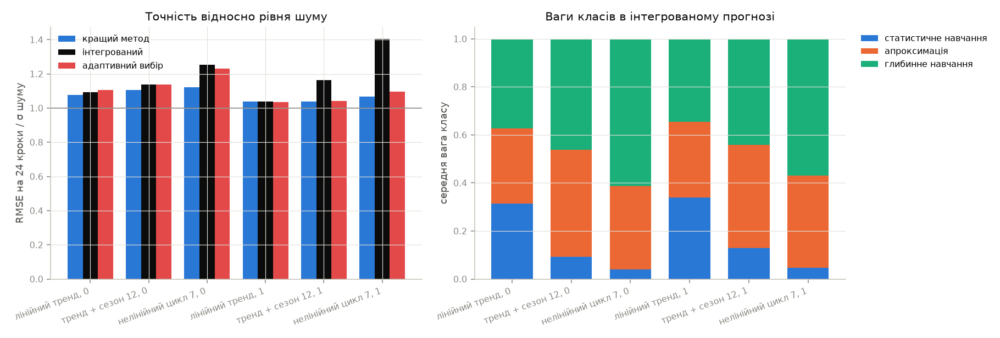

Рисунок 13 – Точність відносно рівня шуму і ваги класів на сигналах з відомою структурою

Кращий метод у всіх шести випадках має RMSE на 24 кроках у межах 1,04–1,12σ, тобто
на рівні неусувного шуму. На лінійному тренді класи отримують майже рівні ваги
(0,31–0,37), бо точна модель є в кожному. На сезонному сигналі і циклі вага
статистичного навчання падає до 0,04–0,13. Інтегрований прогноз гірший за кращий метод
не більше ніж на 12 % у п'яти випадках з шести. Виняток – друга реалізація циклу:
1,41σ проти 1,07σ у CNN. На всіх стартах лідером апроксимації тут була регресія з вагою
0,35–0,44, а лідер мереж за внутрішньою валідацією змінювався (LSTM, CNN, MLP). Отже,
12 місяців валідації не завжди вказують на метод, кращий на 24 місяцях.

### Аналіз результатів рівня III

Жоден клас не виграє на всіх рядах. Кращі методи – експоненційне згладжування на курсі
й роздробі, α-β фільтр на ІСЦ, LSTM на Brent. Найкращий за середнім рангом окремий метод –
експоненційне згладжування (2,8), але на ІСЦ воно шосте. Переможець пояснюється
властивостями з таблиці 6:

- курс – випадкове блукання, тому найкращий прогноз близький до останнього значення.
  Експоненційне згладжування (просте або Хольта залежно від старту) відхиляється від
  нього найменше. Наївний прогноз на 6 і 12 місяцях не перевершив жоден метод,
  на 24 місяцях U 24 = 1,02 у кращого;
- ІСЦ – гладкий тренд з інерцією, тому α-β фільтр, що відстежує локальний нахил і
  перезапускає пам'ять після зламу, дає U 24 = 0,60 при найменшому розкиді між стартами;
- роздріб – сильна сезонність. Експоненційне згладжування обрало сезонну структуру на
  всіх стартах, на п'яти з шести – Хольта–Вінтерса (U 24 = 0,59).
  Методи без сезонної компоненти (поліном, α-β фільтр) гірші за сезонний наївний прогноз;
- Brent – волатильний ряд без тренду. Мережі тут найменш зміщені: $|$зміщення$|$ 24
  у 5–8 дол. проти 15–19 у методів інших класів. На 24 місяцях серед окремих методів
  лише мережі кращі за наївний прогноз (U 24 = 0,83–0,90).

Глобальний МНК-поліном останній або передостанній на всіх рядах: екстраполяція
полінома за межі ділянки нестійка. Регресійне згладжування, що теж екстраполює тренд
за часом, передостаннє за середнім рангом (7,5).

Інтегрований прогноз має найкращий разом з експоненційним згладжуванням середній ранг
2,8 і на кожному ряду посідає друге-третє місце. Він не виграє ніде, але й не провалюється
ніде: U 24 = 1,06, 0,61, 0,64 і 0,95. Кращий окремий метод кожного ряду заздалегідь
невідомий. Вибір одного методу за внутрішньою валідацією (адаптивний вибір, середній
ранг 4,2) поступається інтегрованому прогнозу на трьох рядах з чотирьох: 12 місяців
валідації недостатньо, щоб надійно визначити одного переможця, а зважування трьох
лідерів згладжує помилку такого вибору. Ваги класів на рисунку 12 змінюються від
старту до старту разом із властивостями ряду. На курсі в період фіксованого курсу
(2006, 2013) вага апроксимації дорівнює 1. На роздробі вага статистичного навчання
не перевищує 0,15.

Ціна інтегрованого прогнозу – обчислювальна вартість (5–7 с проти 0,1 с у
експоненційного згладжування) за навчання семи методів двічі. Для місячних
економічних рядів це несуттєво.

# IV. Висновки

На рівні I розпарсено файл продажів мережі магазинів, до продажів приєднано довідник
регіонів, обчислено виручку, витрати, прибуток і рентабельність за місяцями і регіонами.
Річний прибуток – 373 тис. грн при рентабельності 11,4 %, з них 30 % дає Центральний
регіон. Динаміка прибутку всіх регіонів синхронна: лютий збитковий через розпродаж
(74 % позицій нижче собівартості), після нього прибуток відновлюється і має пік у
грудні. МНК-моделі добового прибутку степеня 1–3 пояснюють 8–30 % дисперсії, решта –
добові коливання. Таблиці динаміки і моделі збережено у файл.

На рівні II проаналізовано чотири економічні показники з різними властивостями: курс
гривні (випадкове блукання зі стрибками, ексцес приростів 48), ІСЦ України (гладкий
тренд з інерцією і слабкою сезонністю), роздрібну торгівлю США (сильна річна
сезонність, $\rho_{12} = 0{,}92$) і нафту Brent (волатильний процес без тренду).
Усі ряди нестаціонарні в рівнях і стаціонарні в приростах. Шоки приростів, знайдені
за порогом з поправкою Бонферроні, збігаються з відомими кризами.

На рівні III розроблено технологію, що обробляє кожен ряд сімома методами трьох класів і
зводить результати в інтегровану оцінку за нелінійною схемою компромісів за шістьма
частковими критеріями: точність на трьох горизонтах, зміщення, стабільність і
вартість. Переможець залежить від властивостей ряду: експоненційне згладжування на
курсі й роздробі, α-β фільтр на ІСЦ, LSTM на Brent. Глобальний МНК-поліном для
прогнозу на 24 місяці непридатний на всіх рядах. Висновки стійкі до заміни заданих ваг
рівними. Ентропійні ваги переоцінюють критерій вартості і для цієї задачі непридатні.

Оригінальне рішення – інтегрований прогноз, що на кожному старті визначає лідера кожного
класу за внутрішньою валідацією і зважує їхні прогнози обернено до частки похибки
$(Y - 1)^{-1}$. Він посідає друге-третє місце на кожному ряду і має найкращий
середній ранг 2,8 разом з експоненційним згладжуванням, перевершуючи вибір одного
методу за тією самою валідацією. Верифікація на сигналах з відомою структурою
підтвердила, що кращий метод виходить на рівень шуму (1,04–1,12σ), а клас без моделі
сезонності автоматично отримує вагу 0,04–0,13. Обмеження рішення – коротка внутрішня
валідація (12 місяців): метод, кращий на ній, не завжди кращий на горизонті 24 місяці.

# Перелік джерел

1. Національний банк України. Відкриті дані: API статистики та курсів валют. URL: https://bank.gov.ua/ua/open-data/api-dev
2. Federal Reserve Bank of St. Louis. FRED Economic Data. URL: https://fred.stlouisfed.org
3. Pysarchuk O., Andreieva T., Grinenko O., Baran D. Multi-factor forecasting of statistical trends for Data Science problems. System Research and Information Technologies. 2024. No. 2. P. 21–34. DOI: 10.20535/SRIT.2308-8893.2024.2.02
4. Keras 3 API documentation. URL: https://keras.io/api/
