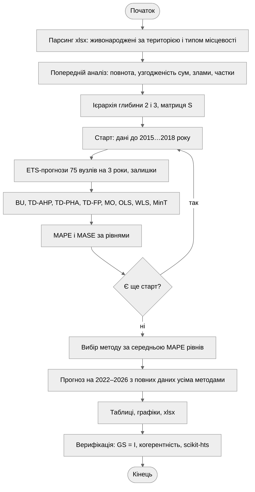
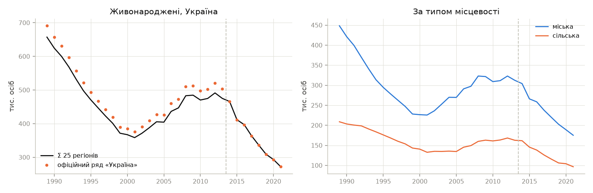
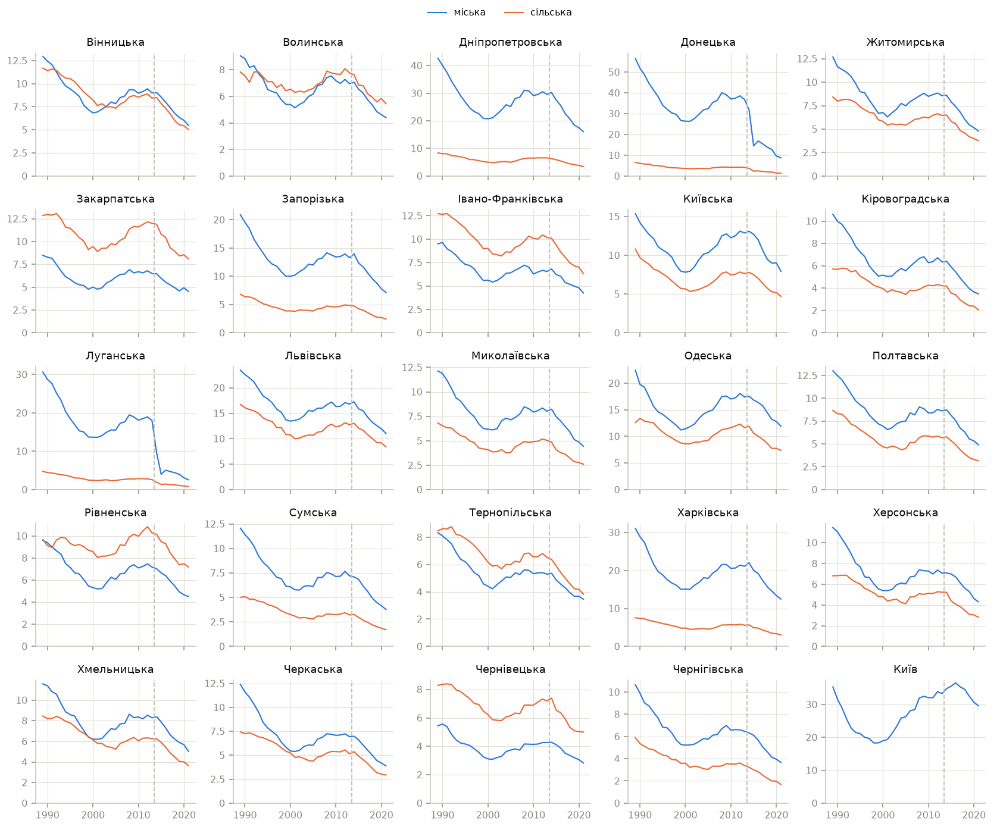
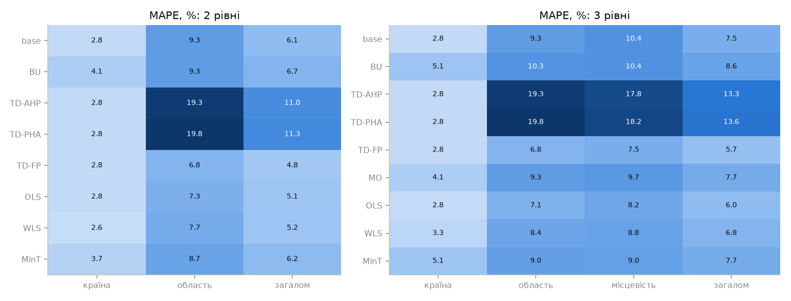
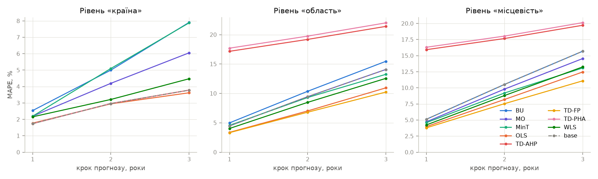
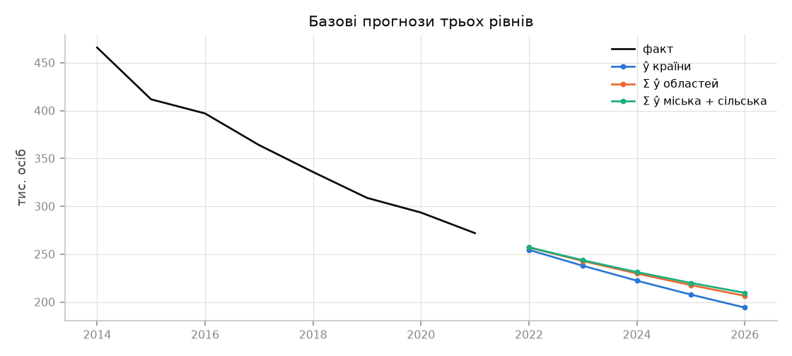
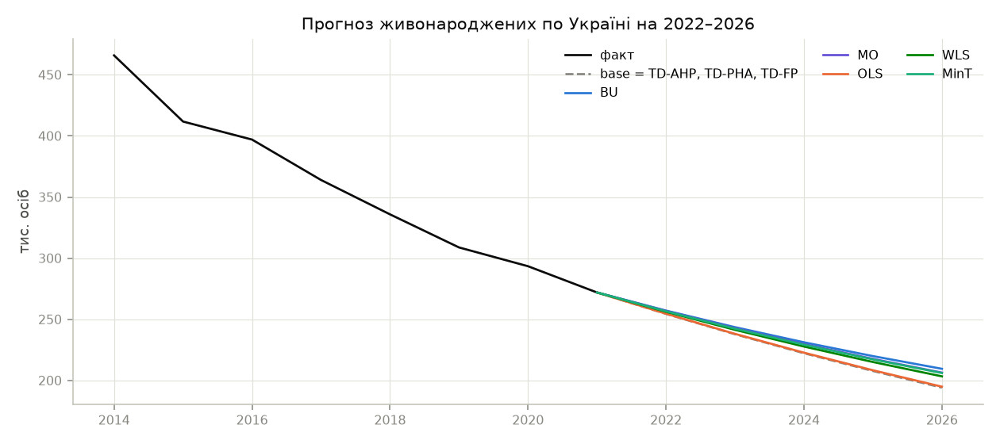
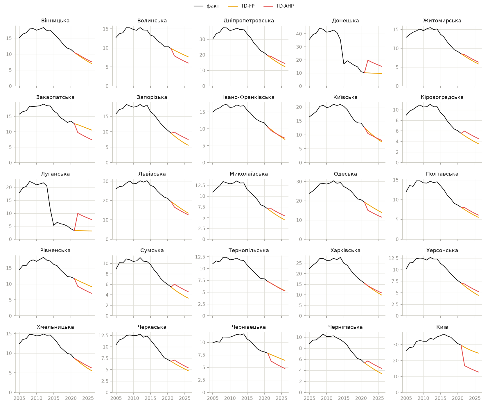
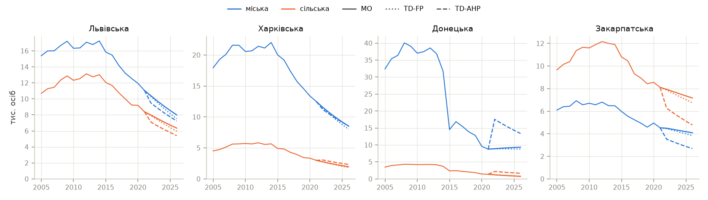

# І. Мета

Дослідити прикладні аспекти розробки, навчання та аналізу моделей ієрархічного
прогнозування на прикладі датасету з регіональним розподілом даних та ієрархічною
структурою.

# ІІ. Завдання

Рівень III, варіант 8. В інтересах державних установ здійснити прогнозування
статистичних даних щодо населення методами bottom-up, top-down, middle-out і
reconciliation на датасеті 2_dataset_POPULATION_BIRTH.xlsx, порівняти результати
методів і зробити висновок про оптимальний метод для цього датасету.

Необхідно реалізувати:

1. Парсинг файлу датасету.
2. Попередній аналіз даних та їх обробку.
3. Модель прогнозування за ієрархією області → країна підходами bottom-up, top-down,
   middle-out, reconciliation.
4. Для middle-out використати дані з більше ніж двома рівнями ієрархії.
5. Прогнозування динаміки народжуваності за регіонами та країною (таблиця, графік).
6. Візуалізацію рішення та порівняння підходів між собою.
7. Висновки щодо оптимального методу для поточного датасету.

# ІІІ. Результати виконання лабораторної роботи

## 3.1. Синтезована математична модель

### 3.1.1. Ієрархічна структура

Датасет Держстату [1] містить 18 демографічних показників у розрізах віку матері й
батька, статі, сімейного стану, громадянства і типу місцевості. Для прогнозу взято
річну кількість живонароджених за 1989–2021 роки з підсумковими значеннями всіх
розрізів, крім території і типу місцевості. Розріз за типом місцевості (міська,
сільська) дає третій рівень ієрархії в тому самому джерелі:

- рівень 0 – Україна, 1 ряд;
- рівень 1 – 24 області і м. Київ, 25 рядів;
- рівень 2 – міська і сільська місцевість кожної області, 49 рядів (у Києві лише
  міська).

Автономна Республіка Крим і м. Севастополь не входять в ієрархію: з 2014 року даних
по них немає, а вузол, що зникає посеред вибірки, порушує сталість структури.
Рівень «Україна» рахується як сума 25 регіонів і з 2014 року точно збігається з
офіційним рядом.

Ієрархія записується сумувальною матрицею $S$ розміром $n \times m$, де $n = 75$ – усі
вузли, $m = 49$ – нижній рівень:

$$y_t = S b_t, \qquad S = \begin{pmatrix} \mathbf{1}^\mathsf{T} \\ S_{1} \\ I_m \end{pmatrix}$$

де $b_t$ – значення нижнього рівня, $S_1$ – матриця 25 × 49 з одиницями на перетині
області та її типів місцевості. Для дворівневої постановки області → країна нижнім
рівнем є області: $m = 25$, $S = (\mathbf{1}, I_{25})^\mathsf{T}$.

### 3.1.2. Базові прогнози

Кожен з 75 рядів прогнозується незалежно експоненційним згладжуванням, яке
застосовується до $\ln y_t$, щоб прогноз лишався додатним, а тренд був відносним.
Модель обирається за найменшим AICc серед трьох:

- просте згладжування (SES): $\ell_t = \alpha z_t + (1 - \alpha)\ell_{t-1}$, де $z_t = \ln y_t$;
- метод Хольта з адитивним трендом $b_t$;
- метод Хольта із затуханням тренду: $\hat z_{t+h} = \ell_t + (\phi + \phi^2 + \dots + \phi^h) b_t$.

Базові прогнози $\hat y_h$ не когерентні: прогноз країни не дорівнює сумі прогнозів
областей.

### 3.1.3. Методи ієрархічного прогнозування

Кожен метод дає прогноз нижнього рівня $\tilde b_h$, а прогноз усієї ієрархії
$\tilde y_h = S \tilde b_h$ когерентний за побудовою. Лінійні методи мають вигляд
$\tilde y_h = S G \hat y_h$.

Bottom-up (BU) бере базові прогнози нижнього рівня: $G = (0 \mid I_m)$.

Top-down розподіляє прогноз країни $\hat y_{0,h}$ за частками $p_j$:
$\tilde b_{j,h} = p_j \hat y_{0,h}$. Частки визначаються трьома способами [2]:

$$p_j^{AHP} = \frac{1}{T} \sum_{t=1}^{T} \frac{y_{j,t}}{y_{0,t}}, \qquad p_j^{PHA} = \frac{\bar y_j}{\bar y_0}, \qquad p_{j,h}^{FP} = \prod_{k=0}^{K-1} \frac{\hat y_{j,h}^{(k)}}{\hat S_{j,h}^{(k+1)}}$$

У TD-FP (forecast proportions) $\hat y_{j,h}^{(k)}$ – базовий прогноз предка листа $j$
на $k$ рівнів вище, $\hat S_{j,h}^{(k+1)}$ – сума базових прогнозів його сиблінгів
разом із ним. Частки беруться з прогнозів, тож враховують зміну структури.

Middle-out (MO) прогнозує на рівні областей. Угору прогнози сумуються, униз
розподіляються на міську і сільську місцевість частками прогнозу, як у TD-FP, але від
області.

Reconciliation (оптимальне узгодження) [3] шукає когерентний прогноз, найближчий до
базових за узагальненим МНК:

$$G = (S^\mathsf{T} W^{-1} S)^{-1} S^\mathsf{T} W^{-1}$$

- OLS: $W = I_n$;
- WLS зі структурними вагами: $W = \text{diag}(S \mathbf{1})$, вага вузла обернена до кількості листів у ньому;
- MinT: $W$ – коваріація однокрокових залишків базових моделей. 75 рядів
  за 33 роки дають вироджену вибіркову коваріацію $\hat\Sigma$, тому вона
  стискається до діагоналі: $W = \lambda\, \text{diag}(\hat\Sigma) + (1 - \lambda) \hat\Sigma$,
  де $\lambda$ визначається за Шефером–Штріммером [4].

Для OLS, WLS, MinT і BU $GS = I_m$: незміщені базові прогнози лишаються незміщеними.
Для top-down ця властивість не виконується.

### 3.1.4. Оцінювання методів

Методи порівнюються ретроспективно з ковзним початком прогнозу: моделі навчаються на
даних до 2015, 2016, 2017 і 2018 року і прогнозують на 3 роки вперед. Усі старти лежать
після злому 2014 року, тож перевірка відповідає поточній структурі даних. Похибки
усереднюються за стартами, кроками і вузлами окремо для кожного рівня:

$$\text{MAPE} = \frac{100}{N}\sum \frac{|\tilde y - y|}{y}, \qquad \text{MASE} = \frac{1}{N}\sum \frac{|\tilde y - y|}{\frac{1}{T-1}\sum_t |y_t - y_{t-1}|}$$

MASE нормує похибку на середню річну зміну ряду і порівнює вузли різного масштабу.
Оптимальним вважається метод з найменшою середньою MAPE трьох рівнів, взятих з
однаковою вагою.

## 3.2. Блок-схема алгоритму та її опис



Рисунок 1 – Блок-схема алгоритму програми

Після парсингу і попереднього аналізу будуються дві ієрархії: дворівнева (області →
країна) і трирівнева (з типом місцевості). Для кожного старту ретроспективної перевірки
базові моделі навчаються заново, і їхні прогнози узгоджуються всіма методами. Найкращий
метод визначається за похибками на всіх стартах. Підсумковий прогноз будується з
повних даних. Верифікація перевіряє властивості методів і збіг з бібліотекою
scikit-hts [5].

## 3.3. Опис структури проекту програми

```
project/
├── justfile         рецепти запуску та збірки звіту
├── pyproject.toml   залежності лабораторної роботи
├── data/            births.csv – відібрані ряди
├── out/             графіки, births_forecast.xlsx
└── src/
    ├── main.py        точка входу, етапи 1–4
    ├── loaders.py     парсинг датасету Держстату
    ├── analysis.py    попередній аналіз
    ├── hierarchy.py   вузли, рівні, матриця S
    ├── base.py        базові ETS-прогнози
    ├── reconcile.py   BU, TD, MO, OLS, WLS, MinT
    ├── evaluate.py    ретроспективна перевірка, прогноз
    ├── verify.py      верифікація методів
    ├── figures.py     графіки і таблиця xlsx
    └── plots.py       оформлення графіків
```

Рисунок 2 – Структура проекту

Методи в `reconcile.py` не залежать від даних: кожен отримує ієрархію, базові
прогнози, залишки та історію і повертає прогноз нижнього рівня. Тому ті самі функції
працюють для дворівневої і трирівневої ієрархії. Бібліотека scikit-hts 0.5.12 з
сучасною версією pandas виконує лише BU, OLS і WLS: top-down завершується помилкою,
частки прогнозу дають нулі, а middle-out у ній немає. Тому всі методи реалізовано
матрично в numpy, а scikit-hts використано для звірки.

Використані бібліотеки: `pandas` – парсинг Excel і таблиці; `numpy` – матриці
ієрархії й узгодження; `statsmodels` – експоненційне згладжування; `scikit-hts` –
контроль BU, OLS, WLS; `matplotlib` – візуалізація; `openpyxl` – файли Excel.

## 3.4. Результати роботи програми

### Етап 1. Парсинг і попередній аналіз

З 37 818 рядків файлу відібрано 2 688 значень: 28 територій, три типи місцевості,
1989–2021 роки. Значення за 2022 рік у файлі відсутні. Неповні ряди мають лише Крим
(25 років) і Севастополь (24 роки). Сума міської і сільської місцевості дорівнює
значенню області без розбіжностей. Офіційний ряд «Україна» до 2013 року відрізняється
від суми 25 регіонів рівно на Крим і Севастополь, а з 2014 року збігається з нею.



Рисунок 3 – Кількість живонароджених в Україні і за типом місцевості

Ряд країни має дві хвилі. Після 1989 року (657 тис.) народжуваність падала до мінімуму
2001 року (359 тис.), потім зростала до піку 2012 року (491 тис.). З 2014 року падіння
прискорилося, і у 2021 році народилося 272 тис. дітей, на 44,7 % менше, ніж на піку.
Частка міських народжень за весь період змінилася мало: 68,2 % у 1989 році і 64,4 % у 2021.



Рисунок 4 – Живонароджені за областями, міська і сільська місцевість

Динаміка областей синхронна, але з двома винятками. У Луганській (–53,8 %) і Донецькій
(–52,4 %) областях у 2015 році стався злам: дані з тимчасово окупованих територій
більше не враховуються. Через це частка Донецької області у країні зменшилася з 8,7 %
(середня за 1989–2013) до 3,7 % у 2021 році, а частка Києва зросла з 5,6 % до 10,9 %.
За 2013–2021 роки народжуваність знизилася в усіх регіонах: від –11,1 % у Києві до
–83,7 % у Луганській області. На заході (Закарпатська, Волинська, Рівненська,
Чернівецька, Тернопільська, Івано-Франківська області) сільських народжень більше,
ніж міських. У решті областей переважають міські.

### Етап 2. Ретроспективна перевірка методів

Таблиця 1 – MAPE методів, %, трирівнева ієрархія

| Метод | Країна | Область | Місцевість | Загалом |
| ------ | ------ | ------- | ---------- | ------- |
| base | 2,83 | 9,33 | 10,44 | 7,53 |
| BU | 5,15 | 10,27 | 10,44 | 8,62 |
| TD-AHP | 2,83 | 19,25 | 17,77 | 13,28 |
| TD-PHA | 2,83 | 19,82 | 18,15 | 13,60 |
| TD-FP | 2,83 | 6,79 | 7,47 | 5,69 |
| MO | 4,15 | 9,33 | 9,69 | 7,72 |
| OLS | 2,78 | 7,12 | 8,21 | 6,03 |
| WLS | 3,28 | 8,36 | 8,76 | 6,80 |
| MinT | 5,06 | 9,04 | 8,95 | 7,68 |

Таблиця 2 – MASE методів, трирівнева ієрархія

| Метод | Країна | Область | Місцевість | Загалом |
| ------ | ------ | ------- | ---------- | ------- |
| base | 0,45 | 1,20 | 1,39 | 1,01 |
| BU | 0,81 | 1,36 | 1,39 | 1,19 |
| TD-AHP | 0,45 | 2,01 | 1,91 | 1,46 |
| TD-PHA | 0,45 | 2,07 | 1,94 | 1,49 |
| TD-FP | 0,45 | 0,77 | 0,89 | 0,70 |
| MO | 0,65 | 1,20 | 1,27 | 1,04 |
| OLS | 0,44 | 0,80 | 0,98 | 0,74 |
| WLS | 0,52 | 1,03 | 1,11 | 0,89 |
| MinT | 0,80 | 1,28 | 1,24 | 1,10 |



Рисунок 5 – MAPE методів за рівнями для дворівневої і трирівневої ієрархії

У дворівневій ієрархії порядок методів такий самий: TD-FP (4,81 %), OLS (5,07 %),
WLS (5,18 %), base (6,08 %), MinT (6,18 %), BU (6,74 %), TD-AHP і TD-PHA (11,0–11,3 %).
Найточніший базовий прогноз має ряд країни (MAPE 2,83 %). Агрегат згладжує випадкові
коливання областей, і його тренд стабільніший. Усі top-down методи зберігають цей
прогноз на верхньому рівні. BU сумує 49 прогнозів нижнього рівня з власними трендами,
і на рівні країни його похибка майже вдвічі більша.

Top-down з історичними частками (AHP, PHA) дає найбільші похибки на нижніх рівнях –
19–20 %. Частки, усереднені за 1989–2018 роки, не враховують злому 2014 року. Донецькій
області приписується вдвічі більша частка, а Києву – вдвічі менша, ніж є насправді.
TD-FP бере частки з базових прогнозів областей, тому зберігає сучасну структуру і має
найменшу похибку на рівнях області й місцевості.

MinT гірший за OLS і WLS. Його ваги залежать від коваріації залишків за всі роки, а
в ній домінують залишки 2014–2015 років Донецької і Луганської областей
($\lambda = 0{,}15$, стискання слабке). Middle-out точніший за BU на всіх рівнях, але
поступається TD-FP і OLS: прогноз рівня областей несе ту саму похибку, що й base на
цьому рівні.



Рисунок 6 – MAPE залежно від кроку прогнозу, трирівнева ієрархія

Похибка всіх методів зростає з горизонтом приблизно лінійно. Порядок методів на
кожному кроці однаковий, тож висновок не залежить від горизонту в межах трьох років.

### Етап 3. Прогноз на 2022–2026 роки

На повних даних для 65 з 75 вузлів обрано метод Хольта, для 6 – просте згладжування,
для 4 – Хольта із затуханням. Просте згладжування обрано, зокрема, для Донецької і
Луганської областей: тренд після злому не оцінюється надійно.



Рисунок 7 – Базові прогнози країни і суми прогнозів нижніх рівнів

Базовий прогноз країни нижчий за суму прогнозів нижнього рівня на 1,1 % у 2022 році і
на 7,9 % у 2026 році. Без узгодження прогнози за рівнями суперечать одне одному.

Таблиця 3 – Прогноз кількості живонароджених по Україні, осіб

| Метод | 2022 | 2023 | 2024 | 2025 | 2026 |
| ---------------------- | ------- | ------- | ------- | ------- | ------- |
| base, TD-AHP, TD-PHA, TD-FP | 254 477 | 237 838 | 222 287 | 207 752 | 194 168 |
| BU | 257 173 | 243 612 | 231 251 | 219 937 | 209 551 |
| MO | 256 943 | 242 831 | 229 771 | 217 668 | 206 437 |
| OLS | 254 622 | 238 138 | 222 743 | 208 362 | 194 929 |
| WLS | 256 198 | 241 427 | 227 770 | 215 119 | 203 385 |
| MinT | 256 608 | 242 373 | 229 292 | 217 233 | 206 088 |



Рисунок 8 – Прогноз живонароджених по Україні різними методами

Усі методи продовжують спадний тренд 2014–2021 років. Розкид між методами у 2026 році –
194–210 тис. За обраним методом TD-FP народжуваність у 2026 році становитиме 194 тис.,
на 28,6 % менше, ніж у 2021 році.

Таблиця 4 – Прогноз живонароджених за регіонами методом TD-FP, осіб

| Регіон | 2021, факт | 2022 | 2023 | 2024 | 2025 | 2026 |
| ----------------- | ------- | ------- | ------- | ------- | ------- | ------- |
| Україна | 271 983 | 254 477 | 237 838 | 222 287 | 207 752 | 194 168 |
| Вінницька | 10 529 | 9 772 | 9 024 | 8 323 | 7 667 | 7 055 |
| Волинська | 9 852 | 9 379 | 8 931 | 8 494 | 8 069 | 7 657 |
| Дніпропетровська | 19 508 | 17 879 | 16 346 | 14 927 | 13 615 | 12 404 |
| Донецька | 10 134 | 10 037 | 9 926 | 9 804 | 9 672 | 9 532 |
| Житомирська | 8 544 | 7 923 | 7 360 | 6 829 | 6 328 | 5 858 |
| Закарпатська | 12 631 | 12 308 | 11 874 | 11 442 | 11 012 | 10 586 |
| Запорізька | 9 571 | 8 626 | 7 767 | 6 986 | 6 276 | 5 632 |
| Івано-Франківська | 10 545 | 9 774 | 8 967 | 8 216 | 7 520 | 6 875 |
| Київська | 12 632 | 11 411 | 10 292 | 9 272 | 8 344 | 7 499 |
| Кіровоградська | 5 533 | 5 089 | 4 671 | 4 282 | 3 921 | 3 587 |
| Луганська | 3 356 | 3 324 | 3 287 | 3 247 | 3 203 | 3 157 |
| Львівська | 19 440 | 18 205 | 16 923 | 15 712 | 14 571 | 13 497 |
| Миколаївська | 7 029 | 6 434 | 5 880 | 5 368 | 4 895 | 4 458 |
| Одеська | 19 280 | 18 124 | 16 996 | 15 920 | 14 894 | 13 918 |
| Полтавська | 8 063 | 7 475 | 6 948 | 6 450 | 5 980 | 5 539 |
| Рівненська | 11 691 | 11 113 | 10 605 | 10 108 | 9 623 | 9 152 |
| Сумська | 5 484 | 4 978 | 4 522 | 4 102 | 3 718 | 3 365 |
| Тернопільська | 7 275 | 6 878 | 6 463 | 6 066 | 5 687 | 5 325 |
| Харківська | 15 482 | 14 175 | 12 971 | 11 855 | 10 822 | 9 868 |
| Херсонська | 7 113 | 6 464 | 5 892 | 5 364 | 4 878 | 4 431 |
| Хмельницька | 8 681 | 8 009 | 7 319 | 6 680 | 6 090 | 5 545 |
| Черкаська | 6 825 | 6 350 | 5 924 | 5 521 | 5 138 | 4 777 |
| Чернівецька | 7 836 | 7 532 | 7 245 | 6 959 | 6 678 | 6 400 |
| Чернігівська | 5 338 | 4 907 | 4 487 | 4 097 | 3 738 | 3 405 |
| Київ | 29 611 | 28 313 | 27 218 | 26 262 | 25 412 | 24 645 |



Рисунок 9 – Прогноз за областями: TD-FP і TD-AHP

Найшвидше, на 39–41 % за п'ять років, знижується народжуваність у Запорізькій, Київській
і Сумській областях. Найповільніше – у Донецькій і Луганській (6 %), де прогноз дає
просте згладжування, а також у Закарпатській області і Києві (16–17 %). TD-AHP на першому кроці
стрибком повертає області до історичних часток: Донецька і Луганська зростають удвічі,
а Київ падає з 29,6 до 16,8 тис. Ці стрибки й дають його великі похибки в таблиці 1.
Повний прогноз усіх 75 вузлів збережено у файл births_forecast.xlsx.



Рисунок 10 – Прогноз міської і сільської місцевості: MO, TD-FP і TD-AHP

На нижньому рівні MO і TD-FP дають близькі траєкторії, бо обидва ділять прогноз
області за частками прогнозу. Відмінність лише в тому, з якого рівня береться
загальний обсяг. TD-AHP зсуває співвідношення міських і сільських народжень до
середнього за 30 років. У Закарпатській і Львівській областях це помітно занижує
прогноз сільських народжень.

## 3.5. Програмний код

Повний код наведено в архіві проекту. Нижче – ключові фрагменти.

Сумувальна матриця ієрархії:

```python
parent = np.array(parent)
bottom = np.array([i for i, _ in leaves])
S = np.zeros((len(names), len(bottom)))
for j, i in enumerate(bottom):
    node = i
    while node >= 0:
        S[node, j] = 1.0
        node = parent[node]
B = table[[key for _, key in leaves]].to_numpy(dtype=float)
```

Узгодження за узагальненим МНК і стискання коваріації для MinT:

```python
def projection(S, W):
    Wi = np.linalg.inv(W)
    return np.linalg.solve(S.T @ Wi @ S, S.T @ Wi)


def shrink_cov(E):
    T = len(E)
    cov = E.T @ E / T
    sd = np.sqrt(np.diag(cov))
    X = E / sd
    R = cov / np.outer(sd, sd)
    v = (X**2).T @ (X**2) - (X.T @ X) ** 2 / T
    v *= 1 / (T * (T - 1))
    np.fill_diagonal(v, 0.0)
    d = R**2
    np.fill_diagonal(d, 0.0)
    lam = float(np.clip(v.sum() / d.sum(), 0.0, 1.0))
    return lam * np.diag(np.diag(cov)) + (1 - lam) * cov, lam
```

Частки прогнозу для TD-FP (від рівня країни) і middle-out (від рівня області):

```python
def proportions(h, F, anchor_level):
    parent, level = h["parent"], h["level"]
    out = []
    for j in h["bottom"]:
        share, node = np.ones(F.shape[1]), j
        while level[node] > anchor_level:
            siblings = np.flatnonzero(parent == parent[node])
            share = share * F[node] / F[siblings].sum(axis=0)
            node = parent[node]
        out.append(F[node] * share)
    return np.array(out)


def top_down_fp(h, F, E, Y):
    return proportions(h, F, 0)


def middle_out(h, F, E, Y):
    return proportions(h, F, 1)
```

Ретроспективна перевірка для одного старту:

```python
h = hierarchy.build(births, depth, last=origin)
F, E, _ = base.forecast(h["Y"], HORIZON)
future = (full["years"] > origin) & (full["years"] <= origin + HORIZON)
actual = full["Y"][future].T
scale = np.abs(np.diff(h["Y"], axis=0)).mean(axis=0)[:, None]
for method, forecast in reconcile.run(h, F, E, h["Y"]).items():
    error = np.abs(forecast - actual)
    ape = 100 * error / actual
    ase = error / scale
```

## 3.6. Верифікація

Методи перевірено на прогнозі з повних даних для обох ієрархій. Результати для
трирівневої ієрархії наведено в таблиці 5.

Таблиця 5 – Результати верифікації, трирівнева ієрархія

| Перевірка | Методи | Результат |
| ----------------------------------- | ------------------------------- | ------------------------- |
| $\max\lvert GS - I\rvert$ | BU, OLS, WLS, MinT | $< 10^{-13}$ |
| $\max\lvert GS - I\rvert$ | TD-AHP, TD-PHA | 0,99 |
| $\max\lvert\tilde y - S\tilde b\rvert$ | усі, крім base | 0 |
| $\max\lvert\tilde y - S\tilde b\rvert$ | base | 15 383 осіб |
| зміна когерентного входу | BU, TD-FP, MO, OLS, WLS, MinT | $< 10^{-14}$ |
| зміна когерентного входу | TD-AHP, TD-PHA | 5,2–5,4 % |
| різниця зі scikit-hts | BU, OLS, WLS | $< 3 \cdot 10^{-15}$ |

Матриця $G$ лінійних методів знаходиться підстановкою одиничної матриці замість базових
прогнозів. Для BU, OLS, WLS і MinT $GS = I$ з точністю обчислень, для top-down з
історичними частками – ні. Прогнози всіх методів когерентні, базові – ні. Якщо
подати на вхід уже когерентні прогнози $S b$, методи з $GS = I$, а також TD-FP і MO,
повертають їх без змін. TD-AHP і TD-PHA змінюють їх на 5 %, бо замінюють структуру
прогнозу історичною. Ті самі базові прогнози, узгоджені класом `RevisionMethod` з
scikit-hts, збігаються з власною реалізацією BU, OLS і WLS з точністю до похибки
округлення. Для дворівневої ієрархії всі перевірки дають той самий результат.

# IV. Висновки

Розроблено програму ієрархічного прогнозування кількості живонароджених в Україні за
даними Держстату. Програма розбирає файл з 18 показниками в довгому форматі, відбирає
річні ряди за регіонами і типом місцевості та перевіряє їхню узгодженість. Ієрархія
області → країна побудована з 25 регіонів, без Криму й Севастополя, по яких немає даних
з 2014 року. Для middle-out використано третій рівень того самого датасету – міську і
сільську місцевість, разом 75 рядів.

Реалізовано вісім методів у єдиній матричній формі $\tilde y = S G \hat y$: bottom-up,
top-down з трьома способами часток, middle-out і оптимальне узгодження OLS, WLS, MinT.
Верифікація підтвердила когерентність прогнозів, незміщеність проєкційних методів і
збіг BU, OLS, WLS з бібліотекою scikit-hts.

Ретроспективна перевірка на стартах 2015–2018 років показала, що для цього датасету
оптимальний метод – top-down з частками прогнозу (TD-FP): середня MAPE за трьома
рівнями 5,69 %, MASE 0,70. Він поєднує найточніший прогноз агрегату країни з
частками з поточних прогнозів областей. Друге місце посідає OLS (6,03 %), який
незміщений і майже не поступається. Top-down з історичними частками непридатний: злам
2014 року змінив регіональну структуру, і похибка на рівні областей сягає 19–20 %.
Bottom-up і MinT найгірші на рівні країни. Middle-out точніший за bottom-up, але
поступається TD-FP.

За методом TD-FP у 2026 році народжуваність становитиме 194 тис., на 28,6 % менше, ніж
у 2021 році. Інші методи дають 194–210 тис. Прогноз екстраполює тенденції 2014–2021
років. Наслідків повномасштабної війни у даних немає, тож фактичні значення після
2022 року, ймовірно, будуть нижчими.

# Перелік джерел

1. Державна служба статистики України. Демографічна та соціальна статистика: народжуваність. URL: https://stat.gov.ua/uk/explorer
2. Athanasopoulos G., Ahmed R. A., Hyndman R. J. Hierarchical forecasts for Australian domestic tourism. International Journal of Forecasting. 2009. Vol. 25. P. 146–166.
3. Wickramasuriya S. L., Athanasopoulos G., Hyndman R. J. Optimal forecast reconciliation for hierarchical and grouped time series through trace minimization. Journal of the American Statistical Association. 2019. Vol. 114, No. 526. P. 804–819.
4. Schäfer J., Strimmer K. A shrinkage approach to large-scale covariance matrix estimation and implications for functional genomics. Statistical Applications in Genetics and Molecular Biology. 2005. Vol. 4, No. 1.
5. scikit-hts documentation. URL: https://scikit-hts.readthedocs.io
