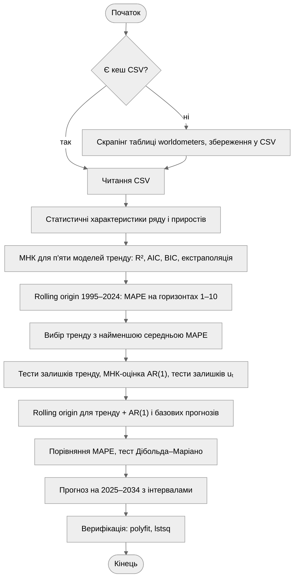
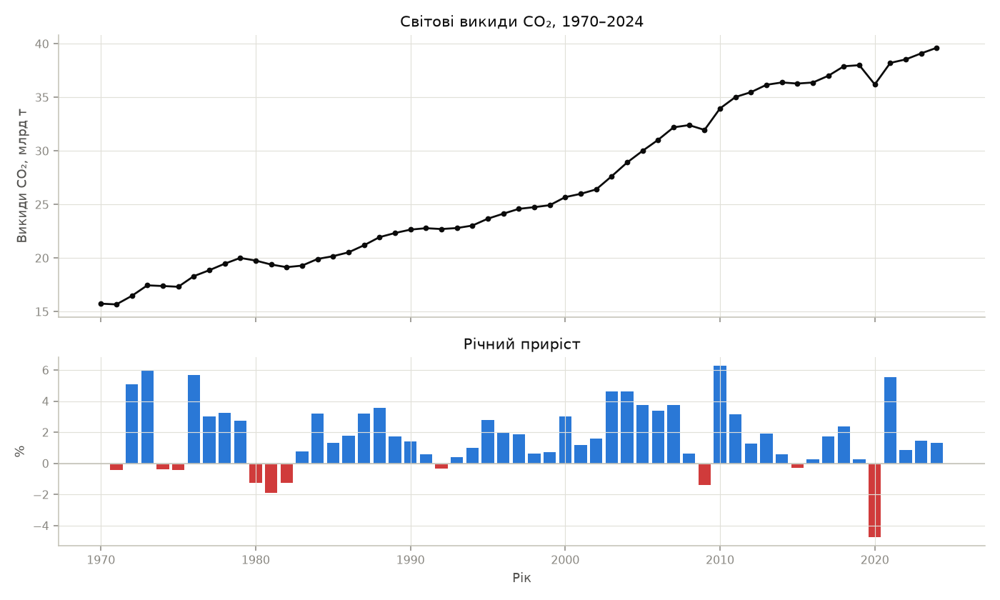
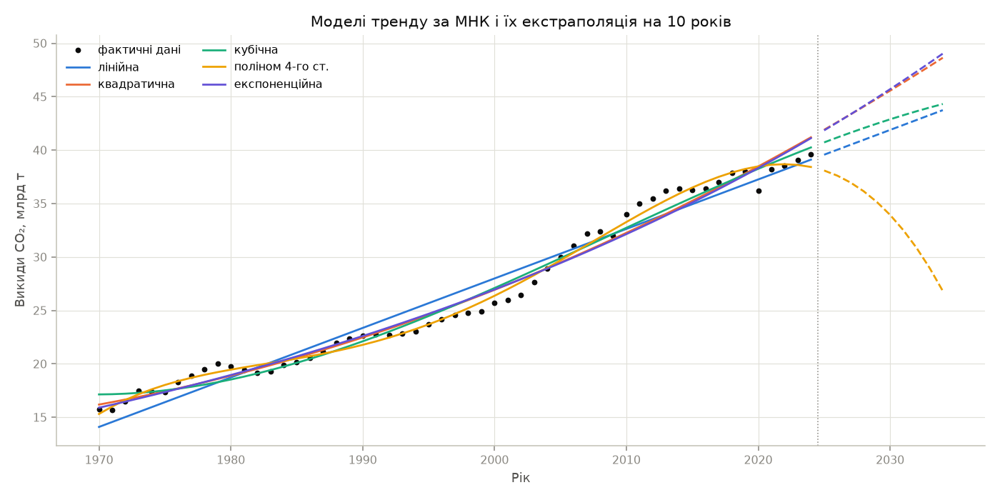
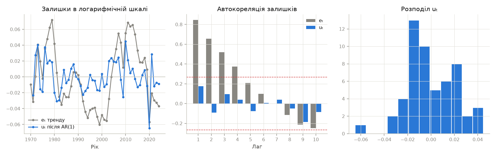
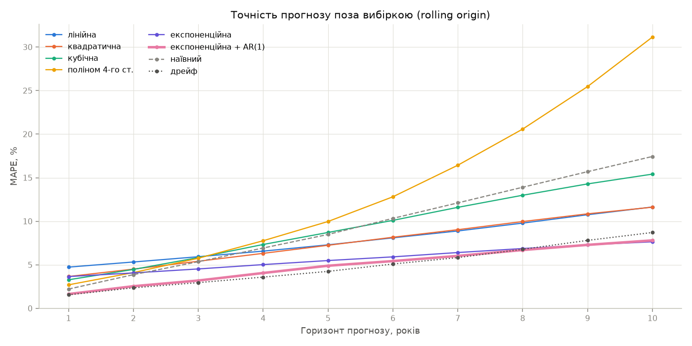
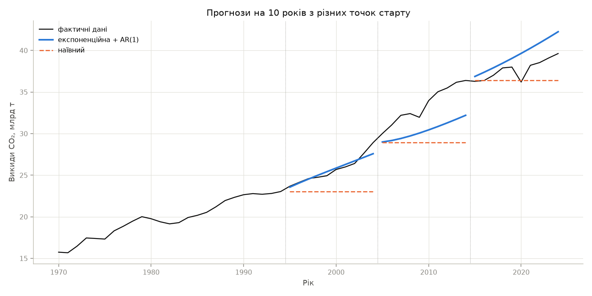
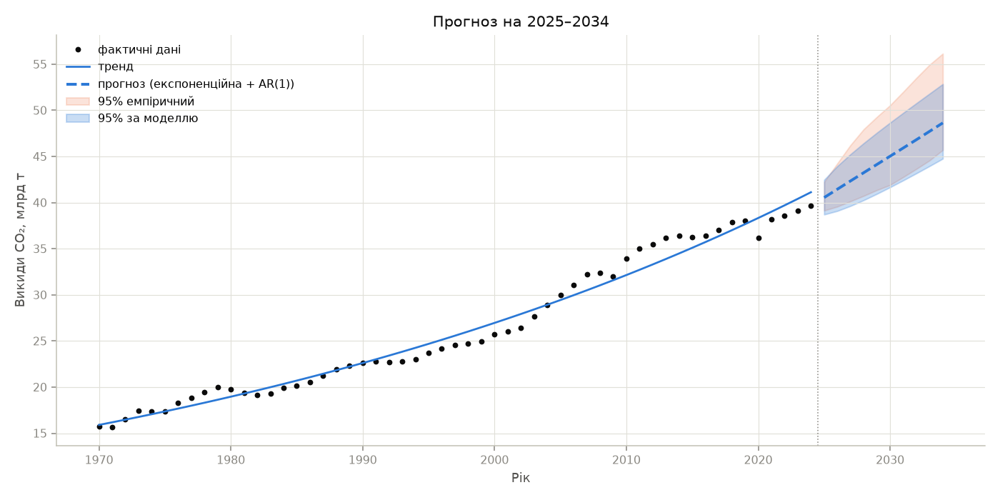

# І. Завдання № 8

# ІІ. Завдання

Оберіть самостійно реальний часовий ряд. Реалізуйте побудову його моделі та
прогнозування поведінки часового ряду поза межами інтервалу спостереження з
використанням методу найменших квадратів. Доведіть ефективність рішень.

Обраний ряд – річні світові викиди CO₂ за 1970–2024 роки (55 значень, млрд т), отримані
веб-скрапінгом таблиці worldometers.info [1]. Ряд має виразний зростаючий тренд,
що робить задачу екстраполяції тренду змістовною, і містить кілька спадів (кризи 1980–1982,
2009 і 2020 років), які перевіряють стійкість моделі.

# ІІІ. Результати виконання модульної контрольної роботи

## 1. Аналіз існуючих підходів до розв'язку практичного завдання

Прогноз ряду поза інтервалом спостереження будують кількома класами методів.

Апроксимація тренду детермінованою функцією часу $\hat y(t) = f(t, C)$, параметри якої
оцінюються методом найменших квадратів (МНК). Модель явна, прогноз на будь-який горизонт
обчислюється підстановкою $t$. Слабкі місця – вибір виду функції і перенавчання:
поліном високого степеня добре описує вибірку і погано екстраполюється.

Рекурентне та експоненційне згладжування (α-β фільтр, Holt). Оцінка рівня і швидкості
оновлюється з кожним новим виміром, тому метод швидко реагує на зміну режиму. Прогноз
на далекий горизонт – пряма з останньою оцінкою швидкості.

Моделі ковзного вікна і авторегресії (ARIMA). Описують залежність значення від
попередніх значень і помилок. Для короткого річного ряду порядок моделі визначається
ненадійно.

Нейромережі (MLP, LSTM, CNN). Потребують сотень і тисяч точок; на 55 значеннях
перенавчаються.

Для оцінки будь-якого методу прогнозування застосовують базові прогнози: наївний
(останнє значення), дрейф (пряма через першу і останню точки) і середнє [4]. Метод
вважається ефективним, якщо він точніший за базові прогнози на відкладених даних.

## 2. Опис головної ідеї, що покладено в основу розв'язку завдання

Модель будується в два кроки, і обидва кроки – МНК.

1. Тренд $D(t)$ обирається з п'яти кандидатів за точністю прогнозу поза вибіркою,
   а не за якістю підгонки на всій вибірці.
2. Залишки тренду виявились сильно автокорельованими, тому для них будується
   модель AR(1), коефіцієнт якої теж оцінюється МНК. Прогноз тренду коригується на
   поточне відхилення ряду від тренду, і ця поправка згасає з горизонтом.

Ефективність доводиться ретроспективним прогнозом з ковзною точкою старту (rolling
origin): модель навчається лише на даних до року $t$ і прогнозує наступні 1–10 років,
помилки порівнюються з базовими прогнозами, значущість різниці перевіряється тестом
Дібольда–Маріано [2].

## 3. Обґрунтування вибору методології для розв'язку завдання

### 3.1. Моделі тренду і МНК

Час нормовано: $\tau = t / n$, де $n$ – довжина навчальної вибірки. Без нормування
матриця $F^\mathsf{T} F$ для полінома 4-го степеня має число обумовленості $1{,}8 \cdot 10^{14}$, з нормуванням – $4{,}5 \cdot 10^5$.

Поліноміальні моделі степеня $m = 1, \dots, 4$:

$$\hat y(\tau) = \sum_{k=0}^{m} c_k \tau^k, \qquad C = (F^\mathsf{T} F)^{-1} F^\mathsf{T} Y$$

де $F$ – матриця плану зі стовпцями $1, \tau, \dots, \tau^m$, $Y$ – вектор спостережень.

Експоненційна модель відповідає сталому відносному темпу приросту і зводиться до лінійної
логарифмуванням:

$$\hat y(\tau) = a e^{b \tau} \quad \Rightarrow \quad \ln \hat y = \ln a + b \tau$$

Якість підгонки оцінюється коефіцієнтом детермінації, скоригованим $R^2_{adj}$ та
інформаційними критеріями, що штрафують кількість параметрів $k$:

$$AIC = n \ln \frac{RSS}{n} + 2k, \qquad BIC = n \ln \frac{RSS}{n} + k \ln n$$

### 3.2. Залишки і модель AR(1)

Залишки тренду $e_t = \ln y_t - \ln \hat y_t$ описуються авторегресією першого порядку,
коефіцієнт $\varphi$ – МНК без вільного члена:

$$e_t = \varphi e_{t-1} + u_t, \qquad \varphi = \frac{\sum e_t e_{t-1}}{\sum e_{t-1}^2}$$

Прогноз на $h$ кроків від останнього спостереження $n$:

$$\ln \hat y(n + h) = \ln D(n + h) + \varphi^h e_n$$

Дисперсія помилки прогнозу складається з накопиченого шуму AR(1) і невизначеності
коефіцієнтів тренду:

$$s_h^2 = \sigma_u^2 \sum_{j=0}^{h-1} \varphi^{2j} + \sigma^2 f_h (F^\mathsf{T} F)^{-1} f_h^\mathsf{T}$$

95 % інтервал прогнозу – $\ln \hat y \pm t_{0{,}975;\,n-k} \cdot s_h$ з переходом назад
до млрд т.

### 3.3. Адекватність моделі

Залишки адекватної моделі мають нульове середнє (t-тест), нормальний розподіл
(тест Шапіро–Вілка) і незалежність. Незалежність перевіряють статистикою Дарбіна–Уотсона
($DW \approx 2$ – автокореляції немає) і тестом Льюнга–Бокса:

$$DW = \frac{\sum (e_t - e_{t-1})^2}{\sum e_t^2}, \qquad Q = n(n+2) \sum_{k=1}^{L} \frac{\rho_k^2}{n-k} \sim \chi^2(L - p)$$

### 3.4. Ефективність

Ретроспективний прогноз: для кожного року старту $t = 1995, \dots, 2024$ модель
навчається на $y_{1970}, \dots, y_{t-1}$ і прогнозує $h = 1, \dots, 10$ років. Мінімальна
навчальна вибірка – 25 років. Помилка – MAPE для кожного горизонту окремо.

Тест Дібольда–Маріано порівнює квадрати помилок двох прогнозів $d_t = e_{1t}^2 - e_{2t}^2$.
Помилки $h$-крокових прогнозів із сусідніх стартів перекриваються, тому дисперсія
середнього $\bar d$ оцінюється з автоковаріаціями $\gamma_k$ до лагу $h-1$, а статистика
коригується за Харві–Лейборном–Ньюболдом [3]:

$$DM = \frac{\bar d}{\sqrt{\left(\gamma_0 + 2\sum_{k=1}^{h-1} \gamma_k\right) / N}} \cdot \sqrt{\frac{N + 1 - 2h + h(h-1)/N}{N}}$$

Нульова гіпотеза – однакова точність, $DM < 0$ означає, що перший прогноз точніший.

## 4. Опис технології / технологій, що використані для розв'язку завдання

Мова Python 3.14, залежностями керує uv.

- `requests` і `beautifulsoup4` з парсером `lxml` – отримання і розбір HTML-таблиці
  з сайту, результат кешується у CSV.
- `numpy` – матриця плану, МНК у замкненій формі, AR(1), бектест, тест Дібольда–Маріано.
- `scipy.stats` – розподіли Стьюдента і $\chi^2$, тести Шапіро–Вілка і t-тест.
- `pandas` – читання і збереження таблиці.
- `matplotlib` – графіки.

МНК, AR(1), інтервали прогнозу і тест Дібольда–Маріано реалізовано власноруч. Бібліотечні
`numpy.polyfit` і `numpy.linalg.lstsq` використано лише для верифікації.

## 5. Опис структурних рішень скриптової реалізації розв'язку

```
project/
├── justfile         рецепти запуску та збірки звіту
├── pyproject.toml   залежності
├── data/co2.csv     кеш отриманих з сайту даних
├── out/             графіки
└── src/
    ├── main.py        точка входу, сім етапів
    ├── loaders.py     скрапінг worldometers, кеш
    ├── lsm.py         МНК, моделі тренду, AR(1), інтервали
    ├── evaluate.py    метрики, бектест, базові прогнози,
    │                  тести залишків, Дібольд–Маріано
    └── plots.py       графіки
```

Рисунок 1 – Структура проекту

`lsm.py` не знає про конкретний ряд: функції `fit` і `fit_ar` приймають вектор значень
і назву моделі, `predict` і `predict_ar` повертають прогноз з інтервалом. Для бектесту
`forecaster` загортає навчання і прогноз в одну функцію «вибірка, горизонт → прогноз»,
тієї ж форми, що й базові прогнози в `evaluate.py`. Тому `backtest` однаково
обробляє і моделі МНК, і базові прогнози. Сайт опитується лише без кешу або на
вимогу, тож повторні запуски відтворюють ті самі результати.



Рисунок 2 – Блок-схема алгоритму програми

## 6. Результати розв'язку

### Етап 1. Вхідні дані

Таблиця з 55 річними значеннями за 1970–2024 роки отримана з сайту і збережена в
кеш. Повторне завантаження дає значення, що збігаються з кешем.

Таблиця 1 – Статистичні характеристики ряду

| Характеристика | Значення |
| ------------------------------------- | ------------ |
| Середнє, млрд т | 26,608 |
| СКВ, млрд т | 7,564 |
| Мінімум / максимум, млрд т | 15,683 / 39,633 |
| Асиметрія | 0,336 |
| Ексцес | −1,328 |
| Середній річний приріст | 1,75 % |
| СКВ річного приросту | 2,15 % |
| Найбільший спад | −4,73 % (2020) |



Рисунок 3 – Світові викиди CO₂ і річний приріст

Спади є в десяти роках з 54: 1971, 1974, 1975, 1980–1982, 1992, 2009, 2015 і 2020.
Від'ємний ексцес відповідає розподілу, близькому до рівномірного, – типова картина для
ряду з трендом.

### Етап 2. Моделі тренду на всьому інтервалі спостереження

Таблиця 2 – Якість підгонки моделей тренду на 1970–2024 роках

| Модель | k | R² | R²adj | RMSE | MAPE, % | AIC | BIC | Прогноз 2034 |
| ------------- | -- | ------ | ------- | ------ | ------ | ------ | ------ | -------- |
| лінійна | 2 | 0,9625 | 0,9618 | 1,452 | 5,30 | 45,0 | 49,0 | 43,75 |
| квадратична | 3 | 0,9799 | 0,9791 | 1,063 | 3,23 | 12,8 | 18,8 | 48,65 |
| кубічна | 4 | 0,9827 | 0,9817 | 0,985 | 3,21 | 6,3 | 14,4 | 44,32 |
| поліном 4-го ст. | 5 | 0,9923 | 0,9916 | 0,660 | 2,00 | −35,8 | −25,7 | 26,82 |
| експоненційна | 2 | 0,9784 | 0,9780 | 1,101 | 3,32 | 14,5 | 18,5 | 49,04 |



Рисунок 4 – Моделі тренду за МНК і їх екстраполяція на 10 років

За всіма критеріями підгонки, включно з AIC і BIC, найкращий поліном 4-го степеня. Його
екстраполяція на 2034 рік дає 26,8 млрд т – рівень 1990-х років, що суперечить
поведінці ряду. Якість підгонки на вибірці не визначає якість прогнозу, тому
модель обирається на етапі 3 за помилкою поза вибіркою.

### Етап 3. Вибір моделі тренду за точністю прогнозу поза вибіркою

Таблиця 3 – MAPE ретроспективного прогнозу, %, за горизонтом h (30 стартів, 1995–2024)

| Модель | h = 1 | h = 3 | h = 5 | h = 8 | h = 10 | Середнє 1–10 |
| --------------------- | ----- | ----- | ----- | ----- | ------ | ----- |
| лінійна | 4,73 | 5,93 | 7,29 | 9,79 | 11,64 | 7,90 |
| квадратична | 3,65 | 5,41 | 7,24 | 9,97 | 11,62 | 7,68 |
| кубічна | 3,28 | 5,83 | 8,71 | 12,99 | 15,41 | 9,40 |
| поліном 4-го ст. | 2,70 | 5,75 | 9,97 | 20,58 | 31,15 | 13,67 |
| експоненційна | 3,65 | 4,53 | 5,49 | 6,87 | 7,64 | 5,69 |

Поза вибіркою картина обернена: поліном 4-го степеня найгірший на горизонтах від 4
років, помилка кубічної моделі теж зростає швидше, ніж у моделей нижчого степеня.
Найменшу середню MAPE має експоненційна модель – найпростіша, з двома параметрами.
Вона й обрана як тренд.

### Етап 4. Аналіз залишків тренду і модель AR(1)

Тренд, навчений на всьому ряді:

$$\hat y = 15{,}9023 \cdot e^{0{,}9677 \tau}, \qquad \tau = \frac{t - 1970}{55}$$

що відповідає сталому темпу приросту $e^{0{,}9677 / 55} - 1 = 1{,}78$ % на рік. Обидва
коефіцієнти значущі: $t = 264{,}4$ і $t = 52{,}7$, $p < 10^{-46}$.

Таблиця 4 – Перевірка залишків

| Перевірка | eₜ тренду | uₜ після AR(1) |
| ---------------------------------- | -------------- | -------------- |
| t-тест середнього, p | 1,000 | 0,883 |
| Шапіро–Вілк, p | 0,016 | 0,206 |
| Дарбін–Уотсон DW | 0,291 | 1,623 |
| Льюнг–Бокс Q(10) | 103,39 | 6,34 |
| Льюнг–Бокс, p | < 0,0001 | 0,706 |
| ACF, лаг 1 | 0,85 | 0,17 |

Залишки тренду мають нульове середнє, проте сильно автокорельовані: $DW = 0{,}29$,
автокореляція на лагу 1 дорівнює 0,85. Ряд відходить від тренду на кілька років поспіль
(1990-ті нижче тренду, 2005–2014 роки вище), і тренд сам по собі цього не враховує. МНК-оцінка
AR(1) для залишків: $\varphi = 0{,}8602$, $\sigma_u = 0{,}0205$. Після неї залишки
$u_t$ проходять усі перевірки на рівні 0,05: автокореляції немає, розподіл не
відрізняється від нормального.



Рисунок 5 – Залишки тренду і залишки після AR(1): динаміка, автокореляція, розподіл

### Етап 5. Ефективність

Таблиця 5 – MAPE ретроспективного прогнозу, %: обрана модель і базові прогнози

| Прогноз | h = 1 | h = 3 | h = 5 | h = 8 | h = 10 | Середнє 1–10 |
| --------------------- | ----- | ----- | ----- | ----- | ------ | ----- |
| експоненційна | 3,65 | 4,53 | 5,49 | 6,87 | 7,64 | 5,69 |
| експоненційна + AR(1) | 1,64 | 3,19 | 4,89 | 6,70 | 7,80 | 4,96 |
| наївний | 2,21 | 5,36 | 8,48 | 13,90 | 17,44 | 9,63 |
| дрейф | 1,55 | 2,95 | 4,24 | 6,78 | 8,71 | 4,89 |
| середнє | 28,43 | 30,63 | 32,83 | 36,20 | 38,38 | 33,41 |



Рисунок 6 – MAPE ретроспективного прогнозу за горизонтом (середнє не показане через масштаб)

Поправка AR(1) зменшує помилку тренду на коротких горизонтах (1,64 % проти 3,65 % на
горизонті 1 рік) і практично не змінює її на 8–10 роках, бо поправка $\varphi^h e_n$
згасає: $0{,}86^{10} = 0{,}22$. Модель тренд + AR(1) точніша за наївний прогноз на всіх
десяти горизонтах, у середньому на 44,3 %, і за середнє – на 85,6 %. Від дрейфу вона
в середньому відстає на 4,2 %: дрейф трохи точніший на горизонтах 1–7, модель МНК – на
8–10.

Таблиця 6 – Тест Дібольда–Маріано для моделі експоненційна + AR(1)

| h | DM проти наївного | p | DM проти дрейфу | p |
| ---- | ------------ | -------- | ------------ | -------- |
| 1 | −1,736 | 0,047 | +1,013 | 0,840 |
| 3 | −2,222 | 0,017 | +1,117 | 0,863 |
| 5 | −1,703 | 0,051 | +0,508 | 0,692 |
| 8 | −1,663 | 0,055 | −0,381 | 0,354 |
| 10 | −1,613 | 0,061 | −0,675 | 0,254 |

Перевага над наївним прогнозом статистично значуща на горизонтах 1 і 3 роки. На
5–10 роках p-значення 0,05–0,06: середня перевага велика (у 1,7–2,2 раза за MAPE), проте
кількість незалежних порівнянь мала – 21–26 стартів з помилками, що перекриваються.
Від дрейфу модель статистично не відрізняється на жодному горизонті.



Рисунок 7 – Прогнози на 10 років зі стартів 1995, 2005 і 2015 років

На рисунку 7 наївний прогноз фіксує рівень і систематично занижує зростаючий ряд.
Модель МНК відтворює зростання. Найбільша помилка – після старту 2005 року: десятиліття
швидкого зростання 2003–2013 років не було передбачуване з даних до 2005 року.

### Етап 6. Прогноз поза інтервалом спостереження

Модель навчена на всьому ряді 1970–2024 років. Емпіричний інтервал побудований з
квантилів відносних помилок ретроспективного прогнозу на кожному горизонті.

Таблиця 7 – Прогноз викидів CO₂ на 2025–2034 роки, млрд т

| Рік | Тренд | Прогноз | 95 % інтервал за моделлю | 95 % емпіричний інтервал |
| ---- | ----- | ------- | ------------- | ------------- |
| 2025 | 41,85 | 40,55 | 38,71…42,47 | 39,14…42,23 |
| 2026 | 42,60 | 41,45 | 39,09…43,95 | 39,56…44,25 |
| 2027 | 43,35 | 42,35 | 39,63…45,24 | 40,14…46,23 |
| 2028 | 44,12 | 43,24 | 40,26…46,44 | 40,73…47,95 |
| 2029 | 44,91 | 44,13 | 40,94…47,57 | 41,35…49,28 |
| 2030 | 45,70 | 45,02 | 41,66…48,66 | 41,91…50,55 |
| 2031 | 46,51 | 45,92 | 42,41…49,72 | 42,76…52,01 |
| 2032 | 47,34 | 46,82 | 43,17…50,77 | 43,65…53,51 |
| 2033 | 48,18 | 47,72 | 43,96…51,81 | 44,57…54,95 |
| 2034 | 49,04 | 48,64 | 44,76…52,85 | 45,70…56,15 |



Рисунок 8 – Прогноз на 2025–2034 роки з інтервалами

У 2024 році ряд на 3,6 % нижчий за тренд, тому прогноз починається нижче тренду
(40,55 проти 41,85 млрд т) і поступово до нього наближається. На 2025 рік обидва
інтервали близькі. Далі емпіричний інтервал ширший за модельний і зсунутий вгору:
найбільші помилки ретроспективного прогнозу – заниження, як після старту 2005 року.

### Етап 7. Верифікація реалізації МНК

Таблиця 8 – Максимальне відхилення коефіцієнтів від бібліотечних реалізацій

| Модель | Число обумовленості FᵀF | Відхилення від polyfit | Відхилення від lstsq |
| ---------------- | ------- | ------- | ------- |
| лінійна | 1,9·10¹ | 2,5·10⁻¹⁴ | 1,2·10⁻¹⁴ |
| квадратична | 5,1·10² | 2,5·10⁻¹³ | 2,6·10⁻¹³ |
| кубічна | 1,5·10⁴ | 1,7·10⁻¹¹ | 1,7·10⁻¹¹ |
| поліном 4-го ст. | 4,5·10⁵ | 2,9·10⁻¹⁰ | 2,8·10⁻¹⁰ |
| експоненційна | 1,9·10¹ | 1,3·10⁻¹⁵ | 1,3·10⁻¹⁵ |
| φ моделі AR(1) | – | – | 2,2·10⁻¹⁶ |

Власна реалізація МНК збігається з `numpy.polyfit` і `numpy.linalg.lstsq` з точністю до
похибки округлення. Відхилення зростає разом з числом обумовленості, але навіть для
полінома 4-го степеня лишається на рівні $10^{-10}$.

## 7. Аналіз результатів, висновки

Побудовано модель річних світових викидів CO₂ і прогноз на 2025–2034 роки методом
найменших квадратів. Модель складається з експоненційного тренду і моделі AR(1) для
відхилень від тренду, усі параметри оцінено МНК. За прогнозом викиди зростуть з
39,6 млрд т у 2024 році до 48,6 млрд т у 2034 році, 95 % інтервал – 44,8…52,9 млрд т.

Ефективність рішень доведено ретроспективним прогнозом на 30 стартах 1995–2024 років.

- Вибір моделі за помилкою поза вибіркою виправданий. Поліном 4-го степеня має
  найкращі $R^2$, AIC і BIC на всій вибірці і найгірший прогноз: MAPE 31 % на горизонті
  10 років проти 7,6 % в експоненційної моделі.
- Модель AR(1) для залишків виправлена тестами: залишки тренду автокорельовані
  ($DW = 0{,}29$, Льюнг–Бокс $p < 0{,}0001$), залишки після AR(1) – ні ($p = 0{,}71$).
  Поправка вдвічі зменшує помилку на горизонті 1 рік.
- Модель точніша за наївний прогноз на всіх горизонтах, у середньому на 44 %.
  Тест Дібольда–Маріано підтверджує перевагу на рівні 0,05 на горизонтах 1 і 3 роки,
  на 5–10 роках p-значення 0,05–0,06.
- Реалізація МНК збігається з бібліотечною з точністю до $10^{-10}$.

Обмеження. Базовий прогноз «дрейф» статистично не гірший за модель МНК: на ряді з
майже сталим темпом зростання пряма через першу і останню точки вже є добрим трендом.
Перевага моделі МНК над ним – явна модель тренду, значущі коефіцієнти, перевірена
адекватність залишків, інтервали прогнозу і менша помилка на горизонтах 8–10 років.
Прогноз не враховує зміну режиму, як-от кліматичну політику або кризу на зразок 2020
року: модель екстраполює темп зростання 1970–2024 років. Ширина інтервалу на 2034 рік
(8–10 млрд т) відображає цю невизначеність.

# Перелік джерел

1. Worldometer. CO2 Emissions by Year. URL: https://www.worldometers.info/co2-emissions/co2-emissions-by-year/
2. Diebold F. X., Mariano R. S. Comparing predictive accuracy. Journal of Business & Economic Statistics. 1995. Vol. 13, No. 3. P. 253–263.
3. Harvey D., Leybourne S., Newbold P. Testing the equality of prediction mean squared errors. International Journal of Forecasting. 1997. Vol. 13, No. 2. P. 281–291.
4. Hyndman R. J., Athanasopoulos G. Forecasting: Principles and Practice. 3rd ed. OTexts, 2021. URL: https://otexts.com/fpp3/
